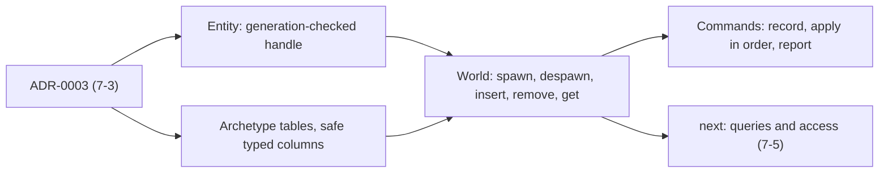

# Review 7-4: `ecs` part 1, entities, archetype tables and the command buffer

Task: 7-4. Class 2 (new crate, new public API). Loops: 1. Open blocker/major: 0.

Delivers: crate `engine/ecs` (layer 1, `base` only, no `unsafe`, no macro; workspace member line in `Cargo.toml`, `Cargo.lock` entry), the as-built paragraph with a class diagram in `wiki/architecture/core-runtime.md` section 4, README v1.48, this file. No protected path touched: `gates/architecture.toml` already lists `ecs` at layer 1, and no `unsafe` means no `gates/unsafe-budget.toml` entry. It implements ADR-0003 (archetype tables, safe columns). Queries, declared access and parallel iteration are card 7-5.

## Decisions

1. **`Entity` is a `base::pool::Handle`** (the design note says an entity is a handle), with a private marker type; slots are reused last in, first out and a slot at the last generation is retired.
2. **No bundle type.** Without macros a tuple bundle needs hand-written impls; `spawn` then `insert` is the primitive (each insert moves a row: about 27 ns in the spike), the command buffer takes a pending spawn and inserts. A bundle can be added later without changing the storage.
3. **Registration on first use** (and `World::register` to warm up), ids by order of first use; no `HashMap`, only `BTreeMap` lookups.
4. **Command buffer without boxing:** one typed queue per component type plus an ordered list of ops, so recording and applying allocate nothing after a warm-up. A refused insert still consumes its value, so the queues cannot fall out of step with the ops.
5. **Errors are values.** `StorageMismatch` reports an internal inconsistency that no caller can cause; its doc says the world should be dropped after it (found by the independent review, which showed the earlier doc over-promised).
6. **`Component: 'static + Send + Sync`** now, so the parallel queries of 7-5 need no breaking change.

## Evidence

- Tests: 24 unit (entity table, columns, archetype, two-element borrow, error text), 18 command buffer, 2 model (a long random history of spawn, despawn, insert, remove against a plain model; the same script recorded in a command buffer against direct calls), 19 world, 4 allocation. All green. `cargo clippy -p ecs --all-targets` clean (workspace limits), `cargo fmt` clean.
- Red evidence: the world tests (18 of 19 fail, the `Send + Sync` check passes) and the command buffer tests (11 of 15 fail; the 4 that pass are vacuous against the stub: an empty buffer, `Send + Sync`, a drop count of values never recorded, and the same-script determinism of nothing) were run against stubs before the implementation. The entity table, column and archetype unit tests were written together with their code, not strictly red first: their strength rests on the mutation run below. One real bug was caught by a test during the work (`two_mut` with an out-of-range index panicked in `split_at_mut`; fixed with a bound check).
- Mutation (cargo-mutants 27.1, whole crate): 153 mutants, 29 unviable, 122 caught, 2 missed, so 98% of the viable ones. The two missed are equivalent (`<` to `<=` in `two_mut` with equal indices: both give `None` through the length of the split slice). Required: 80% on changed layer 0 to 2 code.
- Allocation: 20 frames of churn through the world and through the buffer, 0 allocator calls on the thread (counting allocator); a control test shows the warm-up does allocate.
- Local gates: all steps pass (`target/local-gates-7-4.txt`: fmt, clippy, build, test, app_runtime without mimalloc, base profiling, architecture, unsafe budget, wiki lint, digest, diff hash, the tool tests); rerun after the review fixes, see the PR.

## Not verified

- No coverage measurement (not run locally), no Miri (no `unsafe`), no benchmark yet (registered in cards 7-5 and 7-6), no Linux run (CI is not started on `develop`), one thread.
- No query layer, so iteration cost and the cost of finding matching tables with many tables are not measured here.
- Tables are created lazily: the first structural change to a new component set allocates; the doc says to warm up.

## R1 to R8

| phase | result |
|---|---|
| R1 self | code read through; clippy, fmt, tests |
| R2 automated | fmt, clippy `--all-targets`, tests, mutation, allocation test, local gates |
| R3 independent | read-only agent: 0 blocker, 0 major, 6 minor, see Loops |
| R4 QA | model tests, drop counts, refused-insert queue order, stale handles, retirement of a slot |
| R5 architecture | layer 1, `base` only, no domain module, no `jobs` yet; arch-check passes |
| R6 security | no `unsafe`, no `unwrap` or `expect` in the crate source, no panicking arithmetic in engine code (checked and saturating counters), no hash, no secrets |
| R7 performance | zero allocations in steady state shown; iteration benchmark is card 7-5 |
| R8 product fit | the storage and API the design note and ADR-0003 describe, with the command buffer the note requires |

## Loops

Loop 1, independent review (read-only): 0 blocker, 0 major (it counted the missing review file as a process major; this file), 6 minor.

| finding | resolution |
|---|---|
| `reviews/7-4.md` missing, claims unverifiable | this file |
| `StorageMismatch` partial application contradicts "leaves the world as it was" | doc changed: every variant but `StorageMismatch`; the world should be dropped after it |
| `self.spawns += 1` and the report counters could overflow | saturating; a saturated pending number is refused, not aliased |
| a `Pending` number kept across an apply names the new buffer's spawn at that position | documented on `Target::Pending` and pinned by a test; a test also covers a number used before its spawn |
| model test never drove `Commands` | added: the same random script as a command buffer and as direct calls gives the same world |
| wrong doc comment on `set_generation`; no note on the table count bound | fixed; `World` doc states the 2^K bound |
