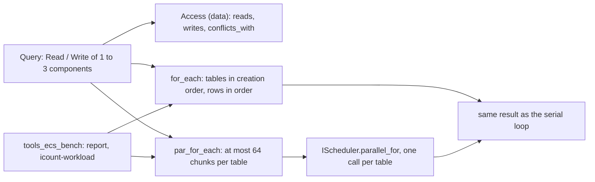

# Review 7-5: `ecs` part 2, typed queries, declared access, parallel iteration, benchmark tool

Task: 7-5. Class 2 (public API, concurrency). Loops: 1. Open blocker/major: 0.

Delivers: `engine/ecs/src/query.rs` (queries, `Access`, `for_each`, `par_for_each`), small supporting changes in `archetype.rs`, `world.rs`, `column.rs`, `error.rs`, `lib.rs`, `engine/ecs/Cargo.toml` (`jobs` dependency, `platform` dev-dependency for the pool tests), the benchmark crate `engine/tools_ecs_bench` (workspace member line in `Cargo.toml`, `Cargo.lock`), the as-built paragraph and an extended class diagram in `wiki/architecture/core-runtime.md` section 4, README v1.49, this file. No protected path touched; the benchmark is not registered as a gate (card 7-6, governance).

## Decisions

1. **Plain traits, no macro, no `unsafe`** (owner choices O2, O3). `Param` (`Read<T>`, `Write<T>`) and `Query` (one param or a tuple of two or three) are sealed; the column rows are split with `split_at(_mut)`, so the parallel path needs only safe code.
2. **Access is data and checked up front.** `Access::of::<Q>()` lists reads and writes; a query that names a component twice is refused with `ConflictingAccess` before anything runs. `conflicts_with` is there for the later system scheduler (O6); two queries cannot overlap yet because a query borrows the world mutably (stated in the docs).
3. **Parallel iteration is inside one query only:** each table is cut into at most 64 contiguous chunks held in a stack array of `Mutex<Option<_>>` cells, one `parallel_for` per table. No allocation, no order dependence: the closure sees one entity at a time.
4. **`Column` is `pub` inside a private module** (it appears in the signature of the sealed `Query::slices`); it cannot be named outside the crate.
5. **Benchmark tool as a layer 4 `tools_*` crate** with the two commands of the physics bench (`report`, `icount-workload`). The report times the frames only; the closing checksum is computed outside the timed region (found by the independent review).

## Evidence

- Tests: `ecs` 24 unit + 18 commands + 2 model + 5 no-allocation + 10 parallel + 12 query + 20 world, `tools_ecs_bench` 7, all green; clippy (pedantic, the repository's nesting, length and complexity limits) clean on `--all-targets`; `cargo fmt` clean; `arch-check` 31 crates, 0 violations (dev-dependencies are exempt from the layer rule).
- Red evidence: against a stub query module 9 of the 12 query tests failed (the 3 that passed are satisfied by the stub: an empty result); the bench tests failed to compile against an empty library.
- Parallel equals serial on the inline, reversed and shuffled schedulers at four grains and on a `WorkStealingPool` at 1, 2 and 4 workers; a table over the 64-chunk cap; a scheduler that refuses every call; a zero grain; a single-chunk table runs on the calling thread; every query shape reaches the scheduler on a large table (a counting scheduler).
- Mutation (cargo-mutants 27.1, `ecs`): 225 mutants, 54 unviable, 171 viable. First run: 8 missed. Six were the `rows()` methods of the read-only shapes (a serial fall-back gave the same result); a test with a counting scheduler now catches them (rerun of the `rows` mutants: 10 of 10 caught). The 2 left are the known equivalent `<` to `<=` in `two_mut` (equal indices give `None` through the length of the split slice). 169 of 171 caught: 98.8%.
- Allocation: 20 frames of `for_each` and two `par_for_each` calls (inline and reversed schedulers), 0 allocator calls on the thread (counting allocator); the test also checks that the queries ran.
- Benchmark (Windows 11 x86-64, 20 logical CPUs, release, 100,000 entities in three tables, median of 30 iterations of 4 frames, three runs, load not controlled): nanoseconds per entity per frame, serial 0.42 to 0.72, pool of 2 workers 0.26 to 0.35, 4 workers 0.18 to 0.22, 6 workers 0.14 to 0.18 (3 to 4 times faster than serial at 6). A first version of the report used one shared atomic counter per entity in the parallel read-only rows and measured the cache line (17 to 22 ns); the final workloads use no shared counter.
- Local gates: see the PR body.

## Proposed target (owner choice O4: proposed from measurement, the owner accepts or changes)

Serial query iteration over 100,000 entities, one thread, release, Windows x86-64: **at most 1.0 ns per entity per frame for one, two and three components** (measured 0.42 to 0.72; headroom of 1.4 to 2.4 times for noise and the cold-cache effect not measured here). For the gate (card 7-6): an instruction count of `tools_ecs_bench icount-workload` with the tolerances of the other benchmarks (warn 5%, fail 10%); the count cannot be measured on this machine (no `valgrind`), so its baseline comes from the first CI run. The pool rows are report only: the speed-up depends on the machine and the chunk size, and the target does not include them.

## Not verified

- No instruction counts (no `valgrind` here), no Linux or ARM64 run, no cold-cache size, no table count above three, no pool allocation measurement on worker threads (the counting allocator sees the calling thread; the pool's own zero-allocation test belongs to the jobs crate).
- A query borrows the world mutably, so two read-only queries cannot overlap; the shared view comes with the system scheduler.
- Miri not run (no `unsafe`).

## R1 to R8

| phase | result |
|---|---|
| R1 self | code read through; clippy, fmt, tests |
| R2 automated | fmt, clippy `--all-targets`, tests, arch-check, mutation run, local gates in the PR body |
| R3 independent | read-only agent: 0 blocker, 0 major, 8 minor; see Loops |
| R4 QA | parallel equals serial on four schedulers and a pool, refusals, chunk cap, zero allocation, mutation 98.8% |
| R5 architecture | `ecs` depends on `base` and `jobs` (L1 to L1); `platform` only as a dev-dependency; the tool is layer 4 |
| R6 security | no `unsafe`, no `unwrap`/`expect`, no secrets, poisoned cells recovered with `into_inner` (moot under `panic = abort`) |
| R7 performance | benchmark above; no shared state per entity in the parallel path |
| R8 product fit | queries and parallel iteration as the design note section 3 asks; a target proposed for the owner |

## Loops

Loop 1, independent review (read-only): 0 blocker, 0 major, 8 minor.

| # | Finding | Resolution |
|---|---|---|
| 1 | report cells included a serial checksum pass (about 25% inflation) | fixed: `frames_serial` and `frames_parallel` are timed, the checksum is outside; numbers re-measured |
| 2 | zero-allocation test did not check the queries ran, swallowed failures, named no scheduler | fixed: asserts the final value, panics on a failed spawn, the doc names the two schedulers |
| 3 | `Jobs` doc said "nothing ran" | fixed: only a zero grain refuses before anything runs |
| 4 | single-chunk test could not fail | fixed: asserts the calling thread and that values changed |
| 5 | "chunks of at least grain" ignored the last chunk | fixed in the code doc and the page |
| 6 | registered but absent component untested | fixed: test with `register::<Tag>()` |
| 7 | a query needs `&mut World`, so read-only queries cannot overlap | documented in the page and above |
| 8 | unreachable error branch in `run_chunks` (`chunks` at most 64) | kept: it converts a `usize` without a cast and cannot happen; not worth an unsafe-looking `as` |
