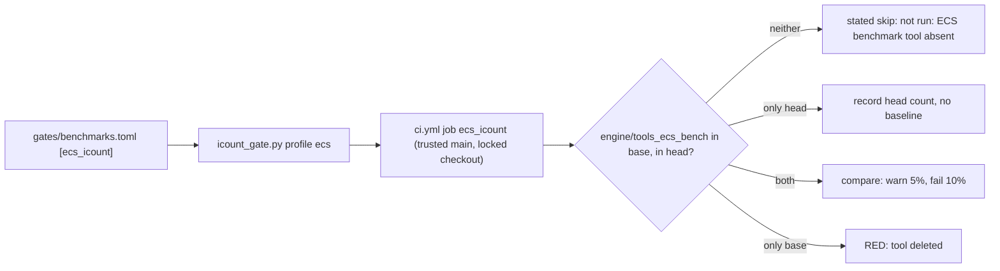

# Review 7-6: register the ECS instruction-count benchmark (governance)

Task: 7-6. Class 3 (governance task declared by the owner in the session of 2026-11-15; goes to `main` first). Loops: 1. Open blocker/major: 0.

Delivers: an `ecs` profile in `tools/icount-gate/icount_gate.py` with its tests, `[ecs_icount]` in `gates/benchmarks.toml`, the job `ecs_icount` in `.github/workflows/ci.yml`, the test that pins the job to the audio job in `tools/release/test_workflows.py`, the new subgraph in `wiki/workflow/ci-diagrams.md`, README v1.50, this file. No threshold or band changes: `gates/gates.toml` is untouched (warn 5%, fail 10% apply as for physics and audio). Modelled on card 5-15 (audio).

## Decisions

1. **Same structure as the audio gate.** The ECS job is the `audio_icount` job with the profile words swapped; a test pins the equality, so a later edit that makes one job drift from the other is red.
2. **Relative gate only.** The gate compares the instruction count of the serial query workload of the pushed commit with the base tree (bands of `gates.toml`). It adds no absolute figure; the absolute target proposed in `reviews/7-5.md` (O4) stays a decision for the owner and is not enforced here.
3. **Workload: 8192 entities, 8 frames** (the defaults of `tools_ecs_bench icount-workload`), serial, one thread, no clock, no hash iteration: every run does the same work, so the noise limit of 0.5% (a tenth of the warn band) is feasible.
4. **Stated skip until the crate is on `main`.** `engine/tools_ecs_bench` is on `develop` and reaches `main` with the next release; until then the job says `not run: ECS benchmark tool absent` (not red, not silent). Once the head has the crate and the base has not, it records the head count only.

## Evidence

- Tests: `tools/icount-gate` 110 (15 new for the ECS profile: config and bounds, the workload arguments, the skip line, presence in four states, compare, measure), `tools/release/test_workflows.py` 90 (3 new), all green. YAML loads and the job is listed.
- Red evidence: the ECS tests failed (1 failure, 19 errors) before the profile and the table existed; the two job tests failed with `ValueError: substring not found` before the job existed.
- Independent review (read-only): 0 blocker, 0 major, 4 minor; see Loops.
- Local gates: see the PR body.

## Not verified

- **The measuring path has not run end to end.** There is no `valgrind` on this machine or in WSL, and the CI of a pull request reads the trusted tool from `main`, which has no ECS profile until this card is merged, so the job cannot measure before the merge. After the merge, `main` is merged into `develop` and `ci` is started by hand on `develop`; the job then finds the crate in the head only and records the count (and the spread of the two runs against the 0.5% limit). That run is the first real evidence and is reported to the owner.
- The count of the workload and its spread on a hosted runner are unknown until then. If the spread exceeds the limit, the job is red and the fix is a larger workload or a governance change of the limit.

## R1 to R8

| phase | result |
|---|---|
| R1 self | diff read through against the audio card |
| R2 automated | both test suites, wiki lint, arch-check, local gates in the PR body |
| R3 independent | read-only agent: 0 blocker, 0 major, 4 minor |
| R4 QA | profile, presence states, summary words, CLI, job pinned to the audio job |
| R5 architecture | one tool, one profile table, one job per benchmark; no change to bands |
| R6 security | the tool and thresholds come from a checkout of `main`, locked before the pushed code runs; the count is read from valgrind's own log; the package name is validated and passed through `env:` |
| R7 performance | the workload is small and deterministic; 2 runs per tree |
| R8 product fit | closes the card-7-5 hand-off: the benchmark becomes a gate in the same form as physics and audio |

## Loops

Loop 1, independent review: 0 blocker, 0 major, 4 minor.

| # | Finding | Resolution |
|---|---|---|
| 1 | diagram says "Thirteen independent jobs", now fourteen | fixed |
| 2 | word-swap in the equality test could hide a non-matching replacement | accepted: the swap is the same pattern as card 5-15; the equality and the `if:` and flag counts also pin the job |
| 3 | README v1.50 sits above v1.47 while v1.48 and v1.49 live on `develop`: a merge conflict in the header when `develop` merges `main` | expected; resolved on that merge as for card 7-3 |
| 4 | diagram repeated the workload numbers of `benchmarks.toml` | fixed: the diagram points to the file |
