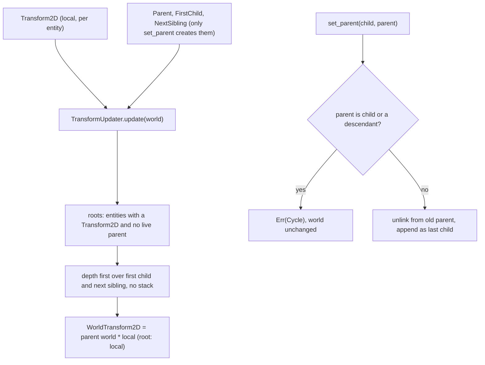

# Review 7-7: `scene`, transforms, hierarchy, world transform update

Task: 7-7. Class 2 (new crate with a public API; no `unsafe`, no new dependency, no governance file touched). Ordinary card into `develop`. Loops: 1 fix loop (2 reviews). Open blocker/major: 0.

Delivers: the crate `engine/scene` (layer 2, depends on `base` and `ecs`): `Transform2D`, `WorldTransform2D`, the hierarchy as the link components `Parent`, `FirstChild` and `NextSibling` with `set_parent`, `detach`, `despawn_subtree`, `parent_of` and `children`, and `TransformUpdater`, the depth-first world transform update. Also the owner's acceptance of target O4 of card 7-5 (recorded in the wiki), the as-built entry and a class diagram in `wiki/architecture/core-runtime.md`, and README v1.51.

## Decisions

1. **Hierarchy as three link components** (owner choice O7 (a), as the phase 7 note said): `Parent`, `FirstChild`, `NextSibling`. They have no public constructor and are neither `Clone` nor `Copy`, so nothing outside the crate can copy a link from one entity to another, and links come only from `set_parent`, which refuses a cycle. **That does not make the links a forest for certain**: `World::remove` and `Commands::remove` are public, and removing a link by hand lets a later `set_parent` close a loop (the first independent review found this; my first draft claimed the forest was guaranteed and dropped the loop guard). So every walk is bounded by the number of entities and reports `SceneError::BrokenHierarchy`.
2. **Children are appended** (insertion order is the order of the list; setting the same parent again moves the child last). Appending walks the list of the siblings, which is linear in their number; a sandbox with a few thousand children under one parent is not the target, and a tail pointer can be added if a measurement asks for it.
3. **A dangling link reads as absent, and the update says what it missed.** A node despawned with `World::despawn` instead of `despawn_subtree` leaves links behind. A dead parent makes a root; a dead first child or next sibling ends the list there, so the siblings after it are no longer listed by their parent and the update cannot reach them. `UpdateReport.unreached` counts them (zero for a scene edited only through this crate; a lower bound for a scene broken by hand), so the stale transform is reported, not silent. `despawn_subtree` is the supported way. Rule for entities without a `Transform2D`: a child passes its parent's matrix on (identity local) and is not counted; a parentless one with children is a root with the identity.
4. **No dirty flags.** The phase 7 note said the benchmark decides. A throwaway probe (not committed; release build on the author's Windows machine, 10,000 entities, median of 40 updates, quiet machine, three runs agreeing) gave about 33 ns per entity for a flat scene (0.33 ms) and about 82 ns per entity for a tree with four children each or a chain (0.82 ms). That is cheap at sandbox size, so the first version recomputes everything. Card 7-13 revisits it against the real frame budget.
5. **One update function, not a system.** `TransformUpdater` keeps the list of roots between calls (one `Vec`, cleared and refilled), so after a warm-up the call makes no allocator call. It is single-threaded; a parallel update waits for choice O6 (system scheduling).
6. **2D only, named so.** `Transform2D` and `WorldTransform2D` leave room for 3D types beside them in phase 8, as the note says.
7. **No `unsafe`, no new external dependency, no change to a protected path.** The architecture check passes without a change: `scene` was already mapped to layer 2 and the edge `scene -> ecs` was already allowed.

## Evidence

- Tests: 49 in `engine/scene`: transform 6, hierarchy 21, update 18, no allocation 2, error 2; `cargo test -p scene` passes, `cargo clippy -p scene --all-targets -- -D warnings` is clean, `cargo fmt --all --check` is clean.
- Red evidence for the first 34 tests (before the implementation, with stubs that compile): hierarchy 13 of 15 failed (the two that passed are the "a new entity has no parent" and "dead parent has no parent" cases, which hold for an empty implementation), transform 6 of 6 failed, update 9 of 11 failed, no allocation 1 of 2 failed. The evidence file is `target/red-7-7.txt` (not committed). **The 13 tests added in the fix loop were written after the fix, not before it**, so they have no red run; they target the reviewer's reproductions and the mutation run (below) shows they bite.
- Mutation (`cargo mutants -p scene --jobs 4`): final run after the fix loop: 59 mutants, 15 unviable, 44 caught, 0 timeouts, **0 missed** (44 of 44 viable detected by a failing assertion). The first run (before the loop) had missed one (`Display for SceneError`, test added) and had four timeouts (mutants that make a walk loop forever); the bounded walks turned those into ordinary failures. The sibling self-loop tests were added after this run (two tests, one line of doc each); the mutation run was not repeated for them.
- Allocation: the counting-allocator test (`updating_a_warm_scene_does_not_allocate`) has the second update of 72 entities make 0 allocator calls on the calling thread.
- Local gates (`python tools/local-gates/local_gates.py --base origin/develop`): 29 steps pass (fmt, clippy, build, test, architecture, unsafe budget, wiki lint, digest, diff hash, tool tests). The four `FAIL` lines it prints are the tools' own negative-case test output, not failures. Output: `target/local-gates-7-7.txt` (not committed).
- Wiki lint: 67 pages, 0 violations.
- UML views: the class diagram added to `core-runtime.md` section 4 and the flowchart above.

## Not verified

- **Line and branch coverage were not measured locally** (the coverage tool is not part of the local gates here). The CI coverage runs only on `main` and by hand; they will cover the crate at the release.
- **The timing probe is not reproducible from the repository**: it is a throwaway program outside the repository, kept out on purpose so that the crate carries no benchmark code that the gates would have to cover. The figures are one machine, one build. If the frame budget of card 7-13 depends on them, that card should measure inside the sandbox.
- **Linux and ARM64** were not run locally; the crate has no platform code and uses `std` and `base` only, and `Mat3::from_rotation_z` uses `std` sine and cosine, so world matrices are repeatable on one machine and build but are not promised identical across platforms (the cross-platform guarantee of the digest covers the physics crate only).
- **Not parallel**: the update is serial; nothing here tests it against the scheduler.

## R1 to R8

| phase | result |
|---|---|
| R1 self | done; found the nesting lint, the visibility of the link trait, the formatting of the new test file |
| R2 automated | fmt, clippy `-D warnings` (workspace lints incl. pedantic, nesting, no unwrap) clean; 49 tests pass; mutation 0 missed; local gates 29 steps pass; wiki lint 0 violations |
| R3 independent | read-only reviewer, two rounds: loop 1 found 1 blocker, 2 major, 6 minor; round 2: 0 blocker, 0 major, 1 minor and 3 nits, all handled |
| R4 QA | test list per behaviour (transform maths, linking, order, cycles, re-parenting, detach, subtree despawn, dangling links, update, depth, allocation, loops); edge cases first, middle, last and only child |
| R5 architecture | `scene -> ecs` was already an allowed edge; no `physics`/`render` knowledge; arch-check passes unchanged; links are plain components, so queries and commands work on them |
| R6 security | no `unsafe`, no external input, no parsing; the only denial-of-service path (a loop) is bounded and reported |
| R7 performance | zero allocation after warm-up (tested); about 33 to 82 ns per entity at 10,000 entities (throwaway probe); append and unlink are linear in the sibling count (documented, not a per-frame path) |
| R8 product fit | the owner reads the class diagram and the changelog; no behaviour visible to a player yet; glue crates 7-9 and 7-10 are the first users |

## Loops

| loop | finding | handling |
|---|---|---|
| 1 | blocker: the "links always form a forest" claim is false (`World::remove::<Parent>` then `set_parent` closes a loop; `update` and `despawn_subtree` hang) | bounded every walk, restored `BrokenHierarchy`, tests for the parent-child and the sibling self loop, wiki claim corrected |
| 1 | major: an outside `World::despawn` leaves siblings that `update` skips silently | `UpdateReport.unreached`, test, documented |
| 1 | major: entities without a `Transform2D` were handled by accident | explicit rule (identity, pass-through, not counted), two tests, documented |
| 1 | minor: climbing stops early when a `Parent` link is gone; append and unlink are linear; `set_parent` not atomic after its checks; allocation claim wording; test gaps | covered by `unreached` and the bounds; linear cost documented and accepted; wording fixed; 13 tests added |
| 2 | minor: `despawn_subtree` can fail after some despawns for a loop off the first-child path | doc softened; sibling self-loop test added |
| 2 | nits: `unreached` is a lower bound in a broken scene; one long doc line | documented; rewrapped |
