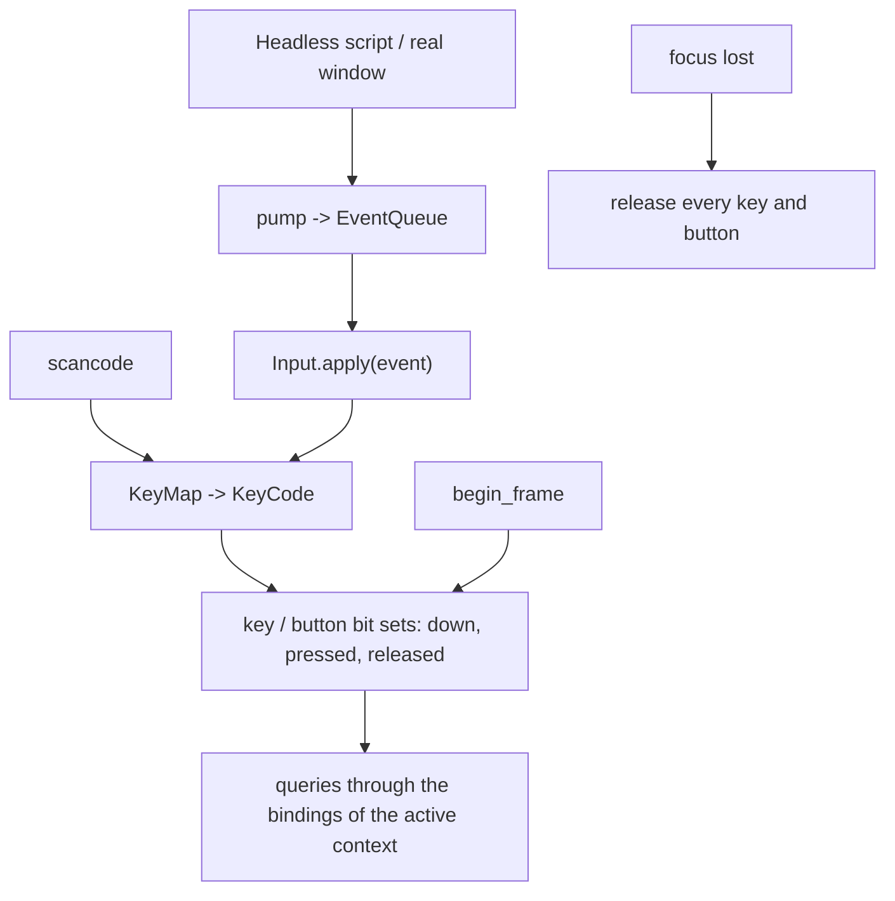

# Review 7-8: `input`, key codes, actions, contexts, per-frame state

Task: 7-8. Class 2 (new crate with a public API; no `unsafe`, no new dependency, no governance file touched). Ordinary card into `develop`. Loops: 1 fix loop (1 independent review: 0 blocker, 0 major, 9 minors handled). Open blocker/major: 0.

Delivers: the crate `engine/input` (layer 2, depends on `base` and `platform`): `KeyCode`, `KeyMap` (Windows, Linux, host), `InputMap` with named actions (button or axis), contexts and bindings, and `Input`, the per-frame state fed by platform events. Also the as-built entry and a class diagram in `wiki/architecture/ecs-and-sandbox-v0.md` section 4, and README v1.52.

## Decisions

1. Physical-position key codes with one scancode table per operating system, because the platform event carries only hardware scancodes.
2. Edges are bit sets cleared by `begin_frame`, not snapshot differences, so a tap inside one frame is kept.
3. Contexts: one active at a time; switching keeps keys down and changes their meaning.
4. Errors are values (`InputError`); ids are bare indices, so only an id out of range of the map is refused or reads as inactive (an in-range id of another map names an unrelated action).
5. No `unsafe`, no new dependency, no protected path touched.

## Evidence

- Tests: keys 8, map 8, state 19, scripted 2, no allocation 2. Red run before the implementation (stubs that compile): keys 5 of 7 failed, map 4 of 4, scripted 1 of 2, state 16 of 18 (`target/red-7-8.txt`, not committed); the allocation test passed on the stub because a stub allocates nothing, so it only proves something once the real state exists (the counter sanity test shows it sees allocations).
- Mutation (`cargo mutants -p input --jobs 4`), final run after the fix loop: 124 mutants, 19 unviable, 105 caught, 0 missed, 0 timeouts. The first run missed 5 (error messages, `is_empty`, the press-only count of unmapped keys); tests and `KeyMap::empty()` were added and the run repeated.
- fmt and clippy `-D warnings` clean.

## Not verified

- The Linux table and the Windows extended keys (arrows, right control and alt) were derived from key lists and agree with the physics sample only for its five keys; not run on hardware.
- Line and branch coverage not measured locally (runs on `main` and by hand).
- The physics sample still has its own table; replacing it belongs to a later card.

## R1 to R8 and loop

| phase | result |
|---|---|
| R3 independent | 0 blocker, 0 major, 9 minors, 5 nits |
| loop 1 | axis sum above 1: key pairs clamped, test; mouse button above 7 silently dead: `BadButton`, test; docs overstated other-map ids and the sample table check: reworded; context switch edge behaviour, pointer sharing and wrong-kind queries: documented; `Input::map()` added; `TooMany` tested; modifiers listed as left out |
| not changed | window-error mapping in a test helper (nit); `Binding::keys` duplicates the variant (kept as a convenience) |
