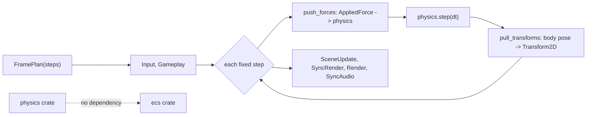

# Review 7-9: `frame` phases and the `sync_physics` glue crate

Task: 7-9. Class 2 (new public API in two crates; no `unsafe`, no new external dependency, no governance file touched). Ordinary card into `develop`. Loops: 1 fix loop (1 independent review: 0 blocker, 1 major, 8 minors handled). Open blocker/major: 0.

Delivers: `frame::Phase` and `frame::FramePlan` (the order of a frame), and the crate `engine/sync_physics` (layer 2 glue, depends on `base`, `ecs`, `scene`, `physics`; dev-depends on `frame`): `PhysicsBody`, `AppliedForce`, `attach_body`, `release_body`, `push_forces`, `pull_transforms`, `SyncReport`, `SyncError`. Also the as-built entry with a sequence and a class diagram in `wiki/architecture/ecs-and-sandbox-v0.md` section 4, and README v1.53.

## Decisions

1. **The body handle is a component with no public constructor and no `Clone`**, so a handle cannot be put on a second entity by accident; `attach_body` is the only maker and undoes itself on a refusal.
2. **Only forces and torque go in.** Physics has `Static` and `Dynamic` bodies only (no kinematic kind), so "kinematic targets" of the design note are not buildable now; this is stated in the wiki.
3. **A zero force is not applied**, because `apply_force` wakes a sleeping body (tested): a default `AppliedForce` must not keep a scene awake.
4. **Bodies on root entities only.** A body pose is in world space and `Transform2D` is local, so `attach_body` refuses an entity with a parent. A later `set_parent` can still break it; documented, not enforced.
5. **Problems are counted, not fatal**: a destroyed body, a static body, a non-finite value are `skipped` in the report; the glue never panics.
6. **`FramePlan` is an iterator with no allocation**, bounded and `ExactSize`; it describes the order only, the application still owns the loop.
7. **No governance file touched.** Glue crates are exempt from the same-layer edge list. Arch-check: 35 crates, 0 violations; a temporary `physics -> ecs` dependency was refused (`forbidden-edge`) and reverted, not in the diff.

## Evidence

- Tests: `frame` phases 9 (plus the 19 existing); `sync_physics` 22 in one test program (attach 9, sync 10, frame loop 2, allocation 1).
- Red evidence: the `sync_physics` tests were run against stubs that compile before the implementation (`target/red-7-9.txt`, not committed): attach 8 of 9 failed, sync 7 of 8 failed (the first batch), frame loop 2 of 2, allocation 1 of 1. **The `frame` phase tests were written together with the implementation, without a red run**; mutation testing is their evidence (below). Tests added after the first implementation (zero-force wake, non-finite values, bounded plan) have no red run either.
- Mutation (`cargo mutants -p sync_physics -p frame`): first run 92 mutants, 3 missed (the finite check: physics rejects a NaN anyway, so only a torque that is not finite beside a good force shows it) and 1 timeout (`+=` to `*=` made the iterator loop). Tests added; second run of both crates: 92 mutants, 85 caught, 6 unviable, 1 timeout (the frame one); `frame` alone after bounding its tests: 69 mutants, 67 caught, 2 unviable, 0 missed, 0 timeouts. The final run after the fix loop is recorded below.
- Final mutation run after the fix loop (`cargo mutants -p sync_physics -p frame`): 92 mutants, 86 caught, 6 unviable, 0 missed, 0 timeouts.
- fmt and clippy `-D warnings` clean on both crates, tests included.
- Allocation: `a_warm_frame_of_both_copies_does_not_allocate`: 40 bodies, 0 allocator calls on the calling thread.
- Determinism: two runs of the frame loop test give the same physics state hash.

## Not verified

- **Line and branch coverage not measured locally** (CI measures on `main` and by hand).
- **The hash across thread counts of a whole frame** is not tested here: the glue is single-threaded and the physics replay tests cover the world; the sandbox sample (a later card) is where it belongs.
- **Not run on Linux or ARM64**; the glue has no platform code, and the cross-platform guarantee of the digest covers the physics crate only.
- **The rollback branch of `attach_body`** (an ECS refusal after the body was made) is not tested: forcing it needs a full ECS world; the code path undoes both steps.
- **Despawn without `release_body`** leaves the body in the physics world (documented, not prevented).
- **Parent after attach** is not prevented (decision 4).
- No benchmark of the copies; at sandbox size they are two linear passes, the frame budget card 7-13 measures them in the real loop.

## R1 to R8

| phase | result |
|---|---|
| R1 self | found the `Copy` iterator lint, test-helper dead code (one test program), a half-applied force when only the torque is bad |
| R2 automated | fmt, clippy, tests, mutation as above |
| R3 independent | 0 blocker, 1 major, 8 minors, nits |

## Loop 1

| finding | handling |
|---|---|
| major: the tolerance of `release_body` for a body destroyed behind the glue was untested | test added |
| minor: `release_body` removed the component before destroying the body | body first, component after; a refusal other than a stale handle keeps the component |
| minor: `ExactSizeIterator` breaks on a 32-bit `usize` | dropped; `size_hint` and `FusedIterator` instead; compile-time check that the three counts match `Phase::ORDER` |
| minor: despawn leaks the body, handles belong to one physics world, gameplay writes to a body's transform are overwritten | documented in the wiki and the doc comment (not prevented) |
| minor: rollback of `attach_body` untested; mutation numbers hard to reconcile | stated under Not verified; numbers rewritten |
| nits: ball test name and x not asserted | renamed, x asserted |
