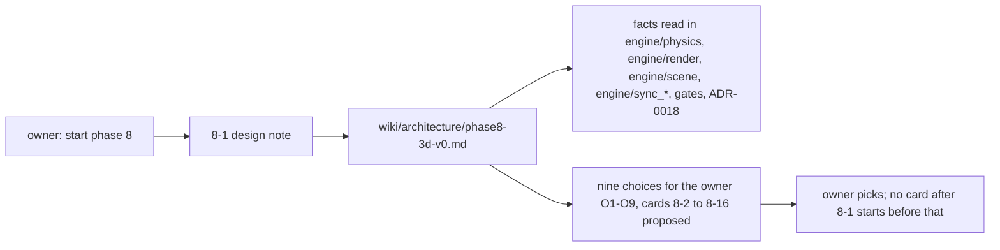

# Review 8-1: phase 8 design note

Task: 8-1. Class 1 (documentation only: one new wiki page, the README changelog and index, this file; no code, no gate, no governance file). Ordinary card into `develop`. Phase 8 started on the owner's explicit go-ahead of 2026-11-17 ("start phase 8"); the `ci` run on `main` after the v0.14.0 release was in progress when the card started, and the checkpoint run on `develop` before it passed all jobs.

## What changes

- New page `wiki/architecture/phase8-3d-v0.md` (evidence table with known and unverified claims, code layout, the physics instance, 3D render features, scene and glue and sample, tests, proposed cards with a dependency view, choices, risks).
- `wiki/README.md`: status line v1.61, one changelog entry, index row 48.
- Not changed: any code, gate, workflow, ADR, digest, roadmap.

## Decisions

1. **Same form as the phase 7 note**, so the owner reads the same sections in the same order.
2. **A spike comes first (8-2)**, because ADR-0018 names "phase 8 shows that 3D needs a different solver structure" as a trigger for the fallback, and nothing in the repository settles it (the `D=3` instance exists only in the spike with an extruded 2D narrowphase).
3. **No new crate and no layer change**: `physics::d3`, new modules in `scene`, `sync_physics`, `sync_render`, and one new layer 4 sample crate.
4. **Governance is isolated in one card (8-13)**: benchmark registration and golden hashes for 3D scenes; it starts only when the owner declares it.
5. **Cut order inside the phase** is written down (8-16, convex hulls, extra joints, sample extras), following the roadmap's rule that 3D scope shrinks first.

## Evidence

- Facts were read from the files named in the page's evidence table; what could not be settled is tagged unverified with the card that checks it.
- No threshold-like number was added; the 3D budgets are left to measurement and the owner (O9).
- Wiki lint: 69 pages, 0 violations. Local gates: exit 0 (`target/local-gates-8-1.txt`, not committed).

## Not verified

- Nothing was built or measured; every claim about cost, robustness or fit with the port is a plan, tagged as such.
- The render contract suite's current cases for uniform blocks were not read case by case.
- Mermaid syntax read by the author, not rendered.

## R1 to R8

| phase | result |
|---|---|
| R1 self | every [K] row traced to a file read in this session |
| R2 automated | wiki lint, local gates, diff hash |
| R3 independent | read-only reviewer, see Loops |
| R4 QA | cards, dependencies and choices cross-checked between sections 7 and 8 |
| R5 architecture | no code and no gate touched; `physics -> ecs` stays forbidden; layers unchanged |
| R6 security | documentation only; no secrets, no session identifier |
| R7 performance | no number claimed; budgets left to measurement |
| R8 product fit | the owner reads sections 1, 7 and 8; the choices are in one table with recommendations |

## Loops

| loop | finding | handling |
|---|---|---|
| 1 | major: O2 cited the wrong roadmap section for the cut order | now "roadmap operating rule 6" |
| 1 | major: the dependency view and the card table disagreed (chain, joints before stability scenes, exit record edges); no card built the 3D benchmark scenes | diagram and sentence corrected; benchmark scenes added to 8-12 |
| 1 | minor: swap-diff wording and "roadmap allows none"; debug draw is 2D only and was put in the render card; "static data"; glue duplication | reworded; debug-draw moved to 8-4; glue choice left to 8-10 |
| 1 | nit: tool layers, facade path | corrected |
