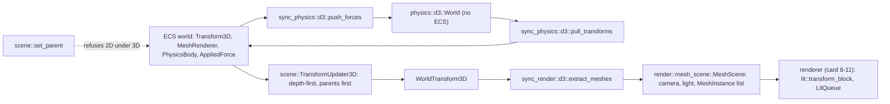

# Review 8-10: 3D scene transforms, physics glue and mesh snapshot

Task: 8-10. Class 2 (new public API in `scene`, `render`, `sync_physics`, `sync_render`; one variant added to `SceneError`; no `unsafe`, no new dependency, no port revision, no governance file). Ordinary card into `develop`. Loops: 1 fix loop (1 independent review). Open blocker/major at the end: 0 known; the fixes of loop 1 were not reviewed again (see "Not verified").

Delivers: `Transform3D` and `WorldTransform3D` on the shared hierarchy with `TransformUpdater3D`; `sync_physics::d3` (forces in, poses out for a 3D physics world); `render::mesh_scene` (`MeshScene`, the plain snapshot of a 3D frame) and `sync_render::d3` (`MeshRenderer`, `extract_meshes`). README v1.72.

## Decisions

1. **The 3D glue repeats the 2D glue, it does not share a helper** (the question the card asked). Handle, description, torque (vector against number) and rotation (quaternion against angle) all differ; a generic version would be about as long as the two copies together and would change the 2D public API. About 130 lines are repeated.
2. **One hierarchy, one generic walk.** The links (`Parent`, `FirstChild`, `NextSibling`) are the same components for both dimensions. `update.rs` is now one generic function behind a private `Space` trait with two implementations; `TransformUpdater` (2D) keeps its API and behaviour, `TransformUpdater3D` is new. Each updater skips roots that carry the other dimension's transform.
3. **A tree is all one dimension** (loop 1, finding 1): `set_parent` refuses to join a 2D and a 3D entity, and an entity that has both transforms, with `SceneError::MixedDimensions`. This closed a leak found by the reviewer, where a 2D updater wrote `WorldTransform2D` onto a 3D child.
4. **The snapshot names a mesh by an index** (`MeshRef`) into the caller's table, so it holds no device handle and the render crate stays free of how meshes are uploaded (that is the sample, 8-11).
5. **`extract_meshes` only extracts what can be drawn** with the camera of the scene: finite matrix, a normal matrix, a finite colour and a finite view-projection times model (loop 1, finding 2).
6. **`set_parent` accepts either transform**; a world that holds only 2D data behaves exactly as before.

## Evidence

- Tests first. Red: the new test files did not compile before the types existed (scene, sync_physics, `mesh_scene`, sync_render); the two loop-1 tests failed first (`MixedDimensions` did not exist; the overflowing model was extracted). Mutation survivors were each turned into a test that failed with the mutant (y and z scale; non-finite force and torque components; a finite force with a non-finite torque, which the guard keeps from being half applied).
- `cargo test -p scene -p sync_physics -p sync_render -p render`: all pass (scene 10 + 2 + the existing suites, sync_physics 23 existing + 12 + 1, sync_render 19 existing + 9 + 1, render 193 unit + integration), 0 failed. `cargo clippy ... --all-targets -- -D warnings`, `cargo fmt -- --check`: clean. Local gates: see the pull request.
- Mutation (`cargo mutants` on `update.rs`, `transform.rs`, `hierarchy.rs`, `sync_physics/src/d3.rs`, `sync_render/src/d3.rs`, `render/src/mesh_scene.rs`): first run 120 mutants, 91 caught, 5 missed, 24 unviable; after the tests above every viable mutant of the changed files is caught (reruns: `transform.rs` and `d3.rs` 26 of 26 and 18 of 18, `hierarchy.rs` and the extraction 34 of 34).
- Allocation: the 3D update, the two 3D copies and the mesh extraction make zero allocator calls after a warm-up (counting allocator, one test file each).
- Independent review (read-only, copy of the crates): tests, clippy and fmt clean; the generic update is a mechanical refactor of the 2D code; deep chains with NaN and 1e30 scales do not panic; the glue rules match the 2D glue.

## Not verified

Nothing drives scene, physics and render together on a device yet (the sample is card 8-11); the lit shader does not exist. The loop-1 fixes (`MixedDimensions`, the view-projection check, the doc changes) were not seen by a second reviewer; the mutation rerun of the touched files came after them. The reviewer did not run cargo-mutants or the allocation tests; the author did. The `clean-code` duplication gate (3%) was not measured on the repeated glue (about 130 lines). No Linux or ARM64 run. The Mermaid view was read by the author, not rendered.

## R1 to R8

| phase | result |
|---|---|
| R1 self | found and fixed: three clippy items in the new tests (length, casts), an unused guard in a test helper |
| R2 automated | tests, clippy, fmt, local gates, mutation |
| R3 independent | one read-only review; findings below |
| R4 QA | transform order per axis, hierarchy, mixed trees, forces and poses, skip rules, ordering, allocation |
| R5 architecture | physics free of the ECS (no import); `scene` holds both dimensions on one set of link components; the glue duplicates by decision |
| R6 security | no `unsafe`, no new dependency, no secrets; fixed capacities; non-finite values skipped, never applied |
| R7 performance | not measured (the update and the copies are linear in the entities; the extraction adds one matrix product per instance) |
| R8 product fit | the owner reads the known limits: no sample yet, a tree is one dimension, the glue is repeated |

## Loops

| loop | finding | handling |
|---|---|---|
| 1 | major: a 3D child under a 2D parent was written a `WorldTransform2D` by the 2D updater and never a `WorldTransform3D` | `set_parent` refuses mixed dimensions (`SceneError::MixedDimensions`); test red first |
| 1 | major: `extract_meshes` accepted a finite model whose product with the view-projection overflows, so `transform_block` would refuse it | the extraction checks the product; test red first |
| 1 | minor: an entity with both transforms is updated by neither updater (new combination, no 2D world had it) | documented (updater, `attach_body`, wiki); `set_parent` refuses it |
| 1 | minor: `reviews/8-10.md` linked by the README did not exist | this file |
| 1 | note: half application of a force when the torque call fails after the force call succeeded | reachable only if the body vanishes between the two calls; the finite check before the calls covers the NaN case, with a test |
