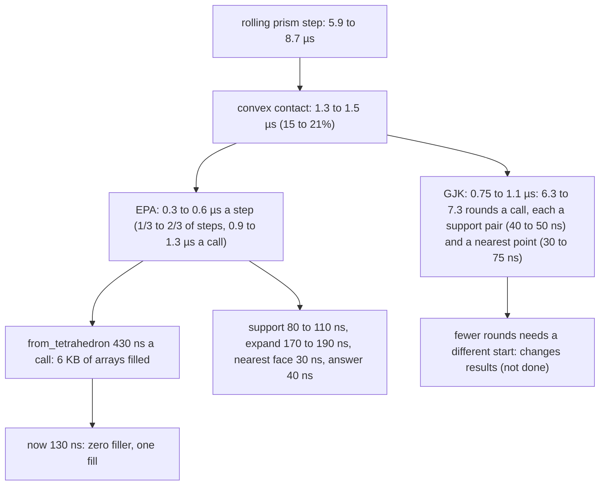

# Review 8-100: where the rest of a hull contact goes; the EPA polytope cleared its arrays slowly (fixed, 1% to 2% of a step); the rest needs a decision

Task: 8-100 (from 8-80). Class 2 (physics `gjk.rs`, hot path; no `unsafe`, no protected path). Owner go-ahead: "I approve then 8-100" (2026-11-27).

In plain words: after 8-80 I asked where the remaining time of a convex contact goes. It is not where I had guessed. A hull contact (GJK, and EPA when the shapes overlap) is about 15% to 22% of a step of a rolling prism (timed), not a quarter; the support scan is a small part; the large parts are the **number of rounds GJK needs (6 to 7; each round searches each shape for its corner farthest along a direction)** and, when the shapes overlap, **starting EPA** (the second stage, which finds how deep they overlap; it clears 6 KB of working arrays before it starts). The second is fixed here without changing a bit of any answer (a rolling prism is about 1% to 2% cheaper, which is near the noise of the machine). The first can only be cut by changing how GJK starts, which changes results; its upper bound was measured and is small.

Outcome:

- **Change:** the polytope of EPA clears its two arrays with all-zero filler values instead of a copy of one vertex and a face pointing along x, so the compiler fills them in one go. No code path reads the filler slots (checked by reading `gjk.rs`: every read of the arrays is bounded by the counts; the sweep below is consistent with this, it does not prove it). `Polytope::from_tetrahedron` goes from 277 ns to 128 ns a call (micro-benchmark with a warm cache; about 430 ns to about 130 ns in the scene, with timers); in the rolling prism, 1.1% to 1.7% of a step (0.1 µs on 6 to 9 µs: near the 0.1 to 0.5 µs round-to-round noise of 8-80; the changed binary was faster in every one of the 5 paired rounds for 8 and 12 sides and in all 5 for 16).
- **Same answers, bit for bit:** a new test hashes the contacts of 3000 pairs (a prism of 8 sides against a larger prism, a box, a capsule or a wide floor, 1,163 touching and 828 apart contacts), recorded before the change; it passes after, on Windows with the cross-platform feature on and off (Linux below).
- **Tried and dropped (no gain):** a smaller `Rim` (bytes instead of words, 6 KB to 0.8 KB) and rewriting `expand` in place (no 3.6 KB copy): the same timing within noise (a clear of the `Rim` is 22 ns). Starting each GJK from the last search direction: see below.

## What was measured

Method: throwaway timers and counters in `gjk.rs` (kept outside the repository), release build, Windows, one thread, the rolling prism of `d3_hull_contacts.rs` (8, 12, 16 sides, speeds 1.0 to 2.0 m/s, 240 steps), ten rolls of each: 9,600 steps a prism. The timers cost about 25 ns a call, so only phases of 300 ns or more are read.

| item | 8 sides | 12 sides | 16 sides |
|---|---|---|---|
| step | 6.6 to 6.8 µs | 7.0 to 7.6 µs | 9.1 to 9.4 µs |
| the contact (`gjk::contact`) | 1.43 to 1.46 µs | 1.30 to 1.41 µs | 1.42 to 1.52 µs |
| GJK (`gjk()`) | 0.75 to 0.77 µs | 0.94 to 1.03 µs | 1.06 to 1.11 µs |
| rounds of GJK a call | 6.3 | 7.1 | 7.3 |
| EPA (`penetrate()`), calls a step and ns a call | 0.66 and 900 | 0.34 and 830 to 900 | 0.33 and 900 to 1,020 |
| of an EPA call: `from_tetrahedron` / support / expand / nearest face / answer (ns, with timers) | 427 / 79 / 173 / 28 / 39 | 444 / 91 / 190 / 30 / 42 | 444 / 107 / 187 / 28 / 39 |
| EPA rounds a call | 1.41 / 0.66 = 2.1 | 0.64 / 0.34 = 1.9 | 0.66 / 0.33 = 2.0 |
| step before and after the change (mean of 5 paired rounds, minimum of 7 runs each) | 5.94 and 5.84 µs (-1.7%) | 6.78 and 6.67 µs (-1.6%) | 8.71 and 8.61 µs (-1.1%) |

- **A support pair is cheap:** a hull of 16 corners 38 ns, of 32 corners 52 ns (micro-benchmark with a box floor), so the 8.2 to 8.7 calls a step are 0.3 to 0.45 µs. The numbers in the report of 8-80 (supports as the largest part of GJK) came from timers that cost as much as the calls; 8-80 already said its timers inflate the shares; its saving of 0.56 to 1.10 µs a step came from untimed runs and fits supports being large before 8-80 made them cheaper. After 8-80 they are small, and its 28% to 32% share of GJK was high.
- **Nearest point:** 28 to 75 ns a call by the size of the simplex, about 0.15 to 0.25 µs a step (3%).
- **Starting GJK from the last search direction** (a probe, not shipped): rounds of GJK fall from 6.3 and 7.1 to 5.2 and 5.7 a call, GJK costs 15% to 30% less, but EPA runs in more steps (0.34 to 0.50 a step for 12 sides), so the contact total moves from 1.43 to 1.30 µs (8 sides) and from 1.41 to 1.32 µs (12 sides) (two timed runs): 0.1 µs, about 1.5% of a step, and the results change. A warm start of the whole simplex was not measured.

## What changed

| item | result |
|---|---|
| code | `gjk.rs`: two constants `UNUSED_VERTEX` and `UNUSED_FACE` (all-zero values) fill the polytope's arrays in `from_tetrahedron`; the old filler was a copy of the first vertex and a face with normal x. Slots past `vertex_count` and `face_count` are never read |
| test | `the_contacts_of_a_fixed_sweep_of_pairs_are_the_recorded_ones`: 3000 pairs, a prism of 8 sides in a random pose against a prism of 16 sides, a box, a capsule or a floor 100 m wide; the hash of the bits of every normal, point and separation. A characterisation test of a refactor, green before and after: the timing is the evidence. It builds its shapes without `sin` or `cos` (constants and `sqrt`) so the hash is the same on every platform and with the feature on or off |
| hand mutations | four tried, one invalid (a reversed comparison that is the same ordering) and discarded; of the three valid ones the progress limit of EPA changed was killed. A change of the visibility limit and of the interior point of the polytope were **not** killed: the sweep guards the memory change, it is not a full test of EPA (the other tests of the physics crate and the 3D golden cover it) |
| default | unchanged: no bit of any answer moves |

## Decisions

1. **Ship only what measured:** the zero filler. The rewrite of `expand` and the byte `Rim` are not in the diff: no gain, more code.
2. **Not done, owner's call:** to cut the 6 to 7 rounds of GJK the start has to change (the last direction, or the last simplex of the pair kept between steps). That changes which simplex EPA starts from and so the last digits of contacts: every golden hash and many pins would be re-measured (a governance task). The upper bound for the cheap form (last direction) is about 1.5% of a step; the simplex form is not measured and needs state per pair. My advice: do not, unless a scene with many hulls shows GJK dominating (card 8-102).
3. **Not done:** a different algorithm for a hull against a box (a separating-axis test with the faces of both), which would avoid GJK for the commonest pair; a design card, not a refinement.

## Not verified

- One laptop, one scene (one prism on a floor); a scene with many hulls, or two hulls resting on each other, was not timed. The PR benchmark gate runs only on `main`.
- The timers cost about as much as the cheapest calls, so the phases below 100 ns are not read.
- The remaining 128 ns of `from_tetrahedron` (four faces: a cross product, a square root and a division each) was not split further.
- Linux (WSL2 Ubuntu, x86-64): the full physics test run passes, which includes the sweep with the feature off, and the sweep passes with the feature on; the 3D golden is equal on both platforms. ARM64 not run. The sweep is one fixed seed. The rounds of GJK and the EPA call counts come from timer builds.
- The sweep detects 1 of 3 valid hand mutations of EPA (above); mutation score by the tool, coverage, Miri (no `unsafe`), hosted `ci`, ARM64. Mermaid read by the author, not rendered.

## R1 to R8

| phase | result |
|---|---|
| R1 self | the first guess (copies of `old` and `Rim` in `expand`) gave no gain when timed; the profile of the phases of EPA pointed at `from_tetrahedron` |
| R2 automated | rustfmt, Clippy with warnings denied, the physics tests, the 3D golden on both platforms, the local gates |
| R3 independent | one read-only review: no blocker, two majors (report wording on the mutations and on 8-80), five minors; all handled (Loops) |
| R4 QA | the sweep before and after, 4 hand mutations tried (3 valid), A/B of binaries alternated |
| R5 to R7 | no API change, no `unsafe`, no allocation; speed measured |
| R8 product fit | a rolling hull is 1% to 2% cheaper, and the owner knows what the rest costs and what it would take |

## Loops

| loop | finding | handling |
|---|---|---|
| 1 | major: mutation count inconsistent; unfair wording about 8-80 | made consistent (4 tried, 3 valid, 1 killed); 8-80's own caveat on timers cited |
| 1 | minor: share 15 to 21%; rounding; micro against scene gap; probe baseline; 'never read' is by reading; Linux not named; plain words | corrected |
