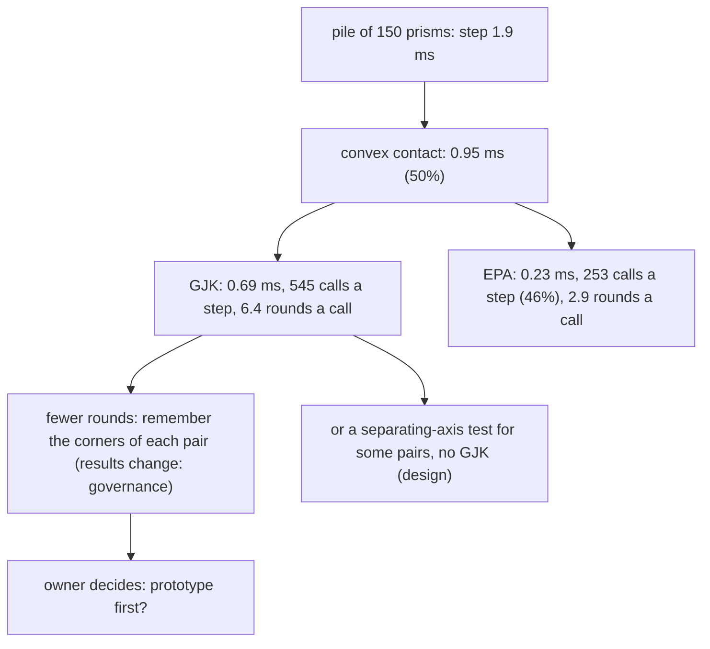

# Review 8-102: in a dense pile of 150 prisms the convex contact is half of the step; cutting GJK's rounds changes results, so it is the owner's decision

Task: 8-102 (from 8-100). Class 1 here (measurement and a report; no engine code). The changes it asks about are Class 2 and move the stored golden hashes (a governance task: they are not made). Owner go-ahead: "8-102" (2026-11-27), read as "look into it"; no governance task was declared, so nothing that changes results was built.

In plain words: card 8-100 measured one prism rolling on a floor, where the convex contact (GJK and, for overlaps, EPA) is about a fifth of a step. This card asked whether that holds for a crowd. **It depends on how dense: 40 resting prisms give 23%, close to the single prism; 150 prisms piled in a box give about half of the step.** (A *round* of GJK is one search of both shapes for their corner farthest along a direction; the cost is the number of rounds GJK needs for each pair, 6 to 7, whether the shapes touch or not.) Cutting the rounds means remembering something from the previous step for each pair, which changes the last digits of contacts and so the stored golden hashes and some pinned tests. That is a governance task. A cheap form of it was measured and does not help.

Outcome:

- **The share:** it can reach half in a dense pile and is 20% to 23% in a sparse scene. 150 prisms (8, 12 and 16 sides, falling into a walled box): the contact is 0.93 to 0.97 ms of 1.90 to 1.95 ms a step (49% to 50%, timed); 40 prisms resting: 53 µs of 234 µs (23%).
- **The cost a call:** 1.7 to 1.8 µs a call (a rolling prism on a floor: 1.4 µs); GJK 1.26 µs, EPA 0.9 µs a call and in 46% of the calls.
- **Rounds:** 6.4 a call; 6.3 for pairs that touch, 6.6 for pairs that do not. (From a cold start a real overlap needs at least 4 rounds, a tetrahedron round the origin; a warm start could in principle need 1.)
- **A warm start from the last search direction, keyed by pair, did not help** in an earlier probe on a different binary (not in the kept patch, so not reproducible from it): 6.4 to 6.6 rounds a call and a step from 1.90 to 1.95 ms to 2.05 to 2.08 ms, the table lookup included. That differs from the single rolling prism of 8-100 (rounds 6.3 and 7.1 down to 5.2 and 5.7, GJK 15% to 30% cheaper, EPA running more often, net about 1.5%); the two probes were not the same (8-100: one global direction, here one per pair). A guess, untested: when shapes touch the last direction is the noise of a point near the origin, so a useful warm start would remember corners, not a direction.

## What was measured

Method: throwaway timers and counters in `gjk.rs` and a test that builds the pile (kept outside the repository as a patch in the scratchpad; the counters for EPA time, support pairs and EPA rounds, and the 40-prism run, come from earlier versions of the probe and are not in the kept patch), release build, Windows, one thread, one laptop, a step of 1/60 s (one step per frame; the 240 Hz of the rolling prism is its number of steps, not its rate). Static floor and four walls; prisms of 8, 12 and 16 sides in turn on a grid, sleeping off, 300 steps to settle (the pile is still moving), then 300 timed steps. The timers cost about 25 ns a call, and two are nested in each call (the contact and `gjk()`): with 545 calls a step about 15 to 30 µs of the 950 µs are the timers.

| item | 40 prisms (resting) | 150 prisms |
|---|---|---|
| step | 234 µs | 1,900 to 1,950 µs |
| convex contact, all calls | 53 µs (23%) | 934 to 967 µs (49% to 50%) |
| calls a step | 50 | 545 |
| ns a call | 1,056 | 1,715 to 1,776 |
| GJK, ns a call (share of the contact) | 718 (68%) | 1,250 to 1,280 (72%) |
| EPA: calls a step, ns a call | 40 and 309 | 253 and 880 to 900 |
| GJK rounds a call | 5.8 | 6.4 |
| of these, pairs that touch / pairs that do not | not split | 6.3 (76,011 calls) / 6.6 (87,384 calls) |
| support pairs a step | 345 | 4,522 |
| EPA rounds a call | 1.2 | 2.9 |

- **A warm direction, keyed by pair** (probe, 2 runs each way, the key a hash of the two shapes' identity): 6.4 to 6.6 rounds a call, GJK 1.26 to 1.41 µs a call (the table lookup counts), step 1.90 to 1.95 ms to 2.05 to 2.08 ms. Not shipped; not kept.
- The pile is not at rest after 300 steps (273 manifolds for 150 bodies); a pile at rest has fewer pairs touching, and the share falls towards the 40-prism figure.

## What it would take (not done)

| option | gain, as far as it can be said | cost and risk |
|---|---|---|
| **Warm start: remember, for each pair, the corners of the last simplex** and start GJK from them | at best GJK falls from 6.4 rounds to about 2 or 3: up to about 0.4 ms of 1.9 ms (20%), with EPA unchanged (0.23 ms, 12%). Not measured: this is the number of rounds, not a prototype | state for each pair (the world already keeps one cache entry for each manifold; a slot could live there), results change in the last digits (the simplex EPA starts from differs): the 3D golden is re-recorded and some pins re-measured; **a governance task** |
| **A separating-axis test** (the faces of both shapes and the crosses of their edges) for a hull against a box, no GJK (in a pile most pairs are hull against hull; the split of the 545 calls by pair kind was not counted) | unknown: a prism of 16 sides has 18 faces and 48 edges, so the test is also 100 or more dot products a pair; not likely better than 1.7 µs without a cache of the last axis | a new algorithm and its contact points; same re-recording |
| A cheaper nearest point or support | small: the support pair is 40 to 50 ns, the nearest point 30 to 75 ns; 8-100 took the one safe saving | none, but little |
| Nothing | the pile of 150 prisms costs 1.9 ms a step, 11% of a frame at 60 Hz, half of it the contact | |

The criterion of 8-100 ("do not, unless a scene with many hulls shows GJK dominating"): in the dense pile GJK is 36% of the step and the contact half, so the criterion is met there, and not in a sparse scene (GJK 15%). **Advice:** worth a prototype if the engine is to run dense piles of hulls; not worth it for a few hulls. The gain below is an optimistic bound: warm rounds cost more than cold ones (the cached corners are moved to the new pose), and EPA may run more often, as it did in the probe of 8-100. The way to find out is a spike that keeps the support-corner indices of each pair and counts rounds and the golden hashes that move; it changes no stored file (it is a branch that is not merged; the throwaway probes of this card also changed results and were not kept) and answers the 20% question. If the owner wants it, it is a new card (8-103); I did not start it.

## Decisions

1. **Nothing built.** Every way to cut the rounds changes results; no governance task was declared. A spike that changes results and is not merged is allowed but is a separate card.
2. **The earlier estimate of the report 8-100 stands for one prism** (a fifth of a step) and is **not typical**: the report of 8-100 said a scene with many hulls was not timed; this report times one.
3. **The 40-prism and 150-prism piles are one arrangement each** (a grid of prisms falling into a box, one layer for 40 and about four layers for 150), so more bodies and more stacking changed together and the report cannot say which gives the half. A pile of mixed shapes, of boxes and hulls, or a stack, would give other shares.

## Not verified

- One laptop, one arrangement, one count of steps (the pile still moves at the end of the settling run). The share of the contact in a pile at rest was measured only for 40 prisms.
- The timers cost 25 ns a call, which is 1% to 2% of the contact here; the shares are timed numbers over timed steps.
- The gain of a warm start is an optimistic estimate from the round counts (6.4 to 2 or 3 rounds), not a measurement.
- The pair kinds (hull against hull, hull against floor or wall) were not counted; neither was how many apart calls end with no contact (separation above the margin): an earlier exit for those would keep results bit for bit and is not priced.
- The warm-direction probe is from a different binary, not in the kept patch, and its result differs from the probe of 8-100 (see above); the patch lacks the counters named above.
- The pile is simulated at one step per frame (1/60 s); at the frame budget of 16.7 ms the 1.9 ms is 11%.
- The rounds of EPA for 40 prisms (1.2) and its share of GJK for 40 prisms are from one run. ARM64, hosted `ci`. Mermaid read by the author, not rendered.

## R1 to R8

| phase | result |
|---|---|
| R1 self | the first reading (the share of the single prism) was replaced by the pile; the first warm-start probe (global direction) was replaced by one keyed by pair, and both were worse |
| R2 automated | none (no code); `wiki-lint` for the report |
| R3 independent | one read-only review: 0 blocker, 3 major (the step rate, the minimum of 4 rounds, "not typical"), 7 minor; all handled (Loops) |
| R4 QA | two runs of each configuration, counters checked against the call counts (545 calls a step, rounds a call = rounds / calls) |
| R5 to R7 | none |
| R8 product fit | the owner has the share, the options and a way to price the best one before deciding |

## Loops

| loop | finding | handling |
|---|---|---|
| 1 | major: dt written as 240 Hz (it is 1/60 s); "least possible is 4" wrong for a warm start and a near-exact touch; "not typical" overclaims from one arrangement | corrected |
| 1 | minor: pair kinds not counted; apart calls ending in no contact not counted; the warm probe not reconciled with 8-100 and not in the patch; the probe changed results; the 20% bound optimistic; 8-100's criterion not answered; timers understated; jargon | added to the text and to Not verified |
