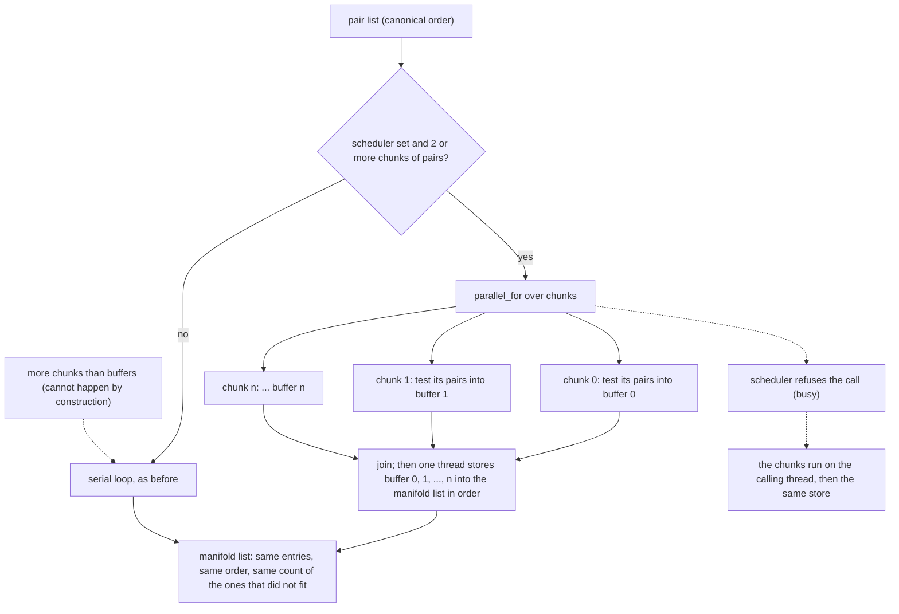

# Review 8-104: the contact tests of a step run through the scheduler; the 1,015-box pyramid with a pool of 4 is about 10% faster (10.3 against 11.5 ms), the manifolds are the same bit for bit

Task: 8-104 (from 8-98). Class 2 (physics core, concurrency, a `Send + Sync` bound on the `Dim` types; no `unsafe`, no protected path). Owner go-ahead: "8-104" (2026-11-28). The card named three pieces of serial work (preparing the constraints, the pair search, the contact tests). This change is the third only; the other two are new Backlog cards (see Decisions).

In plain words: after every step the world tests each pair of nearby bodies for a contact. That loop used one thread, 2.1 ms of the 12.3 ms of the large pyramid (card 8-22), whatever the pool. Now, when the world has a scheduler, the list of pairs is cut into chunks of the solver's chunk size, each chunk tests its own pairs into a buffer of its own, and the buffers are copied into the manifold list one after the other in chunk order, which is the order of the pair list. Each pair is tested by the same code as before on the same bodies, so every manifold is the same and so is the order. **With 4 workers the large pyramid step is 10.3 to 10.6 ms against 11.5 to 11.9 ms (about 10% faster, three alternated rounds); the small scenes show 0.1 to 0.2 ms (91-box pyramid) and about 0.2 ms (mixed pile), the first within the noise.** No golden hash moves.

## What was measured

Method: one throwaway probe, not in the repository (a test file in the bench crate, deleted before the commit), release build, Windows, one laptop (an editor and an agent session open), the scenes of `tools_physics_bench` with sleeping off, 60 steps to settle, then 9 blocks of 10 steps (minimum and median block, ms a step). The old and the new binary were built from the same tree (the change stashed for the old one) and run alternately, three rounds. The pool is the bench pool; the chunk is the solver chunk (it also sets the number of pairs per chunk).

| scene, pool, chunk | old, minimum of each round | new, minimum of each round | best against best |
|---|---|---|---|
| 1,015-box pyramid, pool 4, chunk 32 (the default) | 11.58, 11.53, 11.94 | 10.62, 10.32, 10.64 | -10.5% (11.53 to 10.32) |
| 1,015-box pyramid, pool 4, chunk 8 | 11.45, 11.23, 11.34 | 9.94, 10.03, 9.91 | -11.8% (11.23 to 9.91) |
| 1,015-box pyramid, pool 2, chunk 32 | 13.12, 13.09, 13.23 | 12.18, 12.11, 12.30 | -7.5% (13.09 to 12.11) |
| 91-box pyramid, pool 4, chunk 32 | 1.406, 1.419, 1.575 | 1.306, 1.330, 1.349 | -7.1% (1.406 to 1.306) |
| 91-box pyramid, pool 2, chunk 32 | 1.307, 1.244, 1.234 | 1.157, 1.070, 1.199 | -13.3% (1.234 to 1.070) |
| mixed pile (90 bodies), pool 4, chunk 32 | 0.537, 0.538, 0.562 | 0.339, 0.327, 0.366 | -39% (0.537 to 0.327) |
| mixed pile, pool 2, chunk 32 | 0.513, 0.511, 0.491 | 0.360, 0.387, 0.359 | -27% (0.491 to 0.359) |

The medians show the same picture (large pyramid, pool 4, chunk 32: 11.89, 11.73, 12.15 before; 10.82, 10.68, 10.80 after). The saving on the large pyramid, 1.0 to 1.3 ms, is of the size of 3/4 of the 2.1 ms that card 8-22 measured for the contact tests (about 1.6 ms), less the cost of storing the buffers serially and of the hand-over; that split was not timed. The large saving of the mixed pile (0.2 ms of 0.54) is a measurement, not an explained one: the share of the contact tests in that scene's step was not timed (no per-stage timer was taken here), so why they are so large a part of it is not known.

## What changed

| item | result |
|---|---|
| code | new `core/contact_run.rs` (`ContactRun`: the scheduler, the chunk, one buffer per chunk of the largest possible pair list, allocated once when the execution is set). `World::collide` calls it first and falls back to the serial loop when it declines (no scheduler, one chunk of pairs, or more chunks than buffers). `World::set_execution` builds it. 2D and 3D both use it (the core is shared) |
| the same bits | the test of a pair reads the bodies and the joint table and writes nothing shared; a chunk depends on its pairs only; the cut depends on the number of pairs and the chunk size, never on the workers; the serial store in chunk order is the order of the serial loop, and the manifolds that do not fit are counted by the same `push` in the same order. Each chunk takes the deterministic floating-point guard (`base::fpenv`) like a solver chunk |
| floating-point state | `collide` now takes the deterministic floating-point guard itself (R3 finding 1): a scheduled chunk takes it on its worker, and the serial loop and the fallbacks used whatever the caller had left in the control registers, so the two could differ for a caller with a non-default state. With the default state nothing changes |
| a refusing scheduler | runs nothing; the chunks then run on the calling thread, then the same store (a chunk clears its own buffer first) |
| trait bounds | `Quantity`, `Bounds`, `JointShape` and the `Shape` and `Manifold` types of `Dim` now require `Send + Sync` (the compiler asked for them: a chunk shares the bodies and the joint table between threads). Every type of the crate already has them; an outside implementor of `Dim` would have to as well (public API, noted) |
| tests | 3D: `the_contact_tests_give_the_serial_manifolds_through_any_scheduler` (3 scenes, one with a manifold list of 10 so that most manifolds do not fit, chunks 1, 3 and 1000, in-order, reversed and refusing schedulers; compares the manifold hash, count and missing count with the serial run after 30 steps; characterisation: green before the change) and `the_contact_tests_reach_the_scheduler_when_there_are_several_chunks_of_pairs` (red before: the scheduler was not called; also asserts no call for one chunk of pairs). 2D: `the_contact_tests_of_a_scheduled_2d_world_give_the_serial_manifolds` (2 scenes, chunks 1, 5, 1000, in-order and reversed; green before) |
| hand mutations | 5 tried, all killed: store only the first buffer; no buffer clear; the single-chunk guard lowered to zero; a refusing scheduler ignored; buffers stored in reverse |
| other tests | the unit tests of the crate (479) and every integration test of the `physics` crate pass on Windows, including the allocation tests (a step allocates nothing with a scheduler), the 3D parallel tests and the determinism matrix; rustfmt and Clippy with warnings denied are clean |
| golden | unchanged: the 2D golden (12 scenes) and the 3D golden (5 scenes) recorded with `cross-platform-determinism` on Windows, and the 3D golden on Linux x86-64 (WSL2), are equal to the files (`gates/golden/physics-replay.toml`, `physics3d-replay.toml`) |

## Decisions

1. Only the contact tests are made parallel here. They are the part the 8-98 profile showed as independent per pair, with a result that is merged in order by a plain store. The pair search (a tree walk that fills a list in canonical order) and the preparing of the constraints (which builds the colouring) are different pieces with their own ordering problems; each gets a card: 8-111 (the pair search of the broadphase through the scheduler) and 8-112 (preparing the constraints through the scheduler).
2. The pairs of a chunk use the solver chunk (32 by default), not a number of their own. A pair test is lighter than a constraint solve in a box scene and dearer in a convex scene, so the best value may differ; chunk 8 measured 0.4 to 0.7 ms better than 32 on the large pyramid after this change (9.9 against 10.3 to 10.6 ms; before it, 0.1 to 0.6 ms), the same sign as 8-98 and 8-106 found for the solver itself, with the same caveat that no size is best everywhere. A separate number for the pair chunk is card 8-113.
3. The buffers copy the manifolds once more (the serial store). Writing them straight into the list from the workers is not possible in safe Rust without a different list; it is not tried.

## Not verified

- One laptop, Windows; the machine was not idle. The large-pyramid gain is 1.0 to 1.3 ms in three rounds of nine blocks; the small scenes are 0.1 to 0.2 ms, which is of the order of the noise between rounds (the rounds of the 91-box pyramid differ by up to 0.17 ms), so their figures are the best-against-best of three and are not a claim to the digit.
- The figures of test counts, mutations and the 8-22 split are from the author's runs; the reviewer re-derived the arithmetic, not the runs. The guard in `collide` was added after the review and is not tested with a non-default floating-point state.
- Gaps of the tests: chunk 1000 compares serial with serial (a guard check); the 2D test has no refusing scheduler and no list too small; a change of chunk with manifolds present, a pair list filled to capacity, a scheduler that fails midway, and a poisoned lock are not tested; no new test runs a real pool (the existing `d3_parallel` and determinism tests do).
- The `Send + Sync` bounds are a public-API change for a `Dim` implementor outside the crate (none exists).
- The serial path (no scheduler) was not timed old against new. The code on it is the same loop through a closure; the instruction-count gate of the local gates covers it.
- The memory of the buffers (up to `max_pairs` manifolds, held only when a scheduler is set) was not measured.
- The split of the saving (tests, store, hand-over) was not timed; the 1.6 ms estimate is the 8-22 figure scaled.
- That a step with a pool is bit-identical at every pool size: tested with the in-order, reversed and refusing schedulers and the bench pool of 4 (the `d3_parallel` and determinism tests), not with every size.
- Linux x86-64 (WSL2): the `physics` and bench crate tests pass and the 3D golden equals the file (5 scenes); the 2D golden was recorded on Windows only. ARM64 not run; no hosted `ci`; Miri, coverage and mutation tools not run.
- Mermaid read by the author, not rendered.

## R1 to R8

| phase | result |
|---|---|
| R1 self | the probe test was deleted before the commit; the diff is `contact_run.rs`, `world.rs` (a field, the call, the build), `mod.rs` (one line), the four trait bounds, the tests and this report |
| R2 automated | rustfmt, Clippy with warnings denied (two tests were too nested: flattened), the crate tests, both goldens |
| R3 independent | one read-only review, no blocker; one major and several minors fixed (Loops) |
| R4 QA | an oracle against the serial loop in 3D and 2D, five hand mutations all killed, alternated A/B of the old and new binary in three rounds |
| R5 architecture | one new private module; no new dependency; the only interface change is the `Send + Sync` bound on the `Dim` types |
| R6 security | no `unsafe`, no input from outside; a poisoned lock is read as it is (a panic aborts) |
| R7 performance | measured above: about 10% of the large pyramid step with 4 workers |
| R8 product fit | the first of the three serial pieces of 8-98 is done with a measured gain and no bit moved; the other two are cards |

## Loops

| loop | finding | handling |
|---|---|---|
| 1 | major: serial loop ran under the caller's floating-point state, scheduled chunks under the default | guard taken in `collide`; premise and untested state in Not verified |
| 1 | minor: small-scene headline, 0.15 and 0.5 figures, underivable counts, diagram fallback, test gaps, literals | wording and figures corrected; gaps listed; two named constants |
