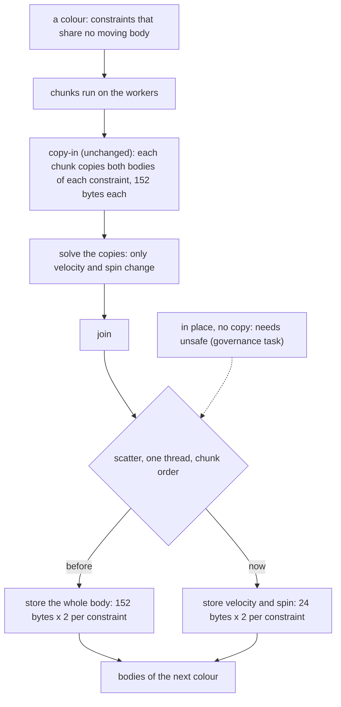

# Review 8-105: the staged colour solve stores back the velocity and the spin of a body (24 bytes) instead of the whole body (152 bytes); the 1,015-box pyramid step with a pool of 4 is about 0.9 ms (about 5%) faster in the median of eight alternated rounds on a busy machine; writing the bodies in place with no copy at all needs `unsafe` and is left to the owner

Task: 8-105 (from 8-98). Class 2 (physics core; no `unsafe`, no protected path, no new bound). Owner go-ahead: "8-105" (2026-11-28). The card offered two routes to remove the copy-in and the serial scatter of the staged colour solve: an `unsafe` block with a budget and a SAFETY argument, or a layout that splits the bodies per colour. The first needs a change to `gates/unsafe-budget.toml` and to the lint of the `physics` crate (`unsafe_code` is forbidden there), both governance files, so it is not taken without a governance task declared by the owner. This card takes what safe Rust allows.

In plain words: when a pool solves the contacts of one colour, every chunk copies the two bodies of each of its constraints (152 bytes each), solves the copies, and after the whole colour is done one thread copies the results back into the body array. That copy-back is serial, so it is the part that does not shrink with more workers. A solve pass changes only two things of a body: its velocity and its spin (24 bytes). Everything else (mass, inertia tensor, acceleration terms, damping, shift, turn) is read-only during a colour. So the copy-back now stores those 24 bytes and leaves the other 128 alone. **The results are unchanged in every check made: the goldens on both platforms, the staged-against-serial tests and a new test that every pass changes nothing but the velocity and the spin all agree (that is evidence, not a proof of bit identity). The pooled large-pyramid step was lower in all eight alternated rounds, by 0.3 to 2.0 ms (median -0.87 ms, mean -0.95 ms, about 5%); the serial path is level.**

## What was measured

Method: a throwaway probe, not in the repository (a test file in the bench crate, deleted before the commit), release build, Windows, one laptop. The binary of `develop` (with 8-112) and the binary of this change were built from the same tree (the change reverted for the old one) and run alternately, eight rounds, the order swapped every other round; each run is 60 steps to settle, then the minimum of 9 blocks of 10 steps, ms a step. The scene is the 1,015-box pyramid of the bench crate, sleeping off.

| 1,015-box pyramid | old, per round (ms) | new, per round (ms) | change per round (ms) |
|---|---|---|---|
| pool of 4, chunk 32 | 19.14, 20.18, 18.78, 19.11, 19.58, 18.85, 18.70, 19.37 | 18.34, 18.15, 18.48, 18.39, 18.29, 17.92, 18.25, 18.27 | -0.80, -2.03, -0.30, -0.71, -1.29, -0.93, -0.45, -1.10 (median -0.87, mean -0.95, about 5%; 0.95 of a mean of 19.21) |
| serial (no scheduler) | 15.90, 15.61, 16.01, 15.92, 15.74, 15.67, 15.72, 15.60 | 15.66, 15.55, 15.58, 15.71, 15.80, 15.57, 15.58, 15.82 | -0.24, -0.07, -0.42, -0.21, +0.06, -0.10, -0.15, +0.21 (median -0.13; six of eight lower and two higher: read as level) |

An earlier probe of the same idea that copied four fields (velocity, spin, shift, turn) gave five lower rounds out of six on the pool (mean about -0.6 ms); it is not the final code and is not counted. The changes per round are computed from the raw three-decimal times, so they can differ by 0.01 from the difference of the rounded columns. The serial row, which does not use the scatter at all, moved by -0.12 ms (median), so about 0.1 ms is the noise floor of this probe. The machine was slower during these runs than in the earlier cards of the series (the pool of 4 took about 19 ms here and the serial path 15.7 ms: the pool was slower than serial, as in 8-114), so the figures are those of a machine under load and are not comparable with cards 8-104 to 8-112. The gain on a quiet machine is not measured. It was not timed by part (the scatter alone, before and after), so how much of the 2.65 ms of 8-98 is left is not known; the gain is a measurement of the whole step, not an explained one.

## What changed

| item | result |
|---|---|
| code | `body.rs`: `SolverBody::take_velocities(&mut self, other)` copies `velocity` and `spin`. `stage.rs`: `store_body` calls it instead of storing the whole copy (static bodies are still never stored). The copy-in, the chunking, the order of the scatter and the scheduler are unchanged |
| why it is the same | the passes of a colour (`WarmStart`, `Solve`, `Restitute`) call `Ends` methods that change a body through `SolverBody::push` only, and `push` writes `velocity` and `spin`; `shift` and `turn` are written by `integrate_position`, which runs outside the colours, and the rest is set when the body is made. The joints run on the serial path and do not use the staged store |
| tests | `body.rs`: `taking_the_velocities_copies_the_velocity_and_the_spin_and_nothing_else` (red until `take_velocities` existed). `constraint.rs`: `a_pass_over_a_constraint_changes_the_velocity_and_the_spin_of_its_bodies_and_nothing_else` (120 random constraints, 1 to 4 points, with and without the bias, bodies that move and bodies that cannot, a shift and a turn that are not the defaults; all three passes one at a time, and two constraints side by side through `solve_pair`, the path of the soft solve; every field except the two is compared as it was, by its debug text; the fields private to `body.rs` keep their defaults there and are covered by the body test). This one is a characterisation test: it is green on arrival and its red evidence is the mutation below. The existing staged-against-serial tests (`colouring_tests`) are the bit-for-bit check of the whole path |
| hand mutations | 6 different mutants, all killed: `take_velocities` also copies the shift; it drops the spin; it drops the velocity; a pass moves the shift (`push` adds to `shift`); the stage stores only the velocity; a pass resets the turn to the identity (caught only because the test bodies now have a turn that is not the identity). The shift mutant was run again after the test was refactored |
| other tests | `cargo test -p physics`: 1,165 tests, 0 failed (Windows); Clippy with warnings denied and rustfmt clean (the first form of the pass test was refused by Clippy for nesting and a literal without separators; it now uses a helper) |
| golden | unchanged: the 3D golden (5 scenes) and the 2D golden (12 scenes) recorded with `cross-platform-determinism` are equal on Windows; the 3D golden (5 scenes) is equal on Linux x86-64 (WSL2), where the `physics` and bench crate tests also pass |

## Decisions

1. A narrower store, not a new layout. Splitting `SolverBody` into a read-only part and a moving part (so that the copy-in also shrinks) would touch every user of `Ends` (`constraint.rs`, `joint.rs`, about 30 places) for a copy-in that runs on the workers; the scatter is the serial part, so it is the part that matters, and it is a nine-line change.
2. The copy-in is left as it is (152 bytes a body, on the workers). Whether copying less there helps was not measured.
3. The in-place write with no copy (the card's title) needs a body array that several threads write at disjoint indices. Safe Rust cannot say that. The safe forms are a lock per body (an uncontended lock costs about as much as the copy it replaces, and a static body shared by many constraints would need special care), or an `unsafe` block with a SAFETY argument (the colours share no moving body, so the writes are disjoint). The second needs a budget in `gates/unsafe-budget.toml` and `unsafe_code = "deny"` with an allow in the crate, both protected paths, so it is the owner's to declare as a governance task. One Backlog card records it (8-119).

## Not verified

- One laptop, Windows, a busy machine (the pool slower than serial); the 5% is of a slow step. A quiet machine and a second machine were not tried; 4 workers only.
- Only the large pyramid was timed. The small scenes were not (the scatter is a smaller part of them).
- The scatter was not timed alone, before and after.
- Linux was run on the code before the last test-only additions (the pair path and the shift and turn in the pass test); no engine code changed after it. ARM64, hosted `ci`, Miri, and the coverage and mutation tools were not run.
- The mutations, the timings and the test counts are from the author's runs; the reviewer re-derived the arithmetic, not the runs.
- The invariant that a pass changes only velocity and spin is checked on the constraint passes, not on a future pass: a new pass that changed another field would be caught by the new test only if it is added to the list of passes it checks and by the staged-against-serial tests when the field matters.
- Mermaid read by the author, not rendered.

## R1 to R8

| phase | result |
|---|---|
| R1 self | the probe test file was deleted before the commit; the diff is `body.rs`, `stage.rs`, `constraint.rs` (tests) and this report |
| R2 automated | rustfmt, Clippy with warnings denied, `cargo test -p physics`, both goldens on Windows, the 3D golden on Linux |
| R3 independent | one read-only review, no blocker and no major; four minors and two nits fixed or stated (Loops); the reviewer re-derived the invariant from the code |
| R4 QA | a body test, a pass invariant test over 120 random constraints, six hand mutations, alternated A/B in eight rounds |
| R5 architecture | no new module, interface or dependency; one `pub(super)` method |
| R6 security | no `unsafe`, no input from outside; the store is by index with `get_mut`, as before |
| R7 performance | measured above: about 5% of the pooled step on a busy machine, serial level |
| R8 product fit | the serial scatter of the card shrinks without `unsafe`; the full removal is a decision of the owner (8-119) |

## Loops

| loop | finding | handling |
|---|---|---|
| 1 | minor: the pass test never ran the pair path (`solve_pair`) | the test now also solves two constraints side by side |
| 1 | minor: the test bodies had default `shift` and `turn`, so a pass that wrote a default would not show | the bodies get a shift and a turn that are not the defaults; the mutant that resets the turn is killed |
| 1 | minor: per-round deltas differed by 0.01 from the rounded columns; one delta was -0.46 for -0.45 | corrected, and the report says the deltas come from the raw three-decimal times |
| 1 | minor: "bit-for-bit" without its support; "6 of 6" counted a repeat; the Linux result sent to the PR | wording says what was checked; six different mutants; the Linux result stated here |
| 1 | minor: the comments of `scatter` and `store_result` still said the whole body is stored; the `Pass` type did not name the contract | comments updated; the contract is in the doc of `Pass` |
| 1 | nit: a debug text compares NaN payloads as equal | kept: the test bodies hold no NaN; the staged-against-serial tests compare bits |
| 0 | the first Clippy run refused the pass test (nesting, a literal without separators) | the checks moved into a helper and the literal given separators |
