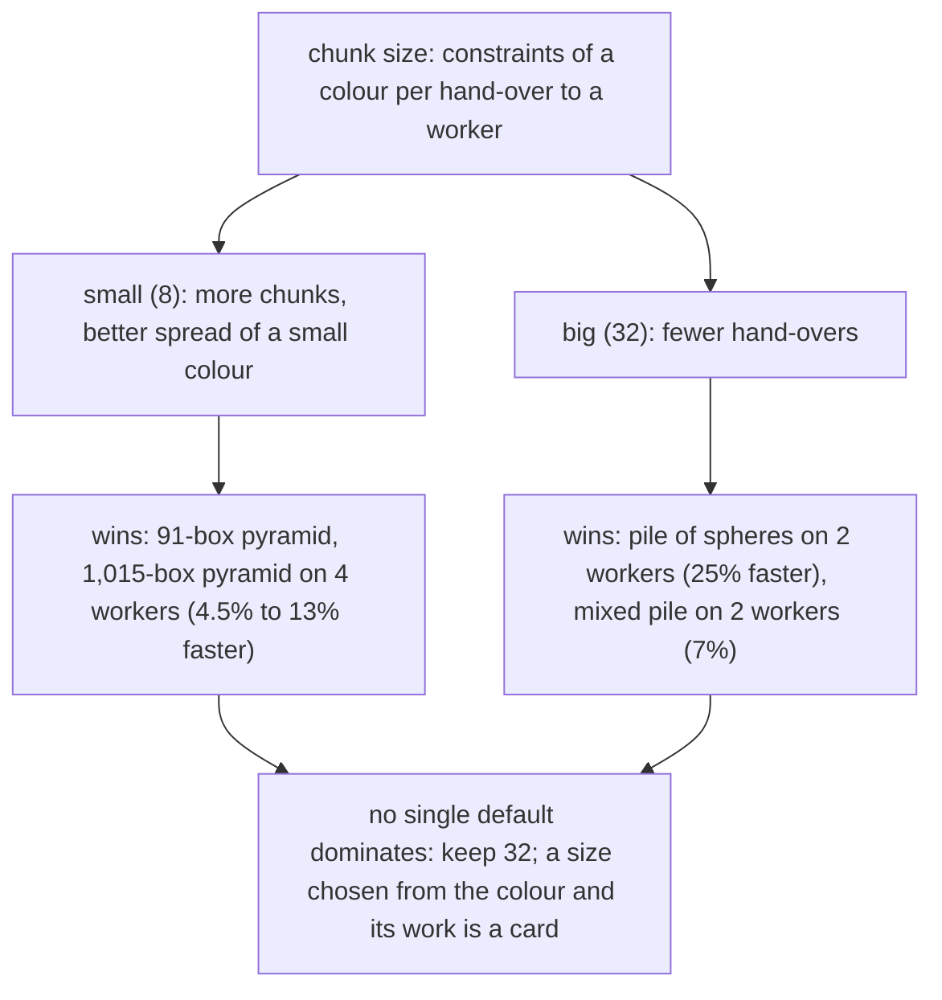

# Review 8-106: no chunk size is best for every scene; 8 is up to 13% faster on a pyramid and 25% slower on a pile of spheres on 2 workers, so the default of 32 stays

Task: 8-106 (from 8-98). Class 1 here (measurement and a report; no engine code). Owner go-ahead: "Do the release then 8-106" (2026-11-28). The card asked whether a default chunk of 8 instead of 32 helps small scenes; the answer is that it helps some and hurts others, so the default is not changed.

In plain words: a *chunk* is the number of constraints of one colour that a worker takes in one go (the default is 32; the scheduler hands chunks to workers). A smaller chunk spreads a small colour over more workers but pays the hand-over more often. **On the 91-box pyramid chunks of 8 are 11% to 13% faster than 32; on a pile of spheres they are 25% slower on 2 workers (on 4 workers +10%, within the spread of the rounds).** The differences are 0.02 to 0.2 ms a step on the small scenes and 0.5 ms on the large pyramid. The same default is used by the 2D solver, where it makes no difference of note (chunks of 8: -3.7% to +1.0%).

## What was measured

Method: a throwaway timing test, not in the repository, release build, Windows, one laptop (an editor and an agent session open), pools of 2 and 4 workers, chunks of 8, 16 and 32, sleeping off. 3D scenes: 60 warm steps, then the best of 7 blocks of 10 steps (1,015-box pyramid) or of 100 steps (the others). 2D pyramids: 120 steps of `run_scene` (the scene build is in the time), best of 5. Three rounds in the same order; the table gives the median of the three rounds, ms a step. The scenes (`scene3d.rs`): large pyramid 1,015 boxes, pyramid 91 boxes, tower 10 boxes, sphere pile 60 spheres, mixed pile 90 bodies. The three chunk sizes ran in the order 8, 16, 32 in every round.

| scene, pool | chunk 8 | chunk 16 | chunk 32 (default) | 8 against 32 | 16 against 32 | spread of the three rounds at 32 |
|---|---|---|---|---|---|---|
| large pyramid, 2 | 13.21 | 13.27 | 13.28 | -0.5% | 0.0% | 2% |
| large pyramid, 4 | 11.33 | 11.76 | 11.87 | -4.5% | -0.9% | 2% |
| pyramid (91), 2 | 1.155 | 1.230 | 1.296 | -10.9% | -5.1% | 4% |
| pyramid (91), 4 | 1.329 | 1.360 | 1.532 | -13.3% | -11.2% | 2% |
| mixed pile, 2 | 0.611 | 0.597 | 0.570 | +7.1% | +4.7% | 2% |
| mixed pile, 4 | 0.664 | 0.708 | 0.676 | -1.8% | +4.7% | 5% |
| sphere pile, 2 | 0.1515 | 0.1342 | 0.1215 | +24.7% | +10.5% | 7% |
| sphere pile, 4 | 0.1789 | 0.1734 | 0.1627 | +10.0% | +6.6% | 13% |
| tower, 2 | 0.0253 | 0.0251 | 0.0238 | +6.3% | +5.5% | 0% |
| tower, 4 | 0.0236 | 0.0237 | 0.0237 | -0.4% | 0.0% | 1% |
| 2D pyramid 44 rows, 2 | 2.886 | 2.897 | 2.858 | +1.0% | +1.4% | 1% |
| 2D pyramid 44 rows, 4 | 2.992 | 3.078 | 3.075 | -2.7% | +0.1% | 2% |
| 2D pyramid 20 rows, 2 | 0.626 | 0.636 | 0.628 | -0.4% | +1.2% | 3% |
| 2D pyramid 20 rows, 4 | 0.755 | 0.760 | 0.784 | -3.7% | -3.0% | 15% |

The spread of the three rounds is given for chunk 32 only. Where it is as large as the difference (the sphere pile on 4 workers, 13%; the 2D pyramid of 20 rows on 4; the mixed pile on 4), the difference is not established; the tower on 2 workers also shows a 9% spread at chunk 8 (0.0235 to 0.0256), so its +6% is not established either.

## What was found

| item | result |
|---|---|
| the pyramid of 91 boxes | chunks of 8 are the best on both pool sizes (-11% and -13%, 0.14 to 0.2 ms), and the gain is larger than the spread of the rounds |
| the large pyramid | -4.5% on 4 workers (11.33 against 11.87 ms), none on 2 (0.5%) |
| the pile of spheres | on 2 workers chunks of 8 are 25% slower (0.03 ms) and chunks of 16 11% slower, with a spread of 7%; on 4 workers they are +10% and +7% (0.016 ms), inside the 13% spread of the rounds; the best is 32 on both |
| the mixed pile and the tower | no reliable difference on 4 workers; on 2 workers chunks of 8 and 16 are 5% to 7% slower (the mixed pile: spread 2%; the tower: 1 µs a step and a spread of 9% at chunk 8, not established) |
| 2D | no change of note (chunks of 8: -3.7% to +1.0%; chunks of 16: -3.0% to +1.4%), a spread as large as the differences on the small pyramid |
| why | not measured. A likely reason for the sphere pile is that its constraints are cheap to solve, so the hand-over of a chunk costs more than the work in it; for the pyramids, whose colours are a few dozen to a few hundred constraints of box contacts, a small chunk spreads the work better. It is a hypothesis: no counters of chunks, colour sizes or idle time were taken |

## Decisions

1. **`DEFAULT_CHUNK` stays at 32.** No value wins everywhere: 8 gains on pyramids and loses on the sphere pile on 2 workers by a larger share; 16 is a compromise (-11% to -5% on the small pyramid, the 5% end near its spread of 4%; +5% to +11% on the sphere pile and the mixed pile on 2 workers). The default is shared by 2D and 3D, and the differences are 0.02 to 0.2 ms a step, 0.5 ms on the large pyramid.
2. **A chunk chosen from the colour** (its size, and how heavy a constraint is) instead of one number is the lever that could take both results. The module comment of `stage.rs` says the cut depends on the colour's size and the chunk size only, so a rule from the colour's size keeps the result independent of the thread count; a rule that also uses how heavy a constraint is needs its own argument (not made here). It is a design with its own measurement, opened as a card (8-110).
3. Nothing in the repository changes except this report: no code, no benchmark text ("chunk 32" in the benchmark report stays true).

## Not verified

- One laptop, Windows, three rounds; pools of 2 and 4 only (8-98 found 8 workers no better than 4 on this machine); no Linux run.
- The reason for each result (see "why"): not measured.
- Whether a chunk between 8 and 32 other than 16, or 4, would do better on a scene: only 8, 16 and 32 were run here (8-98 ran 4 to 128 on the large pyramid only).
- That a result is bit-identical for chunks of 8 and 16: not needed here (no code change), and by design the cut does not change results; the determinism tests of the crate run chunks of several sizes.
- The 2D times include the build of the scene (120 steps of a 20-row pyramid cost about 75 ms in all, build included; the build's share was not measured).
- The colour sizes behind each result are unknown, and no pool of 1 was run. The chunks always ran in the order 8, 16, 32, so an order or a thermal effect on the 32 column is not excluded. The throwaway test and the raw output are not kept in the repository (the numbers are not reproducible from it).
- Mermaid read by the author, not rendered.

## R1 to R8

| phase | result |
|---|---|
| R1 self | the probe test was removed; the diff is this file only |
| R2 automated | no code change: nothing to build; wiki lint and the local gates in the PR |
| R3 independent | one read-only review, no blocker; one major and several minors fixed (Loops) |
| R4 QA | three rounds of every configuration; the spread of the rounds is in the table |
| R5 to R7 | none (no code) |
| R8 product fit | the card's idea is answered with measurements; the default stays and an adaptive chunk is a card |

## Loops

| loop | finding | handling |
|---|---|---|
| 1 | major: 'sphere pile 10% to 25% slower' contradicts the report's own spread (13% on 4 workers) | 25% on 2 workers stated, the 4 workers cell called not established, in the title, intro, Found table and Decision 1 |
| 1 | minor: ms ranges, 2D range for 8 only, 5% end near the spread, mermaid labels, spread at 8 and 16 not tabulated, 75 ms remark, Not verified omissions, determinism argument for a weight-based rule, empty Loops | corrected or added |
