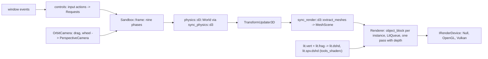

# Review 8-11: the 3D sandbox

Task: 8-11. Class 2 (new crate `app_sandbox3d`, a layer 4 sample; the lit uniform layout of `render::lit` changes, which is public API of card 8-9 that no other crate used yet; no `unsafe`, no new third-party dependency, no port revision, no governance file). Ordinary card into `develop`. Loops: 1 fix loop (1 independent review, two minor fixes).

Delivers: `engine/app_sandbox3d`: spheres, boxes and capsules fall into a walled box; every piece is an entity with a `Transform3D`, a `MeshRenderer` and a body; one frame runs the nine phases of the frame plan through `sync_physics::d3`, `TransformUpdater3D` and `sync_render::d3`; the scene is drawn lit with an orbit camera, driven by `input` actions. The lit GLSL and its two checked-in assets (GLSL text, SPIR-V). Tests: golden command stream on the Null device, replay hash (also at 1 and 4 threads), zero allocations per warm frame, an image test on the OpenGL and the Vulkan device, a check of the checked-in shader assets against the tool.

## Decisions

1. **Two uniform blocks, not three.** Card 8-9 defined a transform block (vertex stage), a light block and a material block (both fragment stage). The shader tool accepts one uniform block per module, so a fragment stage that reads the light and the material cannot be built. The colour moved into the object block (`object_block`, 192 bytes, vertex stage), which the vertex shader hands on to the fragment stage; the light block stays alone in the fragment stage. This changes `render::lit` (`transform_block` and `Material::block_bytes` are gone, `object_block` and `SLOT_OBJECT` are new, `LitBindings.material` is gone), the contract case `lit_block_contract` (two slots) and the 8-9 golden stream (one bind fewer per draw). No other crate used the old names. The alternative, widening the tool to several blocks per module, is a governance change and was not taken.
2. **Meshes are unit meshes scaled by the entity.** A sphere of radius 1, a box of half extents 1 and a capsule of radius 0.5 and half length 0.5 are made once; the `Transform3D` scale gives each piece its size (a capsule scales uniformly), so there are three vertex buffers for any number of pieces. The body is made from the same numbers, so the drawn and the simulated shape agree (tested).
3. **A drop lands at a random point over the floor, not under the cursor.** Picking needs a ray against the scene; the card asks for the glue path, not picking. The point comes from the seeded generator, so a replay is exact.
4. **The orbit camera is data and functions** (`OrbitCamera`: yaw, pitch, distance, target; `drag`, `zoom`, `camera`). It holds pitch and distance in range and ignores a value that is not a number.
5. **The controls use the `input` crate** (named actions, one context), as the card asks, and return plain `Requests`. A quit is known as soon as the event is applied.
6. **One window at a time in the image tests.** GLFW is one per process, so the OpenGL and the Vulkan image tests take a lock.
7. **No audio.** The card does not ask for it; the 2D sandbox's audio is not repeated.
8. **`Renderer::set_target`** draws into a texture instead of the back buffer. It exists for the image test and is a one-line setter.

## Evidence

- Tests first for the layout change (the lit unit tests, the contract tests and the 8-9 golden were changed before `render::lit`; red: they did not compile or failed on the sizes). For the new crate the orbit, controls, spawn, mesh and glue tests were written together with or just before the code; red evidence is thinner here than for the layout change (the first run of most files was already green), and the mutation run below stands in for it.
- `cargo test -p app_sandbox3d -p render -p sync_render`: all pass (`app_sandbox3d`: 47 unit, 3 binary, 31 glue, 1 shader golden, 2 image tests). `cargo clippy ... --all-targets -- -D warnings` and `cargo fmt` clean.
- Image test, OpenGL and Vulkan (validation layer on, `check()` after the frame): on this machine both ran (with `DUCK_REQUIRE_GL=1`, a missing device would fail). The pixel at the middle is the green box in front of the red sphere (depth and per-object colour); the corner is the clear colour; the side of the sphere facing the light is more than 1.5 times as bright as the side that does not, and the dark side is not black (ambient). The centre texel value matches the arithmetic (dark checker texel 40 times about 0.4 gives 16).
- The checked-in assets equal the tool output (`tests/golden.rs`, run with the tools from the original clone's `target/shader-spike`, `DUCK_REQUIRE_SHADER_TOOLS=1`).
- Replay: the same session twice, another seed, one and four threads, equal hashes. Allocation: 60 warm frames after 1500, zero allocator calls, with the stream finished and pieces at rest.
- Real window: `app_sandbox3d --frames 120` on the OpenGL device ran 120 frames, state hash `6be16cd75c98377d`, no GL error.
- Mutation (`cargo mutants`, one file at a time, `sandbox` and `renderer` in four shards because the first full run was stopped for memory): `orbit` 35 of 35 viable caught, `controls` 10 of 10, `spawn` 41 of 41, `mesh` 11 of 11, `session` 9 of 9, `render::lit` 83 of 83, `sandbox` all caught but three, `renderer` all caught but four. The first run found 1 survivor in `orbit`, 14 in `spawn`, 9 in `sandbox` and 6 in `renderer`; tests were added for each real gap (a lens that moves with yaw, the tilt range, capsule size, drop reach, the light direction, piece colours, the entity scale reaching the model, the zero-side resize, `set_target`). Left open, with reasons: `sandbox.rs` `set_execution` (changes the speed, never a bit of the result, by design) and `build_physics` `+` to `*` (only makes the body capacity larger); `renderer.rs` line 41 (the starting capacity of the command stream, which is a performance hint) and the two `&&` to `||` in `check_asset` (a block with the wrong binding or size; a test needs a shader asset built by hand). The `controls.rs`, `mesh.rs` and `session.rs` runs were made before the last small fixes.

## Not verified

- No person looked at the picture; the image test checks the shader's arithmetic and ordering, not how it looks. The window run only proves that frames are drawn without a GL error.
- Linux and ARM64 were not run (the key table is the host table of `input`).
- The Vulkan device runs only the image test, not the window loop.
- The golden fingerprints (frames 1, 60, 200) record today's stream; they were not compared with an independent picture.
- Frame cost was not measured (no budget is asked for this card).
- The allocation test covers frames with no spawn or reset; a frame that spawns a piece allocates in the ECS. The loop-1 fixes were not seen by a second reviewer.

## R1 to R8

| phase | result |
|---|---|
| R1 self | found and fixed: three clippy nesting items, float comparisons in tests, a pool limit of the Null device (256) that the first object count exceeded (now 160), a quit that was only known after the frame |
| R2 automated | tests, clippy, fmt, local gates, mutation |
| R3 independent | one read-only review, no blocker or major; two minors fixed, notes below |
| R4 QA | controls (edges, choice, drag, wheel, quit, focus loss), spawn ranges, scenery, frame phases, drops, reset, full box, camera, resize, golden stream, replay, allocation, image test on two devices |
| R5 architecture | glue crates are the only code that knows two modules; the sample is layer 4 and names the OpenGL adapter only in `app`; physics has no ECS import |
| R6 security | no `unsafe`, no new third-party dependency, no secrets; fixed capacities (128 pieces, 160 objects); non-finite input ignored or refused |
| R7 performance | allocation checked; speed not measured |
| R8 product fit | the owner reads the known limits above |

## Loops

| loop | finding | handling |
|---|---|---|
| 1 | minor: a minimised window left its events unconsumed, so a press or drag would fire when drawing resumed | `Session::discard_input`, called on the skipped frame; test red first (did not compile) |
| 1 | minor: `Renderer::resize` changed the surface before it made the new depth texture, so a failure left them out of step | depth texture first |
| 1 | note: the allocation test covers frames without a spawn or reset (a spawn grows the ECS) | stated in Not verified |
| 1 | note: the shader golden test is skipped where the tools are missing | by design, `DUCK_REQUIRE_SHADER_TOOLS=1` makes it fail; stated here |
| 1 | note: two number keys in one frame: the first wins | accepted |
