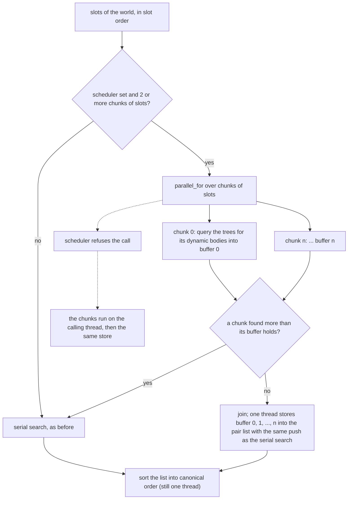

# Review 8-111: the pair search of the broadphase runs through the scheduler; the 1,015-box pyramid with a pool of 4 is about 5% faster (10.7 to 10.9 against 11.3 to 11.6 ms), the pair list is the same bit for bit

Task: 8-111 (from 8-104). Class 2 (physics core, concurrency; no `unsafe`, no protected path, no new bound: the `Send + Sync` bounds of 8-104 are enough). Owner go-ahead: "8-111" (2026-11-28). Only the search for the pairs is made parallel. The sort of the list that follows it is not (see Decisions).

In plain words: after every step the broadphase asks two trees, for each moving body, which boxes overlap its own. That loop used one thread. Now, when the world has a scheduler, the bodies are cut into chunks of the solver's chunk size by slot, each chunk asks the trees for its own bodies into a buffer of its own, and the buffers are copied into the pair list one after the other in chunk order, which is the order the serial search finds the pairs in. The list is then sorted as before, so it is the same list. **With 4 workers the large pyramid step is 10.7 to 10.9 ms against 11.3 to 11.6 ms (about 5% faster, three alternated rounds). The sort, which was 0.44 ms of the 1.3 ms a search took, is still on one thread.**

## What was measured

Method, the split: a throwaway probe (clock reads around the query loop and the sort inside `find_pairs`, a counter file in the bench crate; reverted, not committed), release build, Windows, pool of 4, 50 steps after 60 to settle, means a step, one run. Method, the speed: a second throwaway probe (a test file in the bench crate, deleted before the commit), 60 steps to settle, then 9 blocks of 10 steps, minimum and median block; the binary of `develop` (with 8-104) and the binary of this change were built from the same tree (the change stashed for the old one) and run alternately, three rounds.

| item | large pyramid | mixed pile (90 bodies) |
|---|---|---|
| step, instrumented, ms | 11.19 | 0.424 |
| `find_pairs`: tree queries, ms | 0.848 | 0.035 |
| `find_pairs`: heap sort of the list, ms | 0.440 | 0.022 |
| pairs in the list | 6,930 | 420 |

So the search is about 1.3 ms of 11.2 ms (11.5%) on the large pyramid, of which the queries, the part that can be shared, are 0.85 ms: a perfect split over 4 workers would save about 0.64 ms.

| 1,015-box pyramid, pool 4 | old, minimum of each round (ms) | new, minimum of each round (ms) | change |
|---|---|---|---|
| chunk 32 (the default) | 11.60, 11.34, 11.32 | 10.86, 10.79, 10.72 | -0.74, -0.55, -0.60 ms (-6.4%, -4.9%, -5.3%) |
| chunk 8 | 11.44, 11.14, 11.15 | 10.41, 10.31, 10.48 | -1.03, -0.83, -0.67 ms (-9.0%, -7.5%, -6.0%) |

The medians agree (chunk 32: 11.73, 11.62, 11.51 before; 11.08, 10.92, 10.85 after). The saving, 0.55 to 0.75 ms at the default chunk, is of the size of the 0.64 ms estimate above.

The machine was noisy in the second probe (the same binary gave 1.4 to 2.8 ms for the 91-box pyramid and 16 to 25 ms for the large pyramid with a pool of 2 in different rounds), so the small scenes and the pool of 2 are **not** claimed: their old and new figures overlap. An earlier run of the first version of this change (a buffer sized by the even share of the list, see Decisions) showed a large-pyramid saving of 0.6 to 0.7 ms at chunk 32 (old 11.38, 11.43, 11.65 against new 10.75, 10.74, 10.93).

## What changed

| item | result |
|---|---|
| code | new `core/pair_run.rs`: `Search` (the two trees and the slots, with the query of one body that both paths use) and `PairRun` (the scheduler, the chunk, one buffer per chunk of slots, allocated once when the execution is set). `Broadphase::find_pairs` tries it first and falls back to the serial loop when it declines (no scheduler, one chunk of slots, or a chunk that found more than its buffer holds). `Broadphase::set_execution` builds it, called from `World::set_execution`. 2D and 3D both use it |
| the same bits | a query reads the trees and the slots and writes nothing shared, so what a chunk finds depends on its slots only; the cut depends on the number of slots and the chunk size, never on the workers. The store is in chunk order, which is the order the serial search finds the pairs in, through the same `PairList::push`, so a list that is too small keeps the same first pairs and counts the same missing ones; the sort that follows gives a total order (the keys are unique). The old `add_pair` and `add_later_pair` are now the methods `hit` and `later_hit` of `Search`, used by the serial path too |
| buffers | each holds at most 16 pairs per slot of the world that fit in a chunk (`min(chunk, max_bodies) * 16`, and never more than the list does), one per chunk of slots, so a world holds at most about 16 pairs per slot (a little more when the last chunk is short), only when a scheduler is set and the slots make two chunks or more (a single chunk is never handed over and gets no buffer). A chunk that has overflowed skips the rest of its bodies. A chunk that finds more (a dense pile: every body on every other) makes the search run serially, which costs speed only (the parallel work done before the overflow is lost, so a region dense enough on every step is slower than serial) |
| floating-point state | `find_pairs` takes the deterministic guard like `collide` does since 8-104, so the serial loop and a scheduled chunk compare boxes under the same state |
| tests | 3D: `the_pair_search_gives_the_serial_list_through_any_scheduler` (3 scenes, one with a list of 20 pairs so that most pairs do not fit; chunks 1, 3, 1000; in-order, reversed and refusing schedulers; compares the pairs and the missing count with the serial run after 30 steps; characterisation: green before the change), `the_pair_search_reaches_the_scheduler_when_there_are_several_chunks_of_bodies` (red before: the scheduler was not called; no call for one chunk of slots), `a_pile_that_overflows_the_chunk_buffers_gives_the_serial_list` (30 boxes on top of one another, 435 pairs, one body a chunk: the fallback). 2D: `the_pair_search_of_a_scheduled_2d_world_gives_the_serial_list` (2 scenes, chunks 1, 5, 1000, in-order and reversed; green before). `the_pair_search_follows_the_execution_and_the_bodies_that_go_away` (a scheduler, another chunk, a destroyed body, back to serial, a chunk of one: the list is the serial one after each change). Unit tests of the sizing and of the overflow mark in `pair_run.rs`; the chunk 1000 cases of the equivalence tests only check the single-chunk guard |
| hand mutations | 10 tried, 9 on the final code and the 10th on an earlier form: store only the first buffer; no buffer clear; the single-chunk guard lowered; a refusing scheduler ignored; the overflow mark ignored; the buffer limit removed; the limit set to a huge number; buffers stored in reverse; the later-body test `>` made `>=` (killed by the older tests of the world, not by the new equivalence tests, which compare with a serial path that uses the same query); the check of the total against the list capacity (in the earlier form only: it survived, and it was removed because storing in order makes it redundant, see Decisions). The other nine are killed in the final code (the huge-limit mutant by the unit test of the sizing, not by the equivalence tests, whose output it does not change). One mutant first survived, the reverse store, because the 20-pair test never reached the store (every chunk overflowed an even-share buffer); that is why the buffers are sized per body |
| other tests | the unit tests of the crate (488) and every integration test of the `physics` and bench crates pass on Windows, including the allocation tests (a step allocates nothing with a scheduler) and the determinism matrix; on Linux x86-64 (WSL2) the `physics` and bench tests pass; rustfmt and Clippy with warnings denied are clean |
| golden | unchanged: the 2D golden (12 scenes) and the 3D golden (5 scenes) recorded with `cross-platform-determinism` on Windows, and the 3D golden on Linux x86-64 (WSL2), are equal to the files |

## Decisions

1. The sort is left alone. It is 0.44 ms of the 1.3 ms and is a heap sort of the whole list, one thread, chosen so that the order never depends on an unstable sort. A counting sort by the lower slot, then by the higher one inside a slot, would give the same total order for a small part of that time on every path, serial included; it needs its own scratch buffers and its own proof. New card 8-114.
2. The buffers are sized per body (16 pairs per slot), not by an even share of the list: a world sized for 100,000 bodies that uses a thousand would otherwise give every used chunk a buffer far too small and fall back to the serial search every step, silently. The price is memory held only with a scheduler (16 pairs a slot, about 16 bytes a pair is about 256 bytes a slot, a quarter of a megabyte per 1,000 slots), not measured as part of a run.
3. The check of the total against the list's capacity was removed: storing in chunk order through the same `push` already gives the first pairs and the missing count of the serial search, so the check only forced the serial search for nothing.
4. The cut is by slot, not by dynamic body, so a world with many static bodies in the low slots has chunks without work. Cutting by the live dynamic bodies, and a pair chunk of its own, are part of card 8-113.

## Not verified

- One laptop, Windows, noisy during the second probe; only the large pyramid with a pool of 4 is claimed. The small scenes, the pool of 2 and a second machine were not established.
- That the fallback to the serial search is rare in real worlds: a pile with more than 16 pairs a body on average makes every step serial (still correct). The saving on the large pyramid shows that it does not fall back there, but the number of fallbacks was not counted.
- The split in the first table is one instrumented run with the clock reads included; the sort and the queries are means of 50 steps.
- The memory of the buffers was computed, not measured.
- The `>` to `>=` mutant of the later-body test is killed by the older tests of the world only; the new equivalence tests cannot see a change inside the code both paths share. The equivalence is also not checked against the code of before the change (the serial path was refactored into `Search`): it is the older tests of the pair list and the unchanged goldens that cover that.
- ARM64 not run; no hosted `ci`; Miri, coverage and mutation tools not run; the test counts and the figures are from the author's runs (the reviewer re-derived the arithmetic, not the runs).
- Mermaid read by the author, not rendered.

## R1 to R8

| phase | result |
|---|---|
| R1 self | both probes were removed before the commit; the diff is `pair_run.rs`, `broadphase.rs`, `world.rs` (one call), `mod.rs` (one line), the tests and this report |
| R2 automated | rustfmt, Clippy with warnings denied (nesting forced the `Search` and `Found` helpers), the crate tests on both platforms, the goldens |
| R3 independent | one read-only review, no blocker and no major; three minors and a report nit fixed or stated (Loops) |
| R4 QA | an oracle against the serial search in 3D and 2D, a dense-pile case for the fallback, ten hand mutations, nine killed on the final code and the tenth removed with the code it changed, alternated A/B of the old and the new binary in three rounds |
| R5 architecture | one new private module; no new dependency; no interface change |
| R6 security | no `unsafe`, no input from outside; a poisoned lock is read as it is (a panic aborts) |
| R7 performance | measured above: about 5% of the large pyramid step with 4 workers; the sort remains |
| R8 product fit | the second serial piece of 8-98 is half done (the queries); the sort and the preparing are cards |

## Loops

| loop | finding | handling |
|---|---|---|
| 1 | minor: buffer memory above the stated bound, and a buffer built for a single chunk | limit is `min(chunk, max_bodies) * 16`; no run for fewer than two chunks; report row corrected |
| 1 | minor: a dense chunk keeps searching after it overflowed | the rest of its bodies is skipped (`of_unless_full`); the repeat of the whole search in the fallback remains, said in Decisions |
| 1 | minor: no test of switching back to serial, a changed chunk or a destroyed body | test added |
| 1 | nit: percentages rounded generously, the mutant killers unnamed | per-round percentages and the killer of the huge-limit mutant stated |
