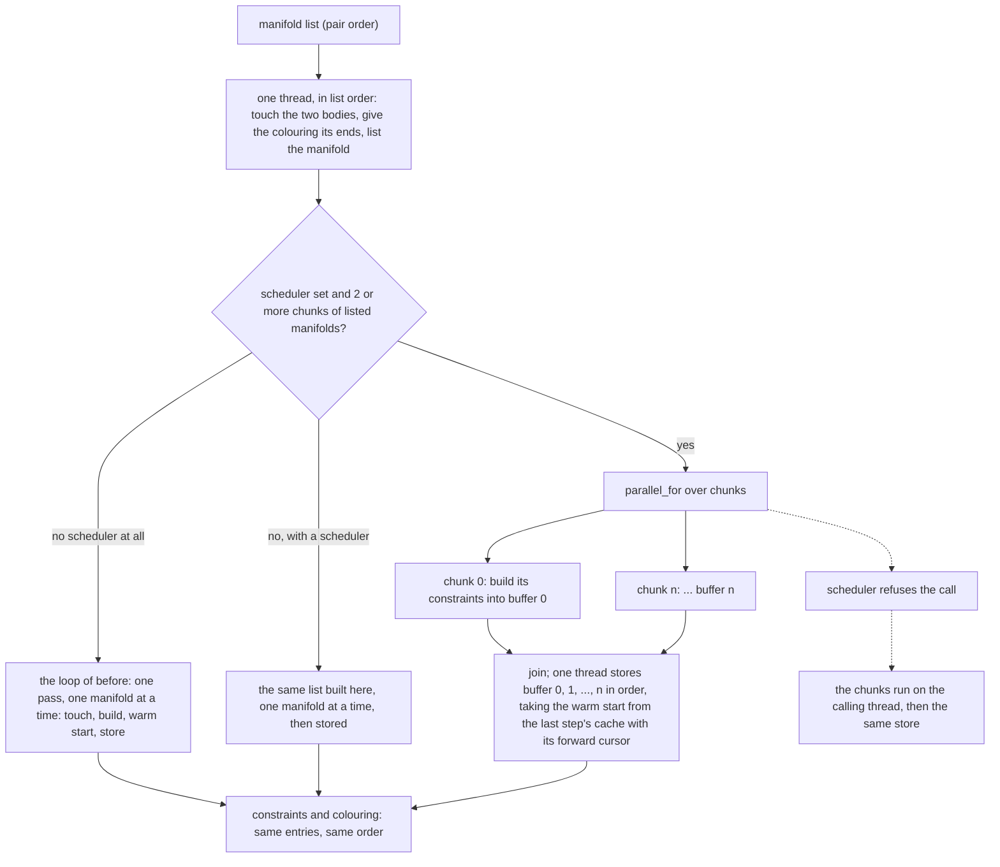

# Review 8-112: the constraints of a step are built through the scheduler; the 1,015-box pyramid with a pool of 4 is 0.7 to 1.0 ms faster in the median of alternated rounds (noisy, on a busy machine), the serial path is level, and the constraints are the same in every test and golden

Task: 8-112 (from 8-104). Class 2 (physics core, concurrency; no `unsafe`, no protected path, no new bound). Owner go-ahead: "Go on with follow-ups on the serial rest 8-112, 8-113, 8-114" (2026-11-28); this card is the third of the three. The card said to measure which part of preparing is independent before building; that measurement is the first table. Only the 3D solver is changed (the 2D solver has its own preparing, see Decisions).

In plain words: at the start of every step the solver turns each contact manifold into a constraint: it works out the contact frame, the effective masses along the normal and two tangents, the approach speed. That loop used one thread (card 8-22: about 1 ms of the serial rest on the large pyramid). Now, when the solver has a scheduler, the work is done in two parts. First, one thread walks the manifolds in order and touches the bodies (their solver copies are made in the order they are first met) and gives the colouring its list. Then the manifolds are cut into chunks of the solver's chunk size, each chunk builds its constraints into a buffer of its own, and one thread stores the buffers in chunk order, applying the warm start as it goes. **With 4 workers the median change of the large pyramid step is -0.7 to -1.0 ms (-0.86 ms in the last eight alternated rounds, of which only five were faster; the same scheduled path was faster in 27 of 34 rounds over four batches that are not independent trials), a modest and noisy result measured on a busy machine; without a scheduler the loop is the loop of before and the step is level (median -0.16 ms).**

## What was measured

The split of preparing (the question of the card). Method: a throwaway patch, reverted and not committed: clock reads around `prepare`, the colouring, the sub-steps and `finish` in `Solver3::solve`, and a copy of `prepare` that runs the touching, the building and the warm start and store as three separate loops, each timed. Release build, Windows, a pool of 4, 50 steps after 60 to settle, means a step, one run. The three-loop copy allocates two vectors a step, so the total of preparing here is higher than the serial loop's; the shares are the information.

| ms a step | large pyramid | 91-box pyramid | mixed pile (90 bodies) |
|---|---|---|---|
| step (instrumented; the parts below are those of `Solver3::solve`, the rest, about 1.2 ms on the large pyramid, is the world step outside the solver: pair search, contact tests, islands) | 10.56 | 1.37 | 0.41 |
| preparing, three-loop copy | 1.75 | 0.095 | 0.023 |
| of it: touching the bodies | 0.055 (3%) | 0.004 | 0.003 |
| of it: building the constraints | 1.108 (63%) | 0.059 | 0.011 |
| of it: warm start, colour list entry, store | 0.589 (34%) | 0.032 | 0.008 |
| colouring (`assign`) | 0.056 | 0.004 | 0.001 |
| sub-steps (the solve) | 7.34 | 1.17 | 0.24 |
| `finish` (keep impulses, write bodies back) | 0.174 | 0.011 | 0.004 |

So the part that is independent per manifold, building the constraint, is about 63% of preparing; the touching is 3%; the warm start with the store is a third (not split further). On the small scenes preparing is 0.02 to 0.1 ms: nothing to gain, and not claimed.

The speed. Method: a throwaway probe (a test file in the bench crate, deleted before the commit), release build, Windows, one laptop. The binary of `develop` (with 8-114) and the binary of this change were built from the same tree (the change stashed for the old one) and run alternately, the order swapped every other round. Each round is 60 steps to settle, then the minimum of 9 blocks of 10 steps, ms a step.

| final code, 8 alternated rounds | old (ms) | new (ms) | change per round (ms) |
|---|---|---|---|
| 1,015-box pyramid, pool of 4 | 20.25, 20.20, 19.85, 22.15, 10.05, 19.58, 20.07, 18.97 | 19.13, 19.45, 18.80, 18.81, 20.54, 20.25, 19.10, 19.93 | -1.12, -0.75, -1.05, -3.34, +10.49, +0.68, -0.97, +0.96 (median -0.86) |
| 1,015-box pyramid, serial (no scheduler) | 16.10, 15.73, 15.55, 15.83, 16.53, 15.62, 15.97, 16.20 | 15.55, 15.70, 15.73, 15.80, 15.58, 16.31, 15.56, 15.91 | -0.55, -0.03, +0.18, -0.03, -0.95, +0.69, -0.41, -0.29 (median -0.16; six of eight are lower and two higher: read as level) |
| 91-box pyramid, pool of 4 | 3.06, 3.06, 3.04, 3.12, 1.36, 2.98, 2.98, 3.07 | 3.04, 2.94, 2.97, 2.79, 3.11, 3.02, 2.89, 2.98 | median -0.08 (within the noise, not claimed) |
| mixed pile, pool of 4 | 0.57, 0.52, 0.69, 0.59, 0.34, 0.57, 0.66, 0.68 | 0.60, 0.71, 0.54, 0.56, 0.82, 0.56, 0.64, 0.93 | median +0.01 (noise, not claimed) |

In round 5 the old binary happened to run while the machine was quiet (10.05 ms, the 91-box and mixed figures drop with it) and the new one did not: that round (+10.49) is the machine, not the code, and the median does not move by it. The scheduled path was the same code in four batches of runs (10, 8, 8 and 8 rounds; the batches differ in the serial path, see Decisions, and in how a made constraint is handed to the store): the median change was -1.05, -0.84, -0.73 and -0.86 ms, and 27 of the 34 rounds were faster (9, 7, 6 and 5). The machine was busier than in the earlier cards (the large pyramid with 4 workers took about 20 ms here against 11 ms in 8-104 and 8-111 for the same code before this change), so the figures are not comparable with those cards, and 0.7 to 1.0 ms is about 4% of this slower step; the split above gives an upper bound: building takes 1.11 ms, of which three quarters (0.83 ms) would go with 4 workers if the work were shared perfectly, less a store and a hand-over that were not timed; the measured 0.7 to 1.0 ms is of that size, which is the only support for the figure on a quiet machine.

## What changed

| item | result |
|---|---|
| code | new `d3/solver/prepare_run.rs`: `PrepareRun` (the scheduler, the chunk and one buffer per chunk of the largest possible list, allocated once when the execution is set, built in `Solver3::set_execution`). `Solver3::prepare` now has two ways. With a run: `touch_manifolds` (serial: touch the bodies, give the colouring its ends, list the manifold index in the scratch `members`), then `make_constraints` (the chunks build into the buffers, the join stores them in order with the warm start). Without a run: the loop of before, `add_constraints`, one manifold at a time. The touching (`touch_ends`) and the building of one constraint (`build_constraint`, used by `Maker` in the chunks and by the one-pass loop) are shared, so there is one copy of each. The joints are unchanged (after the contacts, serial) |
| the same bits | building the constraint of one manifold reads the manifold, the two world bodies and the two solver bodies and writes nothing shared, so what a chunk makes depends on its manifolds only; the cut depends on the number of listed manifolds and the chunk size, never on the workers. Everything ordered stays on one thread: the first-touch order of the bodies (`touch`, which also makes the `active` list), the colouring list, and the warm start, whose cursor only moves forward through the previous step's cache in list order. The store is in chunk order, which is list order |
| floating-point state | each chunk takes `FpGuard::deterministic()`, as the other chunked jobs do; the calling thread already holds it for the whole solve |
| scratch and memory | `members` (a `u32` a manifold, allocated once). The buffers hold a constraint (384 bytes) and its manifold index: 392 bytes for each manifold of capacity, only when a scheduler is set: 0.39 MB per 1,000 manifolds of capacity, 39 MB for a capacity of 100,000, on top of the solver's own constraint array of the same size. The memory was computed from the size of the type, not measured as part of a run |
| tests | `colouring_tests.rs`: `the_constraints_are_made_through_the_scheduler_when_there_are_several_chunks_of_manifolds` (red before the change: the scheduler was not called; a chunk as wide as the widest colour so that no colour is cut in two and every call is the making of the constraints, only the solver gets the scheduler; no call for one chunk of manifolds). The older `the_staged_path_gives_the_bits_of_the_serial_reference` compares the state hash after every step of two scenes through the in-order, reversed and refusing schedulers at chunks 1, 3 and 1000 with the serial reference: it was green before and covers the new path, because the pool of the tests sets the same scheduler for the solver. Four unit tests in `prepare_run.rs` (no run without a scheduler, one buffer a chunk, a buffer no larger than the list, a single chunk or too many chunks declined and nothing made) |
| hand mutations | 12 tried on the final code, 10 killed: only the first buffer stored; buffers stored in reverse; no clear of a buffer; the single-chunk guard lowered to zero; a refusing scheduler ignored; the buffer room set to zero (killed by the unit test of the room); the softness of a static end swapped; the manifold not listed; the scheduled path never chosen; the warm start not applied. **Two survived:** the serial path always made in two passes (the same constraints, only slower: an equivalent mutant) and the check that the list is full made `>` instead of `>=` (unreachable: the manifold list holds at most the manifold capacity, which is the capacity of the constraints, so the cut never applies through a world; the same check was in the loop of before) |
| other tests | the unit tests of the crate (501) and every integration test of the `physics` crate (1,163 tests in all, 0 failed) pass on Windows, including the allocation tests (a step allocates nothing with a scheduler) and the determinism matrix; on Linux x86-64 (WSL2) the `physics` and bench crate tests pass; rustfmt and Clippy with warnings denied are clean |
| golden | unchanged: the 2D golden (12 scenes) and the 3D golden (5 scenes) recorded with `cross-platform-determinism` on Windows, and the 3D golden on Linux x86-64 (WSL2), are equal to the files |

## Decisions

1. Only the building of the constraints is made parallel. The touching of the bodies is 3% and defines the order in which solver bodies and the `active` list are made, so it stays serial. The warm start is a merge-walk with a forward cursor over the last step's cache; it could be made parallel (each chunk starting its cursor with a binary search, if the cache is known to be sorted), but its share was not separated from the colour list entry and the store (0.59 ms together), so it is a new card (8-117), not part of this change.
2. The serial path (no scheduler) keeps the loop of before, one manifold at a time, and shares only the touching (`touch_ends`) and the building (`build_constraint`) with the scheduled path. Two earlier versions sent the serial path through the shared `Maker` and `store_made` (first in two passes, then in one pass with an optional constraint and a tuple); the large pyramid on one thread was 0.3 ms slower with them (about 2%: 6 of 10, 8 of 8 and 7 of 8 alternated rounds slower, medians +0.28, +0.28 and +0.33 ms), and level with the loop of before (median -0.16 ms). The cause (copies of the 384-byte constraint, a second lookup of the ends) was not isolated. The two ways give the same constraints (the equivalence tests compare them; the "always two-pass" mutant is equal in output).
3. The chunk is the solver chunk (32 by default), as for the contact tests and the pair search; card 8-113 measured that a chunk of its own does not help.
4. The 2D solver has its own preparing and is not changed (new card 8-118); the 2D world reaches the scheduler for its pair search and contact tests through the shared core already.

## Not verified

- One laptop, Windows, a busy machine (the same code ran 20 ms against 11 ms in the earlier cards); the figures are of that slower step. The size of the saving on a quiet machine is bounded from the split (at most 0.83 ms), not measured.
- The split in the first table is one instrumented run with the clock reads and two allocating vectors in the three-loop copy; the shares, not the totals, are used. The 1.0 ms of card 8-22 was not re-measured on the serial loop.
- The scheduled path is tested against the serial one through three schedulers that run the chunks on the calling thread (in order, reversed, refusing) and the bench pool of 4 in the older parallel tests; no new test runs the chunks on real threads at several pool sizes.
- No test of the scheduled path has the list of made manifolds differ from the manifold list (a manifold of a missing body, or the capacity cut): through a world neither can happen, and the one-pass loop has the same checks. A mutation that listed the position instead of the manifold index would probably survive.
- The 91-box pyramid and the mixed pile are not claimed (preparing is 0.02 to 0.1 ms there).
- The memory of the buffers was computed from the size of a constraint, not measured; a world with a large manifold capacity pays 392 bytes a manifold with a scheduler.
- That a step with a pool is bit-identical at every pool size: tested with the in-order, reversed and refusing schedulers and the bench pool of 4 (the `d3_parallel` and determinism tests), not with every size.
- The warm start uses a cursor into a cache that is in list order, by the existing design; this change does not depend on that beyond what the serial loop already did (the same store order).
- ARM64 not run; no hosted `ci`; Miri, coverage and mutation tools not run; the figures and test counts are from the author's runs (the reviewer re-derived the arithmetic, not the runs).
- Mermaid read by the author, not rendered.

## R1 to R8

| phase | result |
|---|---|
| R1 self | both probes were removed before the commit; the diff is `prepare_run.rs`, `d3/solver/mod.rs`, the test and this report |
| R2 automated | rustfmt, Clippy with warnings denied (nesting and an argument count forced the helpers and `touch_ends`), the crate tests on both platforms, the goldens |
| R3 independent | one read-only review, no blocker and no major; minors and nits fixed or stated (Loops) |
| R4 QA | an oracle against the serial reference through three schedulers and three chunk sizes, a scheduler-reached test (red before), twelve hand mutations (ten killed, one equivalent, one unreachable), alternated A/B of the old and the new binary in four batches |
| R5 architecture | one new private module; no new dependency; no interface change |
| R6 security | no `unsafe`, no input from outside; a poisoned lock is read as it is (a panic aborts) |
| R7 performance | measured above: about 0.7 to 1.0 ms of the large pyramid step with 4 workers on a busy machine; serial level; the warm start and the store are the serial rest of preparing (card 8-117) |
| R8 product fit | the first serial piece of 8-98 that the 8-104 report listed (preparing the constraints) is now partly parallel; the warm start and the 2D solver are cards |

## Loops

| loop | finding | handling |
|---|---|---|
| 1 | minor: the mermaid sent "no" to the loop of before although a scheduler with fewer than two chunks makes the list in two passes | the diagram has both branches |
| 1 | minor: headline stated 0.7 to 1.0 ms as a win with five of eight rounds faster; "same bit for bit" from two scenes and the goldens | headline and title hedged: median of alternated rounds, noisy, busy machine; "the same in every test and golden" |
| 1 | minor: the equivalence tests never make the listed manifolds differ from the list; no test on real threads | stated in Not verified |
| 1 | nit: 0.65 ms not derivable, 1.2 ms of the step unaccounted, four rounded deltas, the `.all(...)` used for its effect | the bound 0.83 ms derived, the world step outside the solver named, deltas corrected; the `.all(...)` is kept because the nesting limit of Clippy forbids a loop with a break there |
| 0 | two earlier versions of the serial path (through the shared maker and store) were 0.3 ms slower in 21 of 26 alternated rounds | the serial path keeps the loop of before; the shared parts are `touch_ends` and `build_constraint` |
