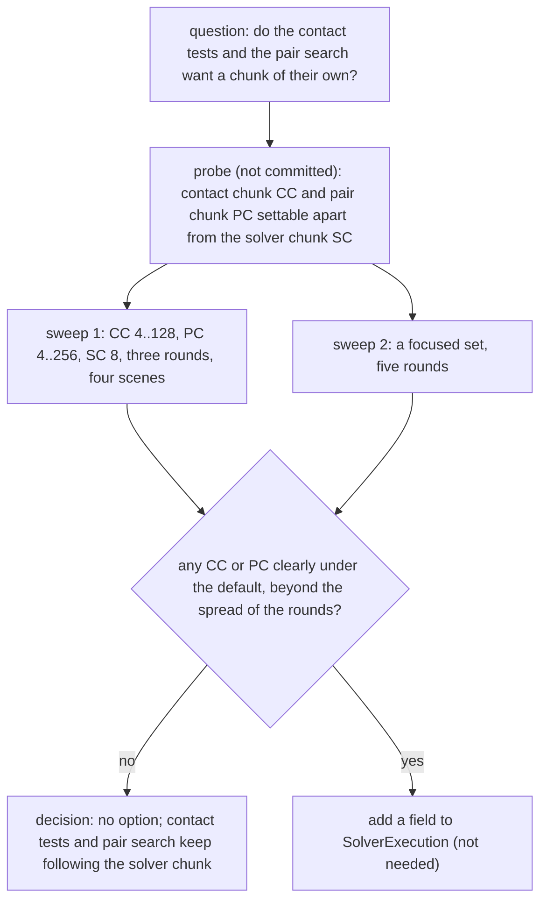

# Review 8-113: a chunk size of its own for the contact tests and the pair search does not beat the solver chunk (32); no setting is better than the default by more than the spread between runs, so no option is added

Task: 8-113 (from 8-104). Class 1 here (measurement and a report; no engine code, no probe committed). Owner go-ahead: "Go on with follow-ups on the serial rest 8-112, 8-113, 8-114" (2026-11-28). The card asked to measure the best chunk of the contact tests (and, since 8-111, of the pair search) on the 3D scenes and 2D W1 before adding any option. The answer is that there is nothing to add.

In plain words: since 8-104 and 8-111 the contact tests and the pair search both cut their work into chunks of the same size as the solver's chunk (32 by default). The card's question was whether they would do better with a size of their own, since a pair test costs something different from a constraint solve. A throwaway probe set the two chunk sizes separately and swept them from 4 to 256 on four scenes with 4 workers, in alternated rounds. **No setting beat the default by more than the 0.3 to 0.6 ms that the same setting varies from one round to the next; the solver chunk of 8 is still the only lever that shows (it is card 8-106's question, and its answer stands).** So no new option, no new field, no code change.

## What was measured

Method: a throwaway probe, not in the repository: two lines that read the contact chunk (`DU_CC`) and the pair-search chunk (`DU_PC`) from the environment in `ContactRun::new` and `PairRun::new`, reverted before the commit, and a test file in the bench crate (deleted) that sets the solver chunk (`DU_SC`) and times four scenes with a pool of 4 workers: the 1,015-box pyramid, the 91-box pyramid, the mixed pile (90 bodies) and the 2D W1 pyramid of 32 rows (528 boxes). Release build, Windows, one laptop. Each run of the probe is 60 steps to settle then the minimum of 9 blocks of 10 steps (2D: the minimum of the step times of `measure_w1`, 40 steps, 6 iterations). The configurations were run alternately, in a rotated order each round. The code is that of `develop` with 8-114.

Sweep 2 (five rounds; median of the rounds, minimum in brackets, ms a step; the default is `base`: all three chunks 32):

| configuration | 1,015-box pyramid | 91-box pyramid | mixed pile | 2D W1, 32 rows |
|---|---|---|---|---|
| base (all 32) | 9.70 (9.52) | 1.344 (1.255) | 0.326 (0.316) | 1.236 (1.213) |
| contact chunk 8 | 9.85 (9.68) | 1.363 (1.285) | 0.331 (0.312) | 1.271 (1.233) |
| contact chunk 64 | 9.99 (9.49) | 1.319 (1.296) | 0.318 (0.316) | 1.267 (1.210) |
| pair chunk 4 | 9.97 (9.82) | 1.310 (1.231) | 0.333 (0.327) | 1.269 (1.214) |
| pair chunk 128 | 9.96 (9.44) | 1.374 (1.301) | 0.348 (0.319) | 1.289 (1.224) |
| solver chunk 8 (the others follow it: 8) | 9.41 (9.23) | 1.124 (1.111) | 0.313 (0.300) | 1.238 (1.194) |
| solver chunk 8, contact chunk 32 | 9.49 (9.34) | 1.125 (1.048) | 0.346 (0.342) | 1.167 (1.158) |
| solver chunk 8, pair chunk 32 | 9.51 (9.26) | 1.120 (1.064) | 0.326 (0.318) | 1.167 (1.148) |

The rounds of the default on the large pyramid were 9.70, 9.60, 9.52, 9.95, 10.09: the same configuration spans 0.57 ms from round to round.

Sweep 1 (three rounds; the other chunk sizes; minimum of the rounds in ms, large pyramid): base 9.38; contact chunk 4 / 8 / 16 / 64 / 128: 9.39 / 9.73 / 9.65 / 9.58 / 9.75; pair chunk 4 / 8 / 16 / 64 / 128 / 256: 9.61 / 9.96 / 9.78 / 9.82 / 9.69 / 9.81. The default spanned 9.38 to 9.77 over its three rounds (0.39 ms). On the other three scenes no value of either chunk was better than the default by more than the spread of its rounds either (91-box pyramid: default 1.25 to 1.34, contact 64 1.20 to 1.34, pair 256 1.25 to 1.33).

## What was found

| item | result |
|---|---|
| a chunk of its own for the contact tests | none of 4, 8, 16, 64, 128 beats 32 by more than the spread of the rounds; on the large pyramid every median is at or above the default's (9.85 and 9.99 against 9.70 in sweep 2) |
| a chunk of its own for the pair search | the same: 4, 8, 16, 64, 128, 256 are level with or above 32 on the large pyramid (medians 9.96 to 9.97 against 9.70 for 4 and 128 in sweep 2), and mixed or level on the other scenes |
| the solver chunk | 8 against 32: the large pyramid 9.41 against 9.70 (median, -3%), the 91-box pyramid 1.124 against 1.344 (-16%), the mixed pile and the 2D pyramid level (0.313 against 0.326; 1.238 against 1.236). This is the finding of 8-106 again (no chunk is best for every scene) and is not new |
| does the contact or pair chunk explain the gain of chunk 8 that the card quoted (0.4 to 0.7 ms after 8-104) | not separately: with the solver chunk at 8 and the contact (or pair) chunk put back to 32 the large pyramid is 9.49 (9.51) against 9.41, a difference of 0.1 ms, below the spread of the rounds. At most about 0.1 to 0.2 ms of the 0.3 ms that chunk 8 gains here could be due to those two, and that is not established. The 0.4 to 0.7 ms of 8-104 moved all three chunks together and was one set of runs; it is not reproduced here |
| the 2D pyramid | one sweep showed 6% from solver chunk 8 with the pair or contact chunk at 32 (1.167 against 1.236); in sweep 1 solver chunk 8 alone gave 1.15 against 1.22 for the default, in sweep 2 it gave nothing (1.238 against 1.236). The two sweeps disagree, so it is noise at the level of 0.1 ms and is not claimed (card 8-116) |
| the unmeasured costs of the card | the buffers of the contact tests (up to `max_pairs` manifolds) and the serial store were not timed separately: the sweep shows that the total does not move with the chunk, so a different chunk would not change them in a way this probe can see |

## Decisions

1. No option is added and no field of `SolverExecution` changes (it would be public API for no measured gain). The contact tests and the pair search keep following the solver chunk.
2. The solver chunk stays as 8-106 left it (32 by default, a choice for the application).
3. The adaptive chunk (card 8-110) is the place for any later per-scene choice; this card gives it no new input except that the contact and pair chunks need not be considered apart.
4. One Backlog card is opened for the open point of the 2D pyramid (8-116).

## Not verified

- One laptop, Windows; the machine was not idle. The rounds of the same configuration spread by 0.4 to 0.6 ms on the large pyramid (5%), so a gain of under about 5% on that scene could not be seen. A chunk that gains 2% to 3% is not excluded; it is not shown.
- 4 workers only. Two workers, 8 workers, and a second machine were not tried; the chunk that is best differs with the pool in the earlier cards (8-98, 8-106).
- Four scenes only: the large and small pyramid, the mixed pile and the 2D pyramid of 32 rows. A pile of spheres, a scene with convex hulls and joints, and the 2D scenes of other sizes were not swept.
- The sweeps vary one chunk at a time (plus the solver chunk with one of them put back to 32); combinations such as contact 8 with pair 64 were not run.
- The probe patch itself (an environment variable read in two constructors) was reverted and is not in the commit; the figures are from the author's runs and the reviewer re-derived the arithmetic, not the runs.
- Linux, ARM64, hosted `ci`. No code changed, so no golden or test was run for the card beyond the local gates.
- Mermaid read by the author, not rendered.

## R1 to R8

| phase | result |
|---|---|
| R1 self | the probe patch and the probe test were removed before the commit; the diff is this file only |
| R2 automated | no code change: the local gates run in the PR |
| R3 independent | see the Loops table |
| R4 QA | two sweeps, alternated and rotated, five and three rounds, four scenes; the spread of the default is given next to every comparison |
| R5 to R7 | none (no code) |
| R8 product fit | the open point of 8-104 is answered with a measurement: no option; one card for the 2D point |

## Loops

| loop | finding | handling |
|---|---|---|
| 0 | the first sweep could not separate chunk 8 on the large pyramid from the spread | a second, focused sweep of five rounds was run before the conclusion |
