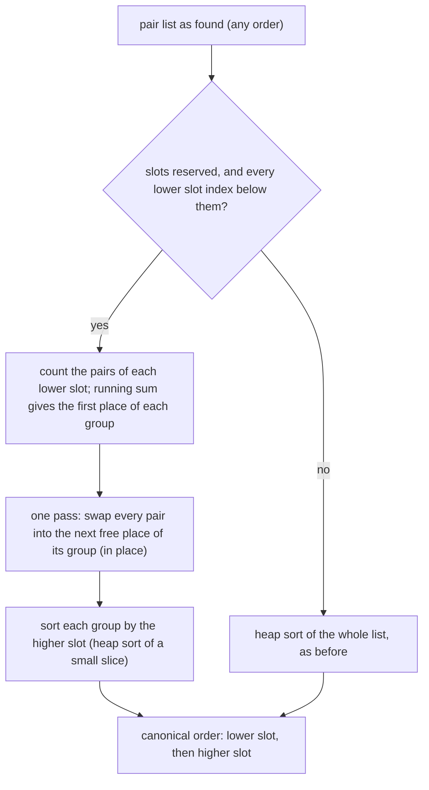

# Review 8-114: the pair list is sorted by a counting sort instead of the heap sort; the 1,015-box pyramid step is about 4% faster on one thread and about 7% faster with a pool of 4 on a busy machine, the sorted list is the same bit for bit

Task: 8-114 (from 8-111). Class 2 (physics core, determinism; no `unsafe`, no protected path, no new bound). Owner go-ahead: "Go on with follow-ups on the serial rest 8-112, 8-113, 8-114" (2026-11-28); this card is the first of the three. The sort is the same on every path (with or without a scheduler), so the gain is not limited to a pool.

In plain words: after the pair search the list of overlapping bodies has to be put in one canonical order, lower slot first and then higher slot. That was a heap sort of the whole list on one thread (0.44 ms of 11.2 ms on the large pyramid, card 8-111). Now the list is sorted in two cheap steps: count how many pairs each lower slot has and move every pair to its place in one pass (in place, no copy of the list), then sort each small group by its higher slot. The keys are unique, so the order is total and it is the same list as before. **The scratch is two counters per slot (8 bytes a slot, allocated once); the step of the large pyramid was faster in every one of six alternated rounds, by 0.1 to 1.6 ms on one thread and by 0.7 to 2.0 ms with 4 workers, on a machine that was slower than in the earlier cards.**

## What was measured

Method: a throwaway probe, not in the repository (a test file in the bench crate, deleted before the commit), release build, Windows, one laptop. The binary of `develop` (with 8-111) and the binary of this change were built from the same tree (the change stashed for the old one) and run alternately, six rounds; each round is 60 steps to settle, then 9 blocks of 10 steps, minimum of the blocks, ms a step. The scene is the 1,015-box pyramid of the bench crate with sleeping off.

| 1,015-box pyramid | old, minimum of each round (ms) | new, minimum of each round (ms) | change per round (ms) |
|---|---|---|---|
| serial (no scheduler) | 16.96, 16.55, 17.35, 15.83, 15.86, 16.31 | 15.71, 15.74, 15.79, 15.74, 15.61, 15.88 | -1.25, -0.81, -1.56, -0.09, -0.26, -0.43 (mean -0.73, about 4.5%) |
| pool of 4, chunk 32 | 20.35, 21.59, 21.59, 20.55, 20.68, 22.29 | 19.10, 19.58, 19.61, 19.83, 19.12, 20.52 | -1.25, -2.01, -1.98, -0.72, -1.56, -1.77 (mean -1.55, about 7.5%) |
| 91-box pyramid, pool of 4 | 3.18, 3.06, 3.07, 2.87, 3.03, 2.96 | 3.00, 3.04, 2.95, 2.94, 2.87, 2.98 | -0.18, -0.02, -0.12, +0.07, -0.16, +0.02 (within the noise, not claimed) |

The machine was slower during these runs than in cards 8-104 and 8-111 (the large pyramid with 4 workers took about 20 ms here against 11 ms there, for the same code before this change), so these figures are **not** comparable with the earlier cards and the percentages are of a slower step. The expected saving from card 8-111 was 0.44 ms (the heap sort of the whole list); the serial figure, 0.1 to 1.6 ms with a mean of 0.7 ms, brackets it, and the pool figure, a mean of 1.5 ms, is larger than the sort alone: the part above 0.44 ms is not explained (a busy machine, or a cache effect of the sort on the pooled path), so the size of the pool gain is a measurement, not an explained one. The direction is the same in all twelve rounds of the two lines.

## What changed

| item | result |
|---|---|
| code | `core/pairs.rs`: `PairList` holds `Buckets` (`starts`, the first place of each lower slot index, and `heads`, the next free place in each group), allocated once by `reserve_slots(max_bodies)`, which `Broadphase::new` calls. `sort` tries `sort_by_counting` and falls back to the heap sort when no slots are reserved or a pair has a lower slot index the scratch has no room for. The heap sort stays in `core/sort.rs`, unchanged, and is also used inside each group (by the higher slot) |
| the same order | the key of a pair is (lower slot, higher slot) and no two pairs share it (a body pair is stored once), so the sorted order is unique: any correct sort gives it. The counting sort puts every pair in the group of its lower slot (the groups are in slot order, because `starts` is a running sum of the counts) and the sort inside a group is by the higher slot, so the result is that order. Nothing in the order depends on the workers, the addresses or a hash |
| scratch | `starts` (slots + 1) and `heads` (slots), `u32` each: 8 bytes a slot, 8 KB for 1,000 slots; nothing grows during a step (the allocation tests of the crate still pass) |
| no copy of the list | the pairs are moved by swaps into the next free place of their group (an in-place permutation); a pair that is already in its group is swapped with itself, so there is no branch for it. A copy of the list (up to `max_pairs` pairs) was not chosen, to keep the memory of the world as it was |
| tests | `pairs.rs`: `the_counting_sort_gives_the_order_of_the_standard_sort_for_every_size` (random lists of distinct pairs, 5 slot counts, 4 list sizes each, compared with the standard stable sort on the same pairs), `one_bucket_holding_most_of_the_pairs_is_sorted_by_the_higher_index` (a ground body in slot 0 with 39 bodies on it, in reverse), `a_pair_above_the_reserved_slots_falls_back_to_the_heap_sort`, `without_reserved_slots_the_list_is_sorted_by_the_heap_sort`, `a_list_is_sorted_again_after_it_is_cleared_and_refilled` (the counters are reset), `an_empty_list_and_a_zero_capacity_list_are_sorted`. `world.rs`: `the_pair_list_of_a_world_has_room_for_the_counting_sort_of_every_slot` and `a_world_with_the_ground_in_a_low_slot_and_bodies_above_it_finds_the_sorted_list`. The tests were written together with the code, not one red at a time: the order tests are characterisation tests (the heap sort passes them too), and the red evidence is that the functions they call did not exist and the hand mutations below |
| hand mutations | 9 tried on the final code form of the time, one of them equivalent: the counts not cleared; counted one slot too low; the first places not copied to the heads; always swap (equivalent: swapping a pair with itself does nothing, so the `if` it removed was dead code and is gone); the head of the target group not advanced; the groups not sorted; the counting path never taken; the groups sorted by the lower slot; the slots not reserved in `Broadphase::new`. The other eight are killed by the new tests |
| other tests | the unit tests of the crate (496) and every integration test of the `physics` crate pass on Windows, including the allocation tests and the determinism matrix; on Linux x86-64 (WSL2) the `physics` and bench crate tests pass; rustfmt and Clippy with warnings denied are clean |
| golden | unchanged: the 2D golden (12 scenes) and the 3D golden (5 scenes) recorded with `cross-platform-determinism` on Windows, and the 3D golden on Linux x86-64 (WSL2), are equal to the files |

## Decisions

1. In place, with two counters a slot, not a second buffer of pairs. A two-pass radix sort (by the higher slot, then by the lower one) is simpler to argue but needs a copy of the list; the in-place form keeps the memory of the world unchanged except 8 bytes a slot.
2. The group sort is the existing heap sort on a small slice, not an insertion sort. A group is the pairs of one lower slot, about 7 on the large pyramid, but a ground body in a low slot with a thousand bodies on it makes one group of a thousand; a heap sort bounds that group at `n log n` where an insertion sort would not. Whether a cheaper sort for the small groups wins was not measured (card 8-115).
3. The fallback to the heap sort is silent (a world built without the reserved slots, or a slot index above them, cannot happen through `World`, but `PairList` is a public type with its own `new`). The test of the world asserts the slots are reserved, so a missing reserve is red.

## Not verified

- One laptop, Windows, a busy machine (the same binary of `develop` took about 20 ms with 4 workers against 11 ms in the earlier cards); the percentages are of that slower step and the pool gain is larger than the 0.44 ms the heap sort was measured to cost, for a reason that was not found.
- The sort alone was not timed, on any list size: only the whole step of three scenes. Whether the counting sort is faster than the heap sort for every list size (the card asks for it) is not established; for a very small list it adds a pass over `slots` counters, which was not measured.
- The 91-box pyramid is not claimed (the six rounds spread more than the change); the mixed pile and the 2D scenes were not timed.
- The test counts, the mutations and the timings are from the author's runs; the reviewer re-derived the arithmetic, not the runs.
- A pile where one lower slot holds most of the pairs (a ground body with a thousand bodies on it) sorts that group by a heap sort; its cost was not measured.
- ARM64 not run; no hosted `ci`; Miri, coverage and mutation tools not run.
- Mermaid read by the author, not rendered.

## R1 to R8

| phase | result |
|---|---|
| R1 self | the probe test was deleted before the commit; the diff is `pairs.rs`, `broadphase.rs` (the reserve), `world.rs` (two tests) and this report |
| R2 automated | rustfmt, Clippy with warnings denied (nesting, an unstable sort in the tests and two casts forced the helpers and the stable sort), the crate tests on both platforms, the goldens |
| R3 independent | see the Loops table |
| R4 QA | an oracle against the standard sort, a one-group case, a fallback case, nine hand mutations (eight killed, one equivalent and removed), alternated A/B of the old and the new binary in six rounds |
| R5 architecture | no new module, dependency or interface; one private scratch type; `PairList::new` is unchanged |
| R6 security | no `unsafe`, no input from outside; the indexing in the permutation is bounded by the counts built from the same list in the step before (a wrong count would panic, which aborts, not corrupt) |
| R7 performance | measured above: about 4.5% of the serial step and about 7.5% with 4 workers, on a busy machine; the sort alone not timed |
| R8 product fit | the second piece of the serial rest of 8-98 (the pair search) is now fully through the cheap path; the preparing of the constraints (8-112) remains |

## Loops

| loop | finding | handling |
|---|---|---|
| 0 | the always-swap mutant survived | equivalent (a self-swap), the dead branch removed |
