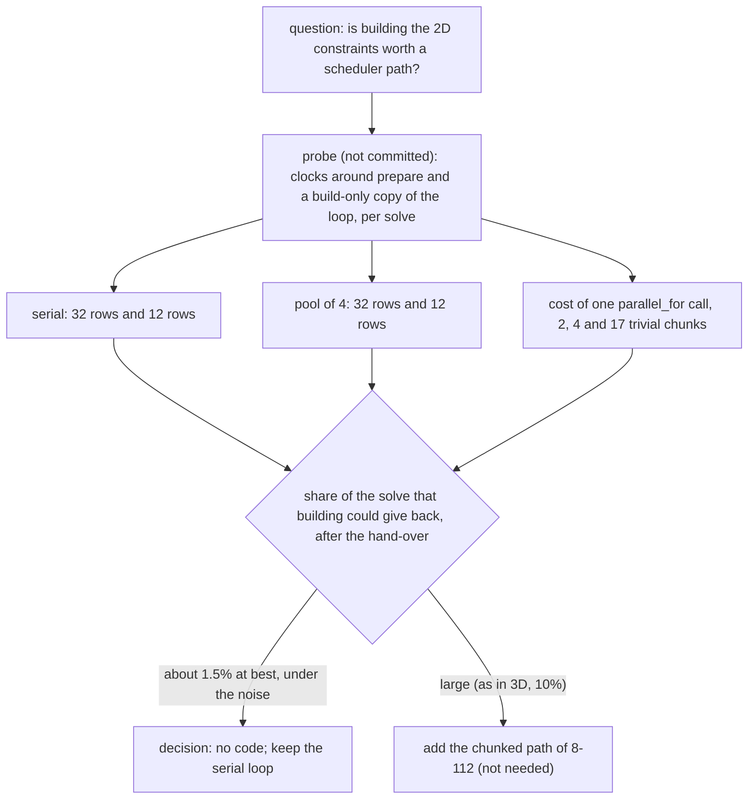

# Review 8-118: building the constraints of a 2D step is 5% of a serial solve and 2% of a pooled one (about 37 and 25 microseconds on the 528-box pyramid); sharing it among 4 workers could save at most about 18 microseconds, so no scheduler path is added

Task: 8-118 (from 8-112). Class 1 here (measurement and a report; no engine code, no probe committed). Owner go-ahead: "8-118" (2026-11-28). The card asked to measure first which share of the 2D W1 step is preparing and how much of it is independent per manifold, and to apply the pattern of 8-104, 8-111 and 8-112 only if the share justified it. It does not.

In plain words: in 3D, building the constraints of a step took 1.1 ms of a 10.6 ms step, so cutting it into chunks for the workers (8-112) was worth a try. The 2D solver has the same loop (one pass over the manifolds that touches the two bodies, builds the constraint and takes the warm start), but the 2D constraints are much cheaper to build and the pyramid is smaller: on the 32-row pyramid (528 boxes, 1,520 manifolds) building them takes about 37 microseconds with no scheduler and about 25 microseconds with a pool of 4, out of a solve of 0.66 and 1.2 milliseconds. Even if 4 workers took three quarters of that away, the gain would be about 18 microseconds, 1.5% of the solve, which is below the noise of every timing in this series (about 5%); even if the whole of preparing could be shared (see below) the bound is 5% to 7%. **So no code is added.** A scheduler hand-over itself is cheap here (about 1 microsecond a call), so the reason is the small share, not the cost of the pool.

## What was measured

Method: a throwaway probe, not in the repository: clock reads around `Solver2::prepare`, around a second loop that only builds the constraints (a copy of `add_constraint` without the colouring, the warm start and the store, run after the real one, so its inputs are warm in the cache), around `Colouring::assign`, the sub-steps and `finish`, summed over 100 solves and printed; a test file in the bench crate (deleted) that runs the W1 pyramid for 500 steps, sleeping off, in the release build on Windows, one laptop that was busy. The table is the average of the last four prints of 100 solves each (the first print includes the settling). The pool is the work-stealing pool of 4 of the bench crate, chunk 32.

| microseconds per solve (means of the prints) | serial, 32 rows | pool of 4, 32 rows | serial, 12 rows | pool of 4, 12 rows |
|---|---|---|---|---|
| manifolds per step | 1,520 | 1,520 | 210 | 210 |
| preparing (touch, build, warm start, store) | 48.4 | 58.6 | 7.2 | 7.2 |
| of it, the build-only copy of the loop | 37.5 | 24.6 | 5.3 | 3.7 |
| colouring (`assign`) | 10.5 | 12.1 | 1.6 | 1.8 |
| sub-steps (the solve) | 579.9 | 1,111.0 | 82.9 | 268.8 |
| `finish` | 21.1 | 21.7 | 3.2 | 3.2 |
| whole solve (the probe's total less the build-only copy it added) | 660 | 1,204 | 95 | 281 |
| building as a share of the solve | 5.7% | 2.0% | 5.6% | 1.3% |
| most that 4 workers could take away (three quarters of the build, before the store and the hand-over) | 28 (4.3%) | 18 (1.5%) | 4.0 (4.2%) | 2.8 (1.0%) |

The 32-row columns are the means of the last four prints, the 12-row columns of five. The probe's own total included the build-only copy it adds (37.5 and 24.6 microseconds on 32 rows), which is why the parts of the first version of this table did not add up to its total; the whole solve above is the total less that copy (the parts then sum to it within 1 microsecond).

The median step of the pooled runs was 1,383 microseconds (32 rows) and 303 microseconds (12 rows) in the same runs. The cost of one `parallel_for` call with trivial chunks, best of 20 batches of 200 calls: 0.7 microseconds for 2 and for 4 chunks, 1.3 microseconds for 17 chunks (the 32-row pyramid has about 48 chunks of 32 manifolds, so the call itself is not the cost; the buffers and the serial store, which 8-112 needed in 3D, were not built here).

## What was found

| item | result |
|---|---|
| the share of preparing | 7% of the serial solve and 5% of the pooled one on the 32-row pyramid (48 and 59 microseconds); the part that is independent per manifold in the pattern of 8-112, the building, is 37 and 25 microseconds of it. The rest (touching the bodies, the colouring list, the warm start cursor, the store) is 11 microseconds by subtraction in the serial run; the 34 of the pooled run is the same serial code and cannot be a real difference, so it shows how far two runs of this probe spread (10 to 20 microseconds, the size of the quantity measured), and the pooled shares are shares of a differently loaded machine |
| independent per manifold | yes by reading the code: `Constraint::new` reads the manifold and the two solver bodies (which the touching has already set up) and writes nothing shared; `add_constraint` also reads friction and restitution of the two world bodies. What is ordered in `add_constraint`: the touching of the bodies (the order of `active`), the colouring list, the cut at `max_constraints` and the skipping of a manifold with a missing body (which shifts the indices of the ones after it), and the warm start cursor (`WarmCache::find` walks the cached manifolds, sorted by pair, forward as the manifold list is sorted by pair; the match of the points of a manifold by feature id, `warm_from`, is independent per manifold). So the pattern of 8-112 would apply, with the cursor and the store on one thread. It is not worth applying |
| the best case | about 28 microseconds (a serial run with the building shared by 4 workers) and about 18 microseconds (pooled), 1.0% to 4.3% of the solve, before the serial store of the buffers and the one hand-over; the three quarters is an estimate, not a limit (in 8-112 the measured gain was 0.86 ms of 1.1 ms, 78%). The cursor is not a hard limit either: the cached manifolds are sorted by pair, so a binary search per manifold would give the same result and make the warm start independent too, which would move the bound to the whole of preparing less the touching (up to 48 and 59 microseconds, 7% and 5% of the solve), at the price of a different warm start code. Even that is at the edge of the noise, so it is not pursued; 3D's equivalent was 1.1 ms of 10.6 ms (10%) |
| the cost of the pool call | about 1 microsecond: it does not decide the question |
| the 2D pool on this machine | the pooled solve is slower than the serial one in these runs (1,204 against 660 microseconds on 32 rows, 281 against 95 on 12 rows; the sub-steps differ, and the preparing of the same serial code differs by about 10 microseconds between the two runs, which is the spread of the probe). This is the same sign as the pool being slower than serial in the 3D runs of 8-114 on this machine, and it is probably the busy machine and the small colours, but it was not investigated: a different question from this card (Backlog card 8-120) |

## Decisions

1. No scheduler path for the 2D constraints, no new option, no change to `d2/solver`. If a later change makes the 2D sub-steps much cheaper, so that preparing becomes a larger share, this measurement can be repeated with the same probe.
2. The 2D pool slower than serial is recorded as an open point with its own card (8-120), because the answer needs a quiet machine.
3. The pattern files of 8-112 (`prepare_run.rs` and the `Maker` split) are not copied to 2D.

## Not verified

- One laptop, Windows, a busy machine; the pooled runs are the slow ones (the pool slower than serial), so the pooled shares are shares of a slow solve. On a quiet machine the sub-steps may be shorter and the building share larger; with the serial figure (5.7%) as the upper bound for the share, the best case is about 4% of the solve.
- The build-only loop is a copy run after the real one, with its inputs in the cache, so it may under-state the first, cold, build; the whole preparing (48 microseconds serial) bounds it from above.
- Two scenes only (the pyramids of 32 and 12 rows). A 2D scene with more points per manifold, joints or circles was not measured.
- The 100-solve averages come from one run of each configuration; no alternation of runs was done, because the answer is a share an order of magnitude below any gain that could be told apart.
- ARM64, Linux and hosted `ci` were not run (no code changed); the local gates run in the PR.
- The probe patch itself (clock reads in `Solver2::solve`, a copy of the building loop) was reverted and is not in the commit; the figures are from the author's runs. Mermaid read by the author, not rendered.

## R1 to R8

| phase | result |
|---|---|
| R1 self | the probe patch and the probe test were removed before the commit; the diff is this file only |
| R2 automated | no code change: the local gates run in the PR |
| R3 independent | one read-only review, no blocker and no major; four minors and three nits fixed or stated (Loops); the arithmetic recomputed from the raw prints |
| R4 QA | serial and pool, two sizes (four prints of 100 solves on 32 rows, five on 12 rows), the hand-over cost measured apart |
| R5 to R7 | none (no code) |
| R8 product fit | the open point of 8-112 is answered with a measurement: no 2D path; one card for the pool being slower than serial |

## Loops

| loop | finding | handling |
|---|---|---|
| 1 | minor: the whole solve was the probe's total, which included the build-only copy it adds, so the parts did not add up (25 to 38 microseconds short) and the shares were slightly low | the whole solve is the total less the copy; shares and bounds recomputed (5.7%, 4.3%) |
| 1 | minor: the 12-row columns matched neither the mean nor the median of their prints | means of the five prints everywhere, said in the text |
| 1 | minor: "`Constraint::new` reads the world bodies" and "`WarmCache::find` matches by feature id" were wrong | `add_constraint` reads the world bodies; `find` is a cursor over pairs and `warm_from` matches the features |
| 1 | major-ish (harmless to the decision): "the cursor stays serial in any design" and "at most three quarters" were overstated | worded as the pattern of 8-112; the binary-search option and its bound (5% to 7%) stated; three quarters called an estimate |
| 1 | minor: "the preparing does not differ" between the serial and the pooled run was false (48 against 59), and 11 against 34 microseconds for the same code is not a real difference | said so: the spread of the probe is 10 to 20 microseconds |
| 1 | minor: the other order dependence of `add_constraint` (the cap, a skipped manifold, the order of `active`) was missing | listed |
| 1 | nit: R3 and R4 rows | filled; card 8-120 carries the corrected figures |
