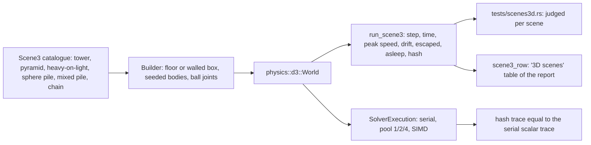

# Review 8-12: 3D stability, determinism and bench scenes

Task: 8-12. Class 1 (tests and a bench scene list in the dev-time tool `tools_physics_bench`; no engine code, no `unsafe`, no new dependency, no governance file). Ordinary card into `develop`. Loops: 1 fix loop (1 independent review, no blocker).

Delivers: `tools_physics_bench::scene3d`, a catalogue of six 3D scenes, each judged by what it must do and each with a replay hash; a "3D scenes" table in the bench report; tests that run every scene and replay it at 1 and N threads.

## Decisions

1. **Judged by kind.** Standing scenes (tower, pyramid, heavy-on-light) must move less than 0.05 m after step 100 and end at rest, awake and with sleeping on. Piles must not leave the box and must be settling (under 0.25 m/s at step 800). The chain must keep each link's two held points within 5% of a link length and must swing.
2. **Rolling resistance stand-in.** The solver has no rolling resistance, so a sphere on a flat floor rolls for a very long time. The pile bodies get angular damping 2 per second; with it the sphere pile sleeps by step 800 (tested). Without it, 400 steps left 0.4 m/s.
3. **The mixed pile is only "settling".** One capsule rocks at about 0.1 m/s for thousands of steps. In a one-off probe it was seen to sleep at about step 3600; no test asserts that. The pile test asks for under 0.25 m/s at step 800 and no escape. This is looser than the rest speed (0.02 m/s) used for the standing scenes, on purpose and stated here. Whether the rocking is a solver weakness (capsule contact) is an open question for the owner; it is not fixed here.
4. **Replay.** Every scene: same final hash twice; hash trace every tenth step equal to the serial scalar trace on the work-stealing pool at 1, 2 and 4 workers and with SIMD on at each. The small scenes fit one chunk, so worker count matters little there; the pyramid and piles are the real test.
5. **No registration.** Registering the 3D benchmarks and any golden hashes is card 8-13 (governance); nothing in `gates/` changed.
6. **Scene numbers are constants** with names; `Scene3::bodies()` is computed from the same constants that build the scene.

## Evidence

- Tests written first against the planned API (red: did not compile), then the catalogue. `cargo test -p tools_physics_bench`: all pass (25 unit, 15 icount, 3 overhead, 2 report3d, 7 scaling, 13 scenes3d, 5 w1). Clippy `--all-targets -D warnings` and rustfmt clean.
- First run of the pile test failed (sphere pile 0.40 m/s at 400 steps); probes over 400, 800, 1600 steps led to decisions 2 and 3. No threshold was loosened for a standing scene.
- Release report run (small sizes) prints the table; the standing scenes end at rest with drift under 0.05 m.
- Local gates: see the PR.

## Not verified

- No Linux or ARM64 run; no cross-platform golden hash (that is 8-13, choice O6).
- No full-size timing: the report's times for the 3D scenes come from one run in a quick report, on this machine only.
- Mutation testing was not run on `scene3d.rs` (a dev-time tool, not L0-L2 code).
- The mixed-pile sleep at about step 3600 is a probe observation, not a test.
- The loop-1 fixes were not seen by a second reviewer.

## R1 to R8

| phase | result |
|---|---|
| R1 self | found and fixed: clippy nesting in the pyramid, item order in `report.rs`, pile and settling numbers |
| R2 automated | tests, clippy, fmt, local gates |
| R3 independent | one read-only review, no blocker; 3 majors (magic numbers, loose pile test, silent conversions) and minors handled below |
| R4 QA | blow-up, list overflow, standing awake and asleep, containment, chain links, replay at 1/2/4 workers and SIMD |
| R5 architecture | dev tool only; depends on `physics`, `base`, `jobs`; no governance file |
| R6 security | no `unsafe`, no dependency, no secrets |
| R7 performance | report only, nothing judged |
| R8 product fit | the open question in decision 3 is the owner's to read |

## Loops

| loop | finding | handling |
|---|---|---|
| 1 | major: magic numbers in scene construction | named constants; body counts from one source |
| 1 | major: pile test looser than rest speed | kept on purpose, stated in decision 3, sphere pile tested to full sleep |
| 1 | major: `unwrap_or` conversions in `pile` and `Builder::new` | counts are `u8`, widened with `From` |
| 1 | minor: unused `handles`, `scene` | removed |
| 1 | minor: replay without SIMD; standing only with sleeping on; escape had no upper bound | SIMD replay added, awake standing test added, ceiling added |
| 1 | minor: wiki wording of the replay test and the 3600 claim; UML view missing | wording corrected; view is above |
| 1 | minor: `GRID` doc, long doc line in `main.rs` | doc fixed; main doc line left |
