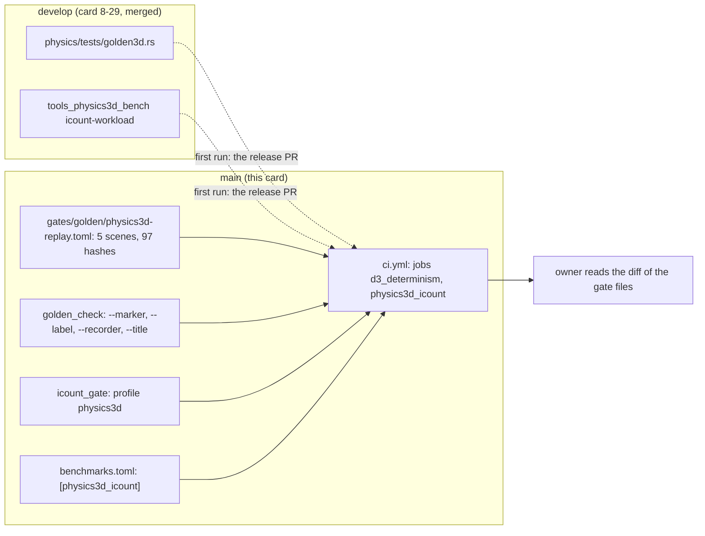

# Review 8-13: the 3D gates (governance)

Task: 8-13. Class 3 (gate configuration `gates/benchmarks.toml`, a new golden file under `gates/golden/`, the workflow `.github/workflows/ci.yml`, the gate tools `tools/golden-check` and `tools/icount-gate` and their tests). **Governance task declared by the owner on 2026-11-19**, ordered as: code card first (8-29, merged into `develop`), then this card, which goes to `main` first; `develop` then merges `main` in. No engine code is changed here and no threshold is lowered.

## What changes, and why each piece

1. **`gates/golden/physics3d-replay.toml` (new).** Five scenes of the `D=3` instance (pyramid, sleeping tower, heavy on light, mixed pile with hulls, joint chain), 97 hashes, recorded with the tool (`golden_check.py record --i-am-changing-the-golden-file`) from the recorder of card 8-29 on Windows x86-64 and **verified on Linux x86-64 (Ubuntu under WSL2) with the same tool**: both runs "equal". It is a separate file, not more scenes in `physics-replay.toml`, because the 2D job compares the scenes of its run with its file strictly (a scene in the file but not in the run is red) and `main` has no 3D code yet.
2. **`tools/golden-check`.** `presence` gets `--marker PATH --label TEXT`: a target whose recorder is one file is present when the file is in the pushed commit, skipped only when it is on neither main nor the push, and red when main has it and the push lacks it (the same three states as the crate check). The marker must be a relative path inside the tree. `record` gets `--recorder` and `--title` so the new file's own comments name its recorder; the defaults reproduce the 2D file text exactly (tested).
3. **`tools/icount-gate`.** A fourth profile `physics3d` (table `physics3d_icount`, flags `--layers` up to 40 and `--steps`), the words "Physics 3D" and the skip line "not run: 3D physics benchmark tool absent".
4. **`gates/benchmarks.toml`.** `[physics3d_icount]`: package `tools_physics3d_bench`, 10 layers (385 boxes), 20 steps, 2 runs, noise limit 0.5%. **The size is a first choice that was not measured under callgrind** (valgrind was not available where I worked); the first hosted run confirms the noise limit or the entry is changed in a governance task. The bands (warn 5%, fail 10%) stay in `gates/gates.toml` and are not touched.
5. **`ci.yml`.** Two jobs, no existing job edited. `physics3d_icount` is the ECS job with the 3D profile (a test says so line by line). `d3_determinism` is the 2D golden job with the 3D file and recorder; it has a bootstrap step like the instruction-count jobs (it says "not run" in the summary until the 3D golden file and the marker option are on `main`), a lint of the trusted golden file, the presence check by marker, the flag check, the recorder run and the comparison with the golden file **of main**; there is no cost report and no `continue-on-error`. The pushed commit supplies only the code under test.

## What each job does before and after the release

- On `main` today there is no 3D recorder and no 3D tool, so both jobs state "not run" (the recorder absent; the benchmark tool absent). **Neither job has run on real 3D code yet.** The first run is the release PR (`develop` into `main`), which is also the first hosted run of any phase 8 code. If the golden hashes differ on a hosted runner, that PR shows it red; this is the point of the gate and also the risk of this card.

## Evidence

- Tests first for the tool changes (red, then green): `test_icount_gate_physics3d.py` (19 tests, red on the missing profile), `test_golden_check.py` 13 new tests (red on the missing functions and options; two failed once more on a Windows path check and on a title wording and were fixed). Workflow tests for both jobs were written after the YAML (not red first); they compare the 3D icount job with the ECS job line by line and pin the conditions of the golden job.
- Suites run: `tools/icount-gate` 125 tests, `tools/golden-check` 66, `tools/release` 189, all OK; `tools/gate-check` ("digest and gate configuration agree") OK.
- The golden file: `golden_check.py lint` ok (5 scenes, 97 hashes); `verify` equal against the Windows output and against the Linux output of the same final code (`develop` at the merge of 8-29).
- The existing 2D golden file and job are untouched; `python -m unittest` of the golden tests passes with the 2D defaults.

## Not verified

- **No hosted run of the new jobs on 3D code**, because `main` has none. The dispatched `ci` run of this branch exercises only the "not run" paths (see the PR for its result).
- Instruction counts under callgrind were never measured; the workload size and the 0.5% noise limit are unchecked on a runner.
- Linux evidence is Ubuntu under WSL2, not a hosted ubuntu runner; ARM64 is not gated.
- The checks do not tell the feature on from off on these scenes (the hashes were the same with it off), so the golden file proves cross-platform determinism of the 3D scenes, not the facade's necessity.
- The branch changes `wiki/README.md` at the same place as `develop` does (changelog); the merge of `main` into `develop` will need that conflict resolved by hand.
- Mermaid read by the author, not rendered.

## R1 to R8

| phase | result |
|---|---|
| R1 self | a Windows-only path check, a title wording, and an unintended extra comment inside the ECS job slice (it broke an existing test) found and fixed |
| R2 automated | tool suites, workflow tests, gate-check, local gates, classifier |
| R3 independent | pending |
| R4 QA | marker presence in the three states, bad markers, defaults of the 2D file text, new profile bounds, skip lines |
| R5 architecture | no engine code; jobs follow the trusted-main rule (golden file and tool from `main`, push as data) |
| R6 security | no secrets; the marker is a trusted workflow argument and is still checked to be a relative path; the pushed tree cannot supply the gate files |
| R7 performance | the d3 job runs five scenes (about 5 s of simulation per platform) |
| R8 product fit | the 3D claim of D2 gets a gate that runs from the release on |

## Loops

| loop | finding | handling |
|---|---|---|
| (none yet) | | |
