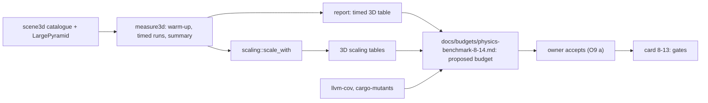

# Review 8-14: 3D benchmark measurement, proposed budget, coverage and mutation

Task: 8-14. Class 1 (dev-time tool `tools_physics_bench` and a measurement note; no public API of an engine crate, no `unsafe`, no dependency, no governance file, nothing in `gates/`). Ordinary card into `develop`. The card says "After 8-13"; 8-13 (governance: register the 3D benchmarks) was not done first. The measurement does not need it, so the order was changed knowingly and the owner was told (I had first called the card unblocked, which was wrong). Registration in the gates stays with 8-13.

## Decisions

1. Timing reuses the 2D machinery: `scaling::scale_with` takes a measuring closure, so the 3D scaling uses the same pool, SIMD and chunk rows as 2D, and the same-hash check.
2. The 3D counterpart of W1 is a 14-layer square pyramid of 1,015 boxes, in the bench only (`Scene3::LargePyramid`, not in `ALL`, so the 8-12 tests are unchanged).
3. The budget is a proposal (median plus 10 to 15% noise margin, rounded up); the gate on instruction counts on the runner is left to 8-13.
4. Mutation was run only on the card 8-19 files, the only phase 8 files with no recorded score; other files use the figures recorded by their cards.

## Evidence

- Tests first: `tests/measure3d.rs` (3), `tests/large3d.rs` (3), one test in `tests/report3d.rs`. `cargo test -p tools_physics_bench`, clippy `-D warnings` and fmt are clean.
- Measurements: see the note. Two same-day full reports agree within about 3%; scaling rows all end in the serial scalar hash (D0, D1, SIMD equals scalar).
- Coverage: llvm-cov, seven crates 92.85%; every phase 8 `physics/src/d3` file above the 90% gate (figures per file in the note).
- Mutation (card 8-19 files): colouring 66 of 66 viable caught; constraint 97 of 97; stage 18 of 19; mod 58 of 59 (after rerunning the five first survivors with the `d3_joints` tests, four were caught). Two survivors remain: `stage.rs` `has_room` to `true` (unreachable by construction, not proven) and `mod.rs` `write_back` `||` to `&&` (open, not judged equivalent).

## Not verified

- Wall times are from the owner's laptop only, on the Balanced plan, not pinned; not the reference machine, no second machine, no Linux or ARM64.
- Branch coverage was not measured; no whole-phase mutation run in one piece; the recorded per-card mutation figures were not re-run.
- Why the lane path gains nothing in 3D, and why a box costs about eight times more than in 2D, was not investigated.
- The proposed numbers are not binding until the owner accepts them.

## R1 to R8

| phase | result |
|---|---|
| R1 self | fmt, clippy, tests, wiki-lint fixed (two threshold-like numbers rephrased) |
| R2 automated | tests, clippy, fmt, local gates, coverage, mutation |
| R3 independent | one read-only review, no blocker; one major and three minors fixed, notes below |
| R4 QA | scaling hashes equal, large pyramid stands, report prints |
| R5 architecture | dev tool only, no layer change |
| R6 security | no `unsafe`, no dependency, no secrets |
| R7 performance | this card is the measurement |
| R8 product fit | the owner reads the note and decides on the budget |

## Loops

| loop | finding | handling |
|---|---|---|
| 1 | major: small-scene scaling figures (91-box pyramid, mixed pile) are 60-step runs not tabulated, and differ from the 300-step medians | the doc now says so |
| 1 | minor: efficiency range 0.12-0.5 in the wiki vs 0.14-0.50 in the doc | wiki aligned |
| 1 | minor: margin said 10-15%, real 12-17% | doc corrected |
| 1 | minor: Windows build 26300 vs 26200 in card 4-22 | probably an OS update, not checked |
| 1 | note: mutation and coverage figures could not be re-run by the reviewer; the loop-1 fixes were not seen by a second reviewer | stated here |
