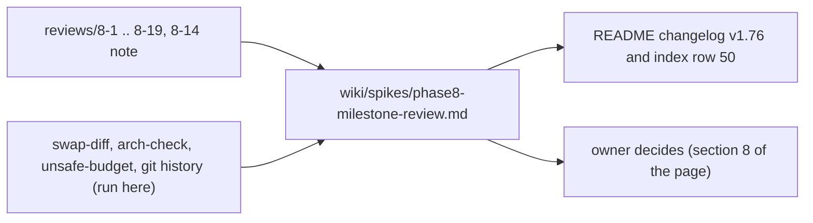

# Review 8-15: phase 8 exit record, milestone review, retrospective

Task: 8-15. Class 1 (documentation only: one new wiki page, the README changelog and index, this file; no code, no gate, no governance file, nothing in `gates/`). Ordinary card into `develop`. The card says "After 8-8 and 8-14": both are merged.

## Decisions

1. The page follows the phase 7 review (summary, exit criteria, cards, metrics, findings, retrospective, go/adjust, not verified) and adds section 7 (phase 9+ inputs and the editor revisit) that the card asks for.
2. No measurement was repeated: coverage and mutation figures are the recorded ones of the cards and of 8-14, marked as such.
3. The swap-diff tool was run (`v0.14.0` to `develop`): ports 0, adapters 0, but the tool prints FAIL because it limits engine files to 0. The page reports both and asks the owner to confirm the reading.
4. The editor recommendation (keep descoped) is a recommendation only.

## Evidence

- Measured here: swap-diff (adapter 0, ports 0, engine and game 76), arch-check (39 crates, 0 violations), unsafe-budget (88 of 70,354 lines, 0.13%, 0 violations), `git diff --shortstat v0.14.0 develop -- engine` (105 files, +24,247, -348), 16 commits ahead of `v0.14.0`.
- wiki-lint tests run (see PR).

## Not verified

- No test, coverage, mutation or benchmark was repeated; no test count was made.
- The Trello board state was not read for the page; the findings of section 3 were read from the review files and summarised.
- Mermaid read by the author, not rendered.

## R1 to R8

| phase | result |
|---|---|
| R1 self | page numbers checked against the review files and tool output; wiki-lint threshold-like numbers rephrased |
| R2 automated | wiki-lint, local gates |
| R3 independent | one read-only review, no blocker; one major and several minors fixed, notes below |
| R4 QA | numbers of the page checked against the review files and tool output |
| R5 architecture | documentation only |
| R6 security | no secrets, no session id or URL |
| R7 performance | not applicable |
| R8 product fit | the owner reads section 8 |

## Loops

| loop | finding | handling |
|---|---|---|
| 1 | major: the thin-hull limit was understated (5% only; the real figures are 5% to 95% refused and a silent wrong volume below 0.05% thickness) | page corrected in two places |
| 1 | minor: findings counts of 8-3, 8-4, 8-6 did not match the review files | worded as minors and nits without counts |
| 1 | minor: the 8-6 `write_back` survivor was placed in `constraint.rs` and its earlier judgement hidden | corrected, with the 8-14 reopening |
| 1 | minor: "no hosted run covers 3D" and "every review says so" overstated | reworded |
| 1 | minor: "scripted edits several times" not recorded in a review file | reworded |
| 1 | note: ADR-0015 and "overview section 7" not resolvable | removed |
| 1 | note: swap-diff files include 2D, the render contract suite and a docs file | stated on the page |
| 1 | note: dates of owner decisions (8-18 split, 8-19 and 8-20) come from the session and the Trello cards, not a repo file; the last fix loop was not re-reviewed on five cards | stated; the fixes of this loop were not seen by a second reviewer |
