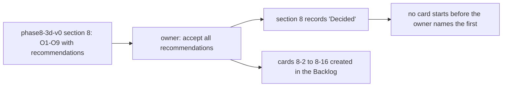

# Review 8-17: record the owner's choices O1-O9 of the phase 8 note

Task: 8-17. Class 1 (documentation only: one paragraph in the phase 8 design note, the README changelog, this file; no code, no gate, no governance file). Ordinary card into `develop`. Owner order: "accept all recommendations" (2026-11-17), after PR #72 merged the note. Loops: 1 (independent review). Open blocker/major: 0.

## Decisions

1. The acceptance is recorded in the note itself, above the choice table, with the date and the owner's words, as phase 7 did for O1 to O8.
2. Each choice is restated in one line so the note is read without the table.
3. Cards 8-2 to 8-16 were created in the Backlog as listed in section 7 of the note; none was started.
4. Card 8-17 was first created in the wrong column (Merged in develop) and moved to In Progress at once.

## Evidence

- Wiki lint: 69 pages, 0 violations. Local gates: see the PR.
- The restated choices were compared with the recommendation column of the table.

## Not verified

- Mermaid syntax read by the author, not rendered.

## R1 to R8

| phase | result |
|---|---|
| R1 self | restated choices checked against the table |
| R2 automated | wiki lint, local gates, diff hash |
| R3 independent | read-only reviewer, see Loops |
| R4 to R7 | not applicable (no code, no gate) |
| R8 product fit | the owner's answer is on record where the choices are read |

## Loops

LOOPTABLE
