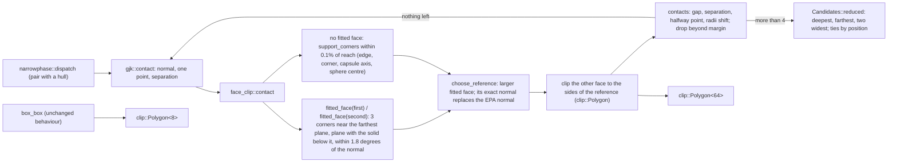

# Review 8-18: `physics::d3` hull contact manifolds

Task: 8-18. Class 2 (narrowphase of `physics::d3`, hot path; no public API change, no `unsafe`, no new dependency, no governance file). Ordinary card into `develop`. Loops: 1 fix loop (1 independent review); the fix of loop 1 was not reviewed again (see "Not verified"). Open blocker/major at the end: 0 known.

Delivers: a pair with a convex hull now gets up to four contact points (the clipping of box against box, applied to the faces of hulls) instead of the one GJK/EPA point, so a hull can rest on a face, stack, and lie flat. README v1.69.

## Decisions

1. **Faces are found again from the corners, not from a stored face list.** `Hull` stores no faces, so `Shape3` stays about 448 bytes. A face is three corners within 5% of the reach of the farthest plane (at most 16 in the window) that span a plane with every corner on one side, within 1.8 degrees of the normal.
2. **The reference normal is the exact face normal, not the EPA normal.** With the EPA normal a resting cube kept getting one or two points (EPA normal noise up to about 0.016 rad when the shapes just touch), and a hull cube kept moving.
3. **Fallback is the single GJK point** when nothing fits or nothing survives the margin, so no pair loses contact it had before.
4. **Capacity is generic.** Hull polygons hold 64 corners, box polygons 8 (review loop 1, M1).
5. **The four kept points are chosen by geometry, not list order** (loop 1, m2): ties within a thousandth go to the point farthest along a direction fixed by the normal.
6. **The plane search is cheap and stops early** (loop 1, M2): the angle test comes before the scan of all corners, and the first plane that fits wins (two fitting planes are less than 4 degrees apart).

Known limits: a face is found only within 1.8 degrees of the normal (a tilt of 2 to 10 degrees gives an edge or corner contact for that step, two points at most, then the hull rocks onto its face, no hysteresis); a window holds at most 16 corners; the near-flat GJK/EPA normal itself can still be wrong in rare tilts of 0.85 to 1.75 degrees (4 of 1080 poses, 7 on `develop`), and then one point stands; stacks of round prisms (octagon, 16-gon) on end keep a speed of 0.01 to 0.02 and never reach exactly 0 (box piles do), below the sleep thresholds, penetration at most 2.8 mm; a capsule on a face has 2 points at exactly 0 tilt and 1 from 0.05 degrees.

## Evidence

- Tests first. Red evidence: with the one-point manifold 10 of 13 new narrowphase tests failed; with a tolerance-only face (no fitted face) the hull cube still moved 0.06 m/s after 4 s; loop 1 tests (`the_polygon_a_box_clips_stays_small`, `the_four_points_kept_do_not_depend_on_where_the_list_starts`, `a_plane_that_does_not_face_the_search_direction_is_not_taken`) failed before the fixes (compile error / hopping points). `d3_hull_manifold.rs`: 13 tests (cube on floor, flipped order, slab, edge 2, corner 1, half overlap, small cube on plate, hull of box corners equals box, 12-gon prism 4 spread points, margin, capsule 2, sphere 1, finite points over 24 poses). `d3_solver.rs`: hull cube comes to rest, tilted cube ends flat, stack of five. Unit tests: 25 in `face_clip.rs`, 6 in `clip.rs`. `d3_no_allocation.rs` includes a cube hull: 0 allocator calls. `cargo test -p physics`: 864 passed, 0 failed. `cargo clippy -p physics --all-targets -- -D warnings` and `cargo fmt -p physics -- --check`: clean.
- Changed assertion: `d3_narrowphase.rs` `a_hull_contact_point_stays_inside_a_small_overlap_and_halfway_between_the_faces` used to check only point 0; it now checks every active point with a slack of 1e-5 (a clipped corner can sit exactly on the edge of the range, 5e-8 over). Stricter, not weaker (reviewer agrees).
- Mutation (`cargo mutants -p physics`, `--lib` plus `d3_hull_manifold`, `d3_solver`), after the loop-1 fixes: `face_clip.rs` 267 mutants, 186 caught, 34 missed, 47 unviable: 84.5% of viable. `clip.rs` 79 mutants, 56 caught, 7 missed, 16 unviable: 89%. Survivors judged equivalent or low value (reasoned, not proven): `local_corner` `*` against `/` (sign is plus or minus one); `MIN_TRIANGLE` and `PLANE_TOLERANCE` arithmetic (at reach 1 in the tests the factors are indistinguishable; the thresholds only reject degenerate planes); `order_round`, `plane_frame` comparison operators at exact ties; `clip_segment` `>` against `>=` at exactly-zero parameter differences (produce the same point twice, removed later); `contact` `len > MAX` against `>=` for exactly four; `preferred_direction` and the tie slack in `clip.rs` (any fixed direction breaks the ties; covered by the start-independence test). Not explained, left open: the `winding` and `area` sign mutants, the `[]` and `[point]` arms of `clip_to` and several `clip_segment` comparisons survive although unit tests check those functions; they are the weakest spot of the test set.
- Performance (release, `D3::collide` ns/query, own timing test, not committed): box on floor 333 (`develop` about 300; was 407 before loop 1); hull cube on box 1700 (`develop` 1700); 16-gon puck on puck 6800 (was 68900 before loop 1, `develop` 3800); 16-gon puck on a tilted puck with no fitted face 11800. No benchmark gate run (cards 8-12, 8-14).
- Independent review (read-only, copies of the crate): 6000 random hull-cube pairs gave the same manifold in both argument orders; a pile of 12 hull cubes settled to speed 0 with 1.5 mm penetration; an offset 8-stack matched the box stack; a cube held on a 20 degree slope and slid at 35; capsule and sphere against a slab gave the same point in both orders; a rolling octagonal prism ended on a face.

## Not verified

No Linux or ARM64 run; no D2 golden hash for 3D hull manifolds (card 8-13); no multi-thread run (serial solver); no benchmark gate, only the ad-hoc timing above; no Miri (no `unsafe`); no branch-coverage or new-line gate run; the loop-1 fixes (generic capacity, plane search, tie-break, wiki numbers) were not seen by a second independent reviewer; the mutation numbers above come from one run per file and the survivors are reasoned, not proven equivalent; the Mermaid view was read by the author, not rendered; the solver was not compared against an independent reference simulation.

## R1 to R8

| phase | result |
|---|---|
| R1 self | found and fixed: noisy EPA normal (fitted face), `MIN_FACE_COSINE` 0.98 breaking the oracle test (now 0.9995), libm calls and nesting flagged by Clippy |
| R2 automated | tests, clippy, fmt, mutation, wiki lint, local gates, diff hash |
| R3 independent | one read-only review; findings below |
| R4 QA | 13 manifold scenes, 3 solver scenes, allocation test, oracle test against the box path |
| R5 architecture | port and `Dim` unchanged; `clip.rs` extracted from `box_box.rs` and shared; no stored face list, `Shape3` size unchanged |
| R6 security | no `unsafe`, no new dependency, no secrets; fixed capacities, no allocation; non-finite points tested |
| R7 performance | measured above; box-box back at `develop` level, round hulls 2 to 3 times GJK alone |
| R8 product fit | the owner reads the known limits above (1.8 degree face window, rocking, prisms never sleeping to exactly 0) |

## Loops

| loop | finding | handling |
|---|---|---|
| 1 | major M1: box-box 35 to 40% slower (polygon capacity 8 to 64) | const generic capacity: 8 for boxes, 64 for hulls; size test; box on floor 333 ns |
| 1 | major M2: `fitted_face` 20 to 30 times slower than GJK on round hulls | angle test before the corner scan, reach computed once, first fitting plane wins; puck on puck 68.9 to 6.8 microseconds |
| 1 | minor m1: near-flat GJK normal can still collapse to one point | documented (GJK/EPA issue, fewer poses than on `develop`); number in the wiki corrected |
| 1 | minor m2: contact points hop between steps on round hulls | ties broken by position; test that the four points do not depend on the list start |
| 1 | minor m3, m4: hard 4 to 2 point switch at 1.8 degrees; capsule tilt flicker | documented as known limits |
| 1 | nit: two wrong doc comments in `face_clip.rs` | fixed |
