# Review 8-19: `physics::d3` contact solver, graph colouring and parallel solve

Task: 8-19. Class 2 (concurrency in the solver of `physics::d3`; no public API change, no `unsafe`, no new dependency, no governance file). Ordinary card into `develop`. Loops: 1 fix loop (1 independent review). Open blocker/major at the end: 0 known; the fix of loop 1 was not reviewed again (see "Not verified").

Delivers: `Solver3` sweeps its contacts colour by colour with the shared `core::colouring` (as `Solver2` does), and when `World::set_execution` has a scheduler, the chunks of each colour run in parallel. The result is bit for bit the serial colour order at any worker count, chunk size and chunk order (D0, D1). README v1.70.

```mermaid
flowchart LR
  W["World::step"] --> S3["Solver3::solve"]
  S3 --> P["prepare: manifolds -> Constraint (Shape + Impulses), colouring.push(awake ends)"]
  P --> A["colouring.assign: lowest free colour, overflow set"]
  A --> SS["sub-steps x4: joints (serial), then contacts"]
  SS --> Q{"execution staged?"}
  Q -->|"no: serial reference"| V["visit_order: colour by colour, canonical order"]
  Q -->|"yes"| C["for each colour: ColourJob, chunks of 32"]
  C --> PF["scheduler.parallel_for(chunks): a chunk reads shared Shape and bodies, works on copies in its own Mutex buffer"]
  PF --> SC["scatter: buffers in chunk order, dynamic bodies and impulses stored back, static never"]
  SC --> OV["overflow set: serial, canonical order"]
  V --> FIN["finish: write motion back, keep impulses in constraint order"]
  OV --> FIN
```

## Decisions

1. **The serial order is colour order.** Constraints are no longer swept in manifold-list order; the colours are visited in order and the constraints of a colour in manifold-list order, the overflow set last (as in 2D). That is the reference every execution is compared with. No existing 3D scene test changed its result.
2. **Same staged design as 2D, without lanes** (`d3/solver/stage.rs`, a twin of `d2/solver/stage.rs`). One `Mutex` buffer per chunk, locked once; the scatter stores in canonical order. No SIMD path in 3D (a `simd` flag in the execution only selects the staged path).
3. **`Constraint` is split into a read-only `Shape` and a small `Impulses` array.** A pass changes only the accumulated impulses, so a chunk copies 312 bytes (64 of impulses, two 124-byte bodies) instead of the 632 of the whole record and the bodies. The first measurement, with the whole record copied, was slow for this reason.
4. **Joints stay serial, before the contacts, in every pass** (as in 2D). A joint never reaches the scheduler, so a scene with joints equals its serial self by construction.
5. **A buffer holds at most `max_constraints` entries** whatever the chunk size asks (loop 1, finding 1).
6. **No automatic switch to the serial path.** The caller decides, as in 2D.

Known limits: the serial order changed (colour order, not list order), so a scene can settle to a slightly different, equally valid state than before this card; joints, `prepare`, `finish` and the position integration are serial; the scatter writes back every non-static solver body, so a constraint end that is a **sleeping dynamic body** shared inside one colour would behave differently from the serial path (it cannot happen through `World::step`, which wakes every island an awake body touches before the solve; the assumption is stated in `stage.rs` and is the same as in 2D; a caller that drives the `ContactSolver` trait directly with such a list is outside the contract).

## Evidence

- Tests first. Red evidence: before the solver was wired, `the_stats_report_the_colours_of_the_last_step`, `the_scenes_have_the_shape_their_names_promise` (hub overflow) and `colours_with_several_chunks_go_to_the_scheduler_and_small_ones_do_not` failed (colours 0, the scheduler never called); the unit tests of the colouring did not compile (no `colouring`, no `Reorder`); `a_buffer_never_holds_more_than_the_solver_has_constraints` failed (capacity 100 000 for 10 constraints) before the loop-1 fix. The hash-equality tests pass vacuously before the change (the execution was ignored), so they only mean something together with the counting-scheduler tests above.
- `tests/d3_parallel.rs` (15 tests): hash after every step equal to the serial reference for the staged path on the calling thread, pools of 1, 2, 4 and 6 workers, chunk sizes 1, 5, 32, 1000, reversed, shuffled and single-range schedulers, a refusing scheduler, repeated runs, one pool serving several worlds with the execution changed in between, islands that sleep and wake; scenes: pyramid, pile of boxes, balls and capsules, hub with colour overflow, a chain of joints over crates, a sleeping pile. `tests/d3_parallel_allocation.rs` (3): zero allocator calls on the caller and on every worker of a pool, serial and staged. Unit tests in `colouring_tests.rs` and `stage.rs`: colouring valid and complete at every step of random scenes and a pyramid, the order inside a colour changes no bit (shuffle, reverse), staged equals serial for inline, reversed and refusing schedulers at chunk 1, 3, 1000, the scheduler is used only for colours with several chunks, the buffers follow the execution, the buffer capacity.
- `cargo test -p physics` (before the loop-1 fix): 30 test binaries, 0 failed. After the fix: `d3::solver` 82 unit tests, `d3_parallel_allocation` 3 tests, run again; the full suite was not run again. `cargo clippy -p physics --all-targets -- -D warnings`, `cargo fmt -p physics -- --check`: clean. `python tools/local-gates/local_gates.py --base origin/develop` and wiki lint: pass (see the pull request for the final run).
- Performance (release, own timing test, deleted afterwards, not committed). Scene: 881 bodies, 4 920 contacts, 13 colours, no overflow. **Staging on one thread: 18.4 ms against 16.8 to 17.8 ms for the serial loop, about 1.04 times** (the first, clean round of two runs; after the first round the laptop throttled itself, plain serial went from 17 ms to 230 to 270 ms). **Scaling with workers is not measured**: every pool row came from throttled rounds (2.8 to 3.9 times serial in them; one earlier run printed 0.78 times at 2 and 6 workers in a single round, not reproducible), so none of them is evidence for or against a speed-up. Benchmarks are cards 8-12 and 8-14. The first version of the split (whole `Constraint` copied per pass) measured about 4 times serial inline; that run was also noisy, so the size of the gain from the split is not established, only the copy volume (632 to 312 bytes).
- Mutation: `cargo mutants` on the changed code was started and **stopped by the system for low memory before it produced a result**; there is no mutation score for this card. The independent reviewer ran nine hand-made mutations of the staged path in a copy of the crate (skip the store of dynamic bodies, drop the last member of a chunk, ignore the overflow set, overflow range off by one, reverse colour order, scatter only the first chunk, drop the impulse store, skip body `b`, chunk boundary off by one): all nine are caught; two of them (overflow ignored, overflow range off by one) only by the integration test `d3_parallel` (the `hub` scene), not by the fast unit tests. Three more (swap the `a`/`b` store order, reverse the scatter order, store static bodies) are equivalent mutants (a constraint's two bodies differ, chunks write disjoint bodies, a static copy equals the original).
- Independent review (read-only, copy of the crate, memory-limited): the staged path is bit-identical to the serial reference in everything it ran; claims 1 to 6 and 8 to 9 of the brief checked in code (no body shared by two awake ends inside a colour, static ends never stored as in `store`, the warm cache and the hash do not depend on the colour order because `finish` pushes in constraint-vector order, overflow range, joints before contacts, buffer sizing, `FpGuard` per chunk, no `unsafe`, no public API change).

## Not verified

No mutation score (run stopped for memory). No scaling number for 2, 4 or 6 workers (laptop throttling), so the 2D rule of thumb (a pool pays from colours of a few hundred constraints) is not confirmed for 3D. No allocation test with joints in the *parallel* path (the serial allocation test with joints exists in `d3_no_allocation.rs`; the joints are serial in both). No Linux or ARM64 run; no D2 golden hash for 3D (card 8-13); no TSan (card 4-21 for 2D); no Miri (no `unsafe`); no benchmark gate; the full `cargo test -p physics` was not repeated after the loop-1 fix (only the affected targets); the loop-1 fix was not seen by a second independent reviewer; the reviewer did not run clippy, rustfmt or doc tests and did not check what `wake_touched` does when contacts are stale before the islands are rebuilt; the Mermaid view was read by the author, not rendered; the wiki banner still says v1.64 (older than this change, as before).

## R1 to R8

| phase | result |
|---|---|
| R1 self | found and fixed: clippy nesting in new tests (helper functions), `large_types_passed_by_value` on `Staged::new` (the constructor went away with the split), a needless struct update |
| R2 automated | tests, clippy, fmt, local gates, wiki lint, diff hash; mutation started, stopped by the system |
| R3 independent | one read-only review; findings below |
| R4 QA | 15 + 3 integration tests, 82 unit tests, nine hand-made mutations by the reviewer |
| R5 architecture | `Dim`, ports and public API unchanged; `core::colouring` and `SolverExecution` shared with 2D; `stage.rs` duplicates the 2D design (about 150 lines) because the chunk types are dimension specific; a shared generic version is a possible later refactor |
| R6 security | no `unsafe`, no new dependency, no secrets; fixed capacities, no allocation per step; the chunk-size buffer size is now bounded |
| R7 performance | measured only as the staging overhead (1.04 times on one thread); scaling not measured |
| R8 product fit | the owner reads the known limits above: parallel speed-up is unproven on this machine, the serial order changed, joints stay serial |

## Loops

| loop | finding | handling |
|---|---|---|
| 1 | minor: `make_outputs` sized every buffer by the chunk size, so a huge chunk (`u32::MAX`) asks for terabytes | capacity clamped to `max_constraints`; unit test red before, green after |
| 1 | minor: wiki said "about 330 bytes" for a 312-byte copy | corrected to 312, with the 632 it replaces |
| 1 | minor: `reviews/8-19.md` linked by the README did not exist | this file |
| 1 | minor: the scatter would write back a sleeping dynamic body shared inside one colour | not reachable through `World::step` (islands wake first); documented above and in `stage.rs`; same assumption as 2D |
| 1 | nit: first doc line of `d3_parallel_allocation.rs` over 100 characters | wrapped |
| 1 | nit: banner "PROPOSAL v1.64" older than the changelog | not touched (as before this card) |
