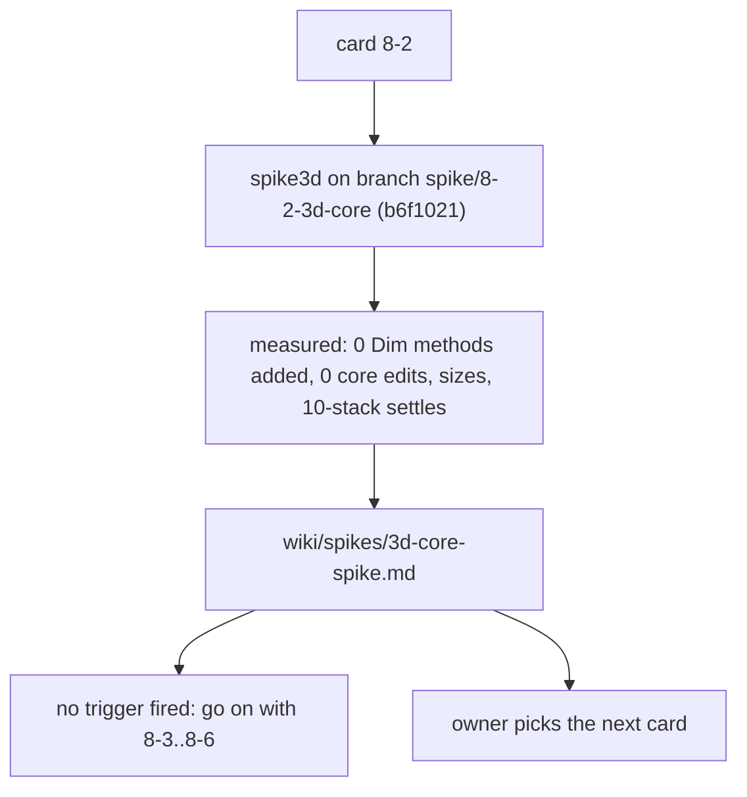

# Review 8-2: 3D core spike

Task: 8-2. Class 1 (documentation only: one new wiki page, the README changelog and index, this file; the spike code is on a throw-away branch and is not part of the diff). Ordinary card into `develop`. Loops: 1 fix loop (1 independent review). Open blocker/major: 0.

Delivers: [spikes/3d-core-spike](../wiki/spikes/3d-core-spike.md), the answers to the ADR-0018 trigger questions from a `D=3` instance on the real generic core (commit `b6f1021`, branch `spike/8-2-3d-core`, not merged). README v1.63 and index row 49.

## Decisions

1. The spike is a TDD exception (throw-away). Its tests are measurements.
2. The code is not merged: a test-only module on a separate branch, referenced by commit hash. The diff of this card is documentation only.
3. No ADR amendment is proposed, because no trigger fired; a fired trigger would have been a proposal to the owner.

## Evidence

- `cargo test -p physics --lib spike3d` on `b6f1021`: 6 tests pass (plus the debug trace); the reviewer reran 7 in release and got the same results.
- Clippy over the physics crate with the spike module gave warnings; the module is throw-away and carries local `allow`s, it is not a gate input.
- Local gates and wiki lint: see the PR.

## Not verified

No Linux, multi-thread or D2-golden run; moving-body scenes; stack stability on two scenes, one friction value. Details on the page, section 6.

## R1 to R8

| phase | result |
|---|---|
| R1 self | numbers traced to test output; two claims softened |
| R2 automated | local gates, wiki lint, diff hash |
| R3 independent | read-only reviewer: 0 blocker, 2 major, 5 minor, 3 nit; all handled |
| R4 QA | spike tests rerun by the reviewer in a worktree |
| R5 architecture | no code or gate in the diff; `Dim` and core unchanged by the spike |
| R6 security | documentation only; no secrets |
| R7 performance | one timing figure, marked single run |
| R8 product fit | owner reads page sections 1, 2 and 7 |

## Loops

| loop | finding | handling |
|---|---|---|
| 1 | major: iteration-count and warm-start claims not reproducible from the commit | marked as session runs, not reproducible |
| 1 | major: "falls asleep" and the replay scene overstated | reworded to what was tested |
| 1 | minors: unit of the ADR contact figure, ratio wording, extra items outside `Dim`, `Solver2` line count scope, inference marked, timing noise | all corrected on the page |
| 1 | nits: stale comment in spike code (branch only), debug trace mentioned, cause of body growth unchecked | page updated; code comment left, throw-away |
