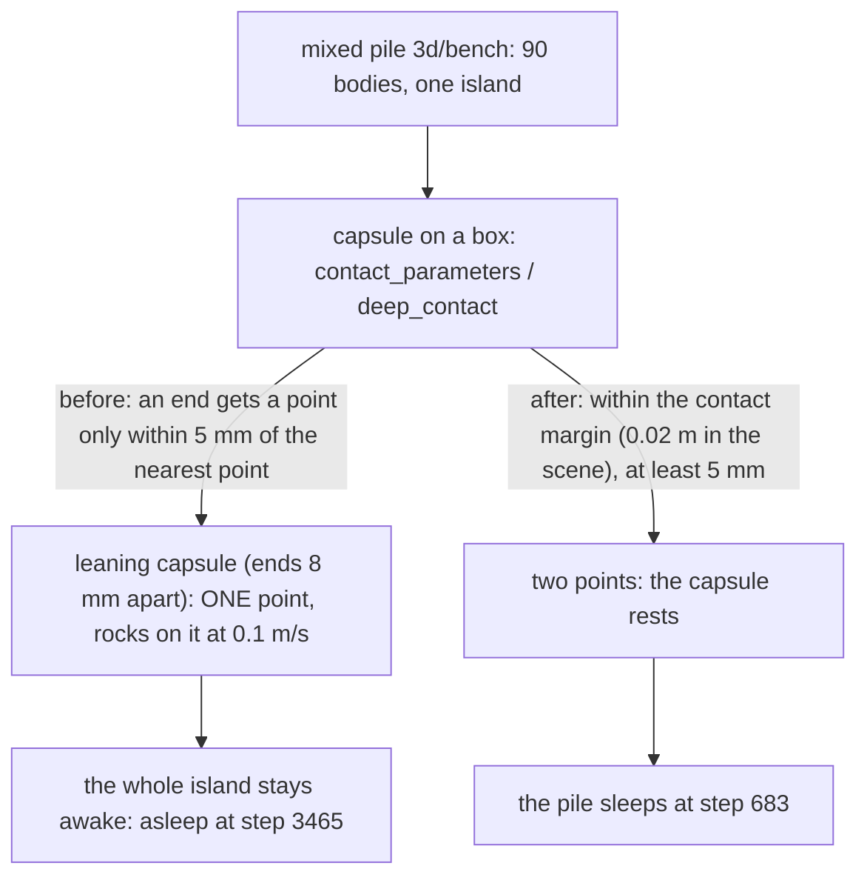

# Review 8-21: a capsule keeps both ends of its contact with a box while both are within the margin

Task: 8-21 (found in 8-12, `reviews/8-12.md`). Class 2 (physics: narrowphase contact generation, determinism surface). Ordinary card into `develop`, **with an open governance question**: the stored golden hash of the scene `mixed pile 3d` changes (see Decisions). Owner go-ahead: "8-21".

## What was done

| item | result |
|---|---|
| reproduced | the benchmark scene `mixed-pile` (90 bodies, sleeping on): all asleep only at step 3465; 4 of 90 asleep between steps 600 and 3300; the fastest body 0.03 to 0.11 m/s over thousands of steps. The movers are capsules (bodies 20 and 86). The pile is one island, so a single body that does not rest keeps all 90 awake |
| looked at | capsule 20 at steps 1000 to 1240: it touches a box under it (one point, 12 to 17 mm deep) and two neighbours (one point each, apart by 2 to 20 mm); it rocks about x with a period of about 24 steps (0.4 s), spin about 0.2 rad/s, speed up to 0.06 m/s; net movement over 150 steps 0.003 to 0.018 m/s |
| cause | `END_TOLERANCE` in `narrowphase.rs`: an end of a capsule got a contact against a box only when it was within a fixed 5 mm of the nearest point. A capsule leaning by 0.004 rad has its ends 8 mm apart: one end lost its point and the capsule rocked on the other (same pattern as the hull edge of card 8-71) |
| tried | (throwaway probes, not in the repository) the tolerance 5 mm, 10 mm, 20 mm, 50 mm on the scene: asleep at step 3465, 537, 683, 470; the rocking peak after step 800 0.119 m/s for 5 mm and 0 for the others. The sleep step is not monotone in the tolerance (chaotic settling), one scene and one seed: the claim is that 5 mm rocks and 10 mm and more do not, not that 683 is a figure to rely on to a step |
| change | `narrowphase.rs`: the band of an end is the contact margin, at least `MIN_END_BAND` (5 mm, the old rule as a floor, so the new rule is a superset of the old one and a margin of zero or a millimetre cannot do worse than before); `contact_parameters` takes `(nearest, band)` and `deep_contact` uses `margin.max(MIN_END_BAND)`. `within_margin` still drops any point beyond the margin from its plane |
| measured after | the mixed pile asleep at step 683 (before: not by step 1500), its fastest body 0.0000 m/s at step 800 (before 0.0598); the sphere pile identical before and after (asleep at 738, speed 0 at 800) |
| tests | 4 new unit tests in `d3_narrowphase.rs` (a capsule leaning by 0, 0.002, 0.004, 0.02 and 0.04 rad on a box face keeps 2 points; leaning by 0.08 rad, ends 0.16 m apart, past the margin 0.1: 1 point; the same with the capsule sunk through the face: 2 points; the boundary: ends 0.0979 apart with margin 0.1: 2 points, 0.1020 apart: 1 point; margin 0.02 with ends 8 mm apart, and margins 0 and 1 mm with a flat capsule: 2 points) and 1 in `scenes3d.rs` (the mixed pile is asleep by step 1200, as the sphere pile). The old settling bound (0.25 m/s at step 800) stays: on Linux the last sphere of the sphere pile sleeps between steps 800 and 900 (card 8-33) |

## Evidence

- Red: against the old `narrowphase.rs`, `a_capsule_leaning_by_a_few_millimetres_keeps_both_ends_while_both_are_within_the_margin` failed at lean 0.004 (one point; 0 and 0.002 passed), `a_capsule_sunk_through_a_box_face_and_leaning_keeps_both_ends` failed at lean 0.004 (one point), and `the_mixed_pile_comes_to_rest_and_sleeps` failed with 4 of 90 asleep at step 1200. All three are green after the change.
- `physics` suite: 1112 tests pass, with and without the cross-platform feature. The `scenes3d` file (15 tests) passes. Clippy and the local gates are run on the final commit (see the PR).
- Golden hashes: the 2D file (12 scenes) is equal; the 3D file differs for `mixed pile 3d` only, from step 50 (see below). The other four 3D scenes are equal.

## Decisions

1. The band is the margin, not another constant: a point within the margin is worth keeping (a speculative contact catches the end before it lands) and one beyond is dropped as before, so the rule has no number of its own. It is the same choice as the band of the hull edge in 8-71.
2. **The golden hash of `mixed pile 3d` changes, so `gates/golden/physics3d-replay.toml` needs a new value, and that file is a protected path. It is not edited here.** The scene has capsules (index 2 of every 4), which now keep both ends from the first contact: the first difference is at step 50. Until the owner declares a governance task for the new value, the `d2_determinism` job of `ci` on `main` would be red for this change; the card is therefore not ready to ride in a release without that task.
3. The old settling bound stays (0.25 m/s at step 800), its comment now says why and names the stricter check (the sleep test).
4. Capsule against capsule was not changed (see Not verified).

## Not verified

- Margins above 0.1, the hover case (a capsule whose nearest end is apart by part of the margin), and whether the contact count flips between 1 and 2 from frame to frame at the band edge (warm start): not measured. A second point at a separation up to the margin is a speculative row: it acts only when the body approaches faster than separation / step, and its friction is bounded by its own normal impulse (`core/soft.rs`, read by the reviewer), so it is expected to be inert at rest.
- Capsule against capsule: two segments that are near parallel (`sin^2` of their angle above 1e-6, about 1 mrad) get one point where two lie within the margin; the same pattern as here, not measured (a pile with capsules lying on capsules did not rock in this scene after the change). A candidate card.
- Linux and ARM64: the sleep step 683 and the bound 1200 were measured on Windows only.
- The new stored value of the golden hash (not produced: the file is not changed here).
- Cost: a capsule on a box now sometimes has two points where it had one (more rows for the solver); the instruction-count benchmark does not contain capsules and was not run.
- Spheres, hulls, capsule against hull and capsule against sphere are unchanged by the code (they do not use this function); not rerun beyond the suite.
- Mermaid read by the author, not rendered.

## R1 to R8

| phase | result |
|---|---|
| R1 self | the first test cases passed at lean 0 and 0.002 (ends within 5 mm already), so the red is at 0.004; the band `margin` for the deep path was checked on the sunk capsule |
| R2 automated | fmt, the suites, both golden files |
| R3 independent | one read-only review: no blocker, 2 major, 5 minor, 2 nits (Loops) |
| R4 QA | tolerance sweep on the scene, before/after on both piles, three tests with red evidence |
| R5 architecture | one constant removed, one parameter added to a private function, no public API change |
| R6 security | none |
| R7 performance | not measured (see Not verified) |
| R8 product fit | a pile with capsules now sleeps in 683 steps instead of 3465; the golden value needs the owner's governance task |

## Loops

| loop | finding | handling |
|---|---|---|
| 1 | major: with a margin of zero or a millimetre the second end of a flat capsule could be lost to rounding, where the old 5 mm kept it | the old 5 mm is the floor of the band (`MIN_END_BAND`); tests at margins 0, 0.001 and 0.02 |
| 1 | major: the comment said `within_margin` dropped the same points anyway; the band is relative to the nearest point and the filter to the plane | comment and the Decision reworded: the band decides which ends are tried, `within_margin` still drops any point beyond the margin from its plane |
| 1 | minor: tests far from the band edge; no margin 0 or 0.02 | boundary test at 0.049 and 0.051 rad; margin tests (above) |
| 1 | minor: the sweep numbers come from throwaway probes and are not monotone | said in the table (tried) |
| 1 | minor: Not verified incomplete | margins above 0.1, hover, flip between 1 and 2 points added |
| 1 | minor: this table empty | this table |
| 1 | minor: `(nearest, band)` as a tuple | kept: four plain parameters would pass the warn threshold of three (clippy parameters > 3) |
| 1 | nit: the `PILE_STEPS` comment mixed two topics; the mermaid said 0.02 only | reworded; the label says the scene's margin and the floor |
| 1 | note: the loop-1 text was not read by a second reviewer | stated |
