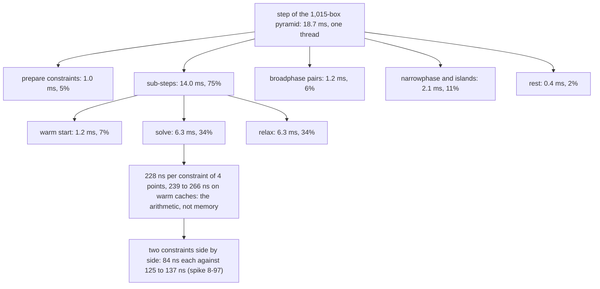
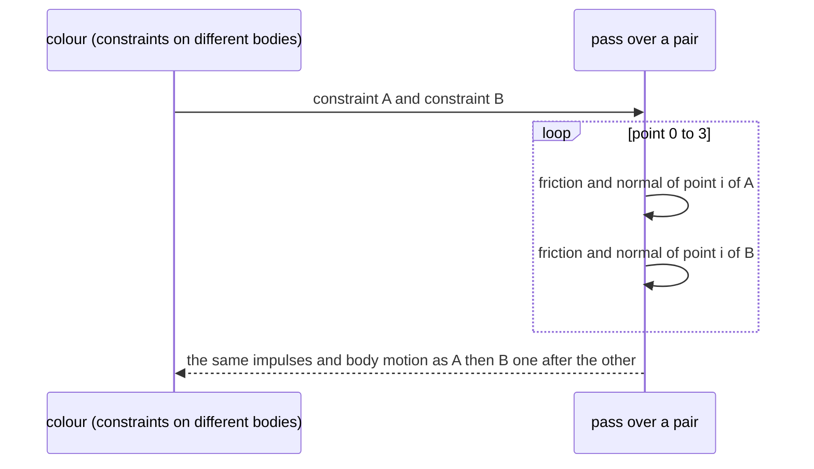

# Review 8-22: where a 3D step goes: three quarters is the contact solve, and memory is not what limits it

Task: 8-22 (found by 8-14). The card is Class 2 (hot-path performance); this diff is documentation only, no engine code. Owner go-ahead: "release now then wave 2" (2026-11-26), Wave 2 card 1 of 4.

Outcome, in four points (one run on the owner's laptop, one thread, 1,015-box pyramid):

- **Where the time goes:** 75% of a 18.7 ms step is the solver's sub-step loop (warm start 7%, solve 34%, relax 34%); 11% is the narrowphase, 6% the search for pairs, 5% preparing the constraints.
- **Memory is not the limit here:** one four-point constraint costs 228 ns in the pyramid and 239 to 266 ns when run alone on warm caches, so the cost is the arithmetic. (At this size; larger scenes were not tried.)
- **No lane (SIMD) path is proposed.** The 3D solver has none (the "lanes" rows of the 8-14 report run the scalar code with extra copies), and the 2D lane path is slower than scalar.
- **One proposal, to be proven first:** in one small test, two independent constraints solved side by side ran the friction pass 1.5 to 1.6 times faster each than one at a time (125 to 137 ns against 84 ns). If that carried over to the whole solve it would make the whole step about 1.3 times faster (Amdahl, see Decisions); card 8-97 is a spike that measures it in the engine first. "A 3D box costs eight times a 2D box" is mostly more work: 27,345 contact points against at most 5,764.

Words used: a *constraint* is one contact between two bodies (up to four points); a *colour* is a group of constraints that touch different bodies, so they can be solved in any order; *narrowphase* is the exact contact test after the broad search for nearby pairs; a *lane path* is a solver that does four constraints at once with SIMD instructions.

## What was measured

Method: a throwaway probe, not in the repository (timers around the phases of `World::step` and of the solver's `solve`, and a micro-benchmark in the unit tests of `constraint.rs`), release build, Windows, one thread, the laptop of the 8-14 report (i7-12700H, Balanced power plan, an editor and an agent session open). The scene is built, 60 steps are run (the 8-95 landing transient is over), then 200 steps are timed. The probe's own cost was not measured separately (about 12 clock reads a step against 18 ms, assumed negligible); the median of 300 steps of the same build with the probe in was 18.67 ms (and 18.66 ms in a second run of five iterations), the 18.63 ms of the 8-14 report. One run that overlapped other work gave 179 ms a step and was discarded; the shares below are from a quiet run.

| item | large pyramid (1,015 boxes) | pyramid (91 boxes) | mixed pile (90 bodies) |
|---|---|---|---|
| step | 18.70 ms | 1.33 ms | 0.54 ms |
| prepare constraints | 0.995 ms (5.3%) | 0.076 ms (5.7%) | 0.019 ms (3.4%) |
| sub-steps in all | 14.04 ms (75.1%) | 1.01 ms (76.2%) | 0.159 ms (29.2%) |
| of that warm start / solve / relax (the rest of the sub-steps, 0.15 ms on the large pyramid, is velocity and position integration) | 1.23 / 6.33 / 6.33 ms | 0.071 / 0.466 / 0.465 ms | 0.015 / 0.069 / 0.069 ms |
| broadphase pairs | 1.16 ms (6.2%) | 0.051 ms (3.8%) | 0.046 ms (8.5%) |
| narrowphase and islands (`collide`) | 2.14 ms (11.4%) | 0.164 ms (12.4%) | 0.306 ms (56.3%) |
| the rest (copies, colouring, write-back, integration, restitution, proxy move) | 0.37 ms (2.0%) | 0.02 ms (2%) | 0.01 ms (2%) |
| manifolds / points | 6,930 / 27,345 (3.95 a manifold: 6,581 of four, 336 of three, 13 of one) | 506 / 1,990 | not counted |

- **The box pyramid is a solver scene, the mixed pile is a narrowphase scene.** In the pile the solver is 29% of a step and `collide` is 56% (hulls and capsules go through GJK and the face clip): that is where cards 8-78 and 8-80 act. The shares were measured once each; the small scenes vary more from run to run than the large one.
- **A box rests on about 6.8 manifolds** (6,930 for 1,015 boxes: the floor, the box below, the boxes beside it), 4 points each. Every sub-step solves each point three times (warm start, solve, relax).
- **Memory is not what limits the solver at this size.** Solving one 4-point constraint (friction and normal) costs 228 ns on the pyramid (6.33 ms over 4 sub-steps and 6,930 constraints) and 239 to 266 ns in a micro-benchmark of one constraint on a hot cache (two runs; the loop resets the velocities each time). So the memory around the constraints costs nothing visible here (the working set of a thousand bodies and seven thousand constraints is a few megabytes, probably inside the processor's cache; larger scenes were not tried); the arithmetic does. Of the hot-cache time, friction was about 125 to 137 ns, the normal about 115 to 124 ns, the warm start 44 ns.
- **Per point, 3D costs about the same as 2D within a factor of two.** 3D: 18.7 ms over 27,345 points = 0.68 µs a point. 2D W1 (990 boxes, 2,882 manifolds a step, at most two points each, so at most 5,764 points; the points were not counted): 2.34 ms in a run on the same laptop, 2.22 ms in the 4-22 report, so at least 0.39 µs a point. The 3D point is therefore at most about 1.8 times a 2D point, and the point count is at least 4.7 times: the "eight times" of the 8-14 report is mostly more contact points (a box in a square pyramid touches more boxes), plus six degrees of freedom and two friction rows in 3D.
- **The lane path.** `d3::solver::stage` says it: there is no lane (SIMD) path in 3D; with `simd` on, the solve takes the staged path (copies of the two bodies and the impulses in and out of a buffer, then a serial scatter) and runs the scalar code. So the 8-14 rows "lanes" against "scalar" (19.6 ms against 18.1 ms serial) measure the cost of the staged copies (about 8%), not a SIMD solve. In 2D, where the lane path exists, it is slower than scalar when serial (3.65 ms against 2.22 ms, `docs/budgets/physics-benchmark-4-22.md`).
- **Why a lane path would not obviously help, and what might.** A manifold's points cannot be solved side by side bit for bit: each point's relative velocity includes the impulses of the points before it. Across constraints of a colour the work is independent (the colouring guarantees different bodies), but a lane solve needs gathers and scatters of the bodies, which may be why the 2D lane path loses (a hypothesis: the 4-22 report says where its time goes was not profiled, and that path also copies). A different gain is plausible: the scalar solve is a long chain of dependent operations (cross products, a matrix times a vector, a square root in the friction cone). **Test (warm caches, one 4-point constraint, friction pass only, one run):** the friction of one constraint took 125 ns in the solver's own loop (137 ns in a second run) and 149 ns when written as a function per point; two independent constraints (own bodies, own impulses) solved point by point side by side took 167 ns for both, 84 ns each: 1.5 to 1.6 times against the solver's own loop (1.8 against the function form, a different code shape, not used as the baseline). The processor probably overlaps the two chains. Each constraint would do the same operations in the same order, so the replay hashes should be unchanged; that must be shown by a test. That dependency chains are the limit is an inference from this one experiment (no hardware counters were read), and the compiler may also have vectorised the side-by-side code by itself, which was not checked.

## Decisions

1. **No 3D lane path is proposed.** The 2D lane path loses to scalar and the 3D has none. The one experiment that showed a gain was written without SIMD code, but whether the compiler vectorised it was not checked.
2. **Card 8-97 (new) is a spike with a go or no-go step, not a promised speed-up:** solve two constraints of one colour point by point side by side, bit-identical to the scalar reference, D0 and D1 unchanged, and measure it in the engine first. From the micro-test, 1.5 times on the 68% of the step that is solve and relax would make the whole step 1.29 times faster (0.32 + 0.68 / 1.5 = 0.77 of the time); 1.8 times would give 1.43 times, but 1.8 is not a baseline-fair figure. Only the friction pass was measured; the normal pass (a quaternion rotation of the anchors) was not. The colouring makes the pair independent (different moving bodies); a static body can be shared inside a colour but is only read, never written back; the overflow set stays serial. Both paths (the unstaged reference and the staged one) would need it.
3. **The W4 budget (21 ms) holds on this laptop:** 18.66 and 18.67 ms medians (two runs of five iterations). One thread, laptop, not the reference machine.
4. **Open points are cards, not fixes here:** 8-97 (interleaved solve); the staged path's copies cost about 8% and the pool's efficiency (0.43 at 4 workers) is not profiled (card 8-98); the narrowphase is 56% of the mixed pile (8-78, 8-80 are the cards that touch it).

## Not verified

- The probe's own cost and the effect of the Balanced power plan, the thermal state and other programs: one quiet run for the shares, two for W4. No second machine.
- That the solver is limited by dependency chains: one micro-experiment on the friction pass (baseline 125 to 149 ns between forms), not the normal pass, not in the engine, no counters; whether the compiler vectorised the side-by-side code; that the micro-run (velocities reset each loop, a perfectly trained branch predictor, the friction-cone branch) behaves like the engine; larger scenes than a thousand bodies (cache size); the 2D lane path's cause of slowness.
- The pool path (4 workers): not profiled; the shares are for one thread.
- The 2D point count: at most two points a manifold is the code's cap (`MAX_MANIFOLD_POINTS`), so 5,764 is an upper bound; the points of the 2D pyramid were not counted. The 8-14 scaling rows are 60 steps and include the landing, the 18.63 ms figure is 300 steps.
- That a bit-identical interleaved solve exists for the normal pass too (it rotates the anchors by the turn quaternion, another long chain).
- Linux, ARM64, the hosted `ci`, Miri, coverage, mutation (this change adds one report). Mermaid read by the author, not rendered.

## R1 to R8

| phase | result |
|---|---|
| R1 self | the first number read was a run that overlapped other work (179 ms a step); the quiet run replaced it, and the report says so |
| R2 automated | no code in the diff: wiki lint and the local gates are the evidence |
| R3 independent | one read-only review, no blocker, three majors fixed (Loops) |
| R4 QA | per-phase timers, three scenes, two W4 runs, one micro-benchmark with a lockstep variant; the probe is not kept |
| R5 to R7 | none (no code) |
| R8 product fit | the card's question has an answer (where the time goes, no lane path, one proposal) and the proposal is a card, not a surprise change to the hot path |

## Loops

| loop | finding | handling |
|---|---|---|
| 1 | major: dependency chains and 'no SIMD needed' unproven (one run, a different baseline, auto-vectorisation unchecked) | softened in the title, outcome, test text, Decision 1 and Not verified |
| 1 | major: expected gain given only for a pass, not for the step | Amdahl figure 1.29 (1.43), 8-97 made a spike with go or no-go |
| 1 | major: 2D lane cause stated as shown | hypothesis, with the 4-22 caveat |
| 1 | minor: two table cells wrong (the rest 9% and 7%), 11.5%, compute-bound against latency-bound, headline length, words | corrected (2% each), terms unified, headline split, a words line |

## The proposed interleaving (UML view of card 8-97)

