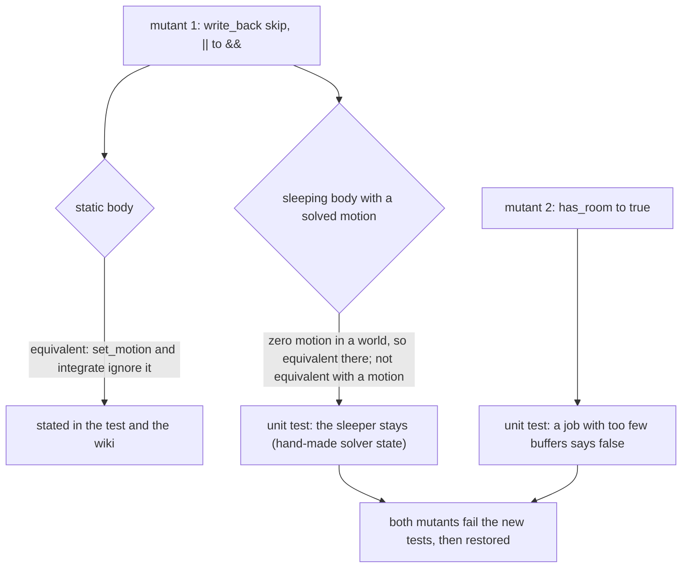

# Review 8-23: two surviving mutants of the 3D solver

Task: 8-23 (found in 8-14). Class 1 (tests only, no engine code changes). Ordinary card into `develop`. Owner, 2026-11-20: "let's tackle all class 1 tasks".

## What was done

- `d3/solver/mod.rs`: tests `a_solved_awake_body_takes_the_solved_motion` (the positive control, so the other two cannot pass because nothing is ever written), `a_sleeping_body_stays_where_it_is_even_if_the_solver_holds_a_motion_for_it`, `a_static_body_stays_where_it_is_even_if_the_solver_holds_a_motion_for_it`. The solver state is set by hand (`touched`, `bodies[0]`). Through a world a sleeper can be touched (a contact or joint with a static body does not wake it), but its solved motion is zero, so the `&&` mutant is behaviourally equivalent there and only a hand-made nonzero motion shows it. The test pins the guard against a future solver that gives a sleeper a motion.
- `d3/solver/stage.rs`: `a_job_has_room_only_when_there_is_a_buffer_for_every_chunk` (5 members in chunks of 2 are 3 chunks; 3 buffers and 5 buffers are room, 1 buffer and none are not).

## Evidence

- Red: with `||` changed to `&&` the sleeping-body test fails; with `has_room` returning `true` the room test fails (run together: 2 failed, 84 passed). Both files restored afterwards (diff shows only the added tests).
- Green: `cargo test -p physics --lib d3::solver`: 86 passed. clippy `-D warnings` and fmt on `physics`.
- The static case is a proof by reading, not a test that can fail: for a static body both paths end in a function that returns at once, so the mutant is equivalent there; the static test pins the behaviour.

## Not verified

- Not run: the whole-phase mutation run and branch coverage named on the card (still open; branch coverage needs nightly). cargo-mutants was not re-run on the files, only the two mutants were made by hand.
- Linux, ARM64. Mermaid read by the author, not rendered.

## Loops

| loop | finding | handling |
|---|---|---|
| 1 | major: the docs said a sleeper cannot be touched through a world | wrong, found by instrumenting `write_back` (reached about 5000 times in the suite, always with a zero motion); wording fixed here, in the test and in the wiki |
| 1 | minor: `make_outputs(5, 5)` is one buffer, not two | fixed; a case with more buffers than chunks added, it kills `>=` to `==` (which only a colouring test killed) |
| 1 | note: the loop-1 fixes were not seen by a second reviewer | stated |
