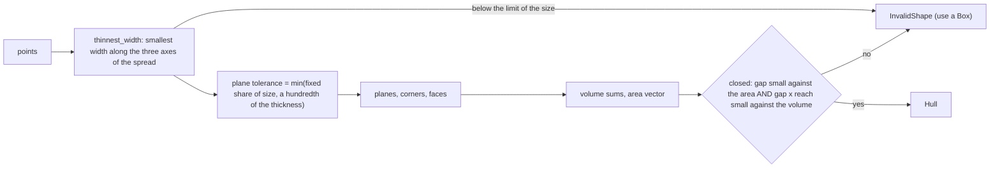

# Review 8-24: thin hulls no longer get a silently wrong volume

Task: 8-24 (found in 8-5, listed as F-HULL in the phase 8 milestone review). Class 2 (physics, a refusal rule of the public `Hull::new`; no `unsafe`, no new dependency, no governance file). Ordinary card into `develop`.

## The defect, measured

An independent reference was written first: the f64 volume of the hull of random tilted plates by brute force (every triple of points with all others on one side is a face), in `engine/physics/tests/d3_hull.rs`, itself tested on a box and a tetrahedron. Before the change, at a thickness of 1e-4 of the size, up to 65 of 200 six-point plates came back with a volume more than 3% off and no error (the worst 91% off); at 3e-4 up to 40 of 200 (the worst 57%); even at 1e-3 a few. The card's "70%" was therefore real, and not limited to 8 points. A first probe with axis-aligned prisms did not show it: tilted plates are needed.

Causes found: the plane tolerance was a fixed share of the size, as large as a thin plate; and the closed-surface check compared the gap in the faces with the *total area*, which for a plate is thousands of times its volume, so a gap that could change the volume by tens of percent passed.

## What changed (`engine/physics/src/d3/hull.rs`)

1. `thinnest_width`: the thickness from the points alone (smallest width along the principal axes of their spread), so it does not depend on the planes that are still to be found.
2. Plane tolerance is the smaller of the old fixed share and a hundredth of the thickness.
3. Points thinner than 5e-5 of the size are refused with `InvalidShape` (the two faces cannot be told from the rounding of the input).
4. The closed-surface check also refuses a hull whose gap could change the volume by more than a hundredth: moving the reference point by the reach of the corners changes the volume by about the gap times the reach over three.

## Tests (red first)

- `a_thin_tilted_plate_is_refused_or_has_the_right_volume_and_never_a_wrong_one`: 5 thicknesses by 4 point counts by 3 sizes, 200 random tilted plates each, against the f64 reference. **Red on the old code**: "thickness 0.0001, 6 points: 65 wrong, 43 right, 92 refused". Green now.
- `most_plates_of_a_third_of_a_thousandth_are_built`: at most 60 of 200 refused for each point count (before: 35% at 8 points, 76% at 16).
- `points_thinner_than_the_limit_are_refused_whatever_their_number`: red on the old code.
- `the_reference_volume_is_exact_on_a_box_and_a_tetrahedron`: the oracle checks itself.
- The 20 earlier hull tests are unchanged and pass.

## Evidence

- `cargo test -p physics -p tools_physics_bench`: all pass; `cargo clippy --workspace --all-targets -D warnings` and `cargo fmt --check` clean.
- Over 16 configurations of 200 plates (1e-4 to 1e-3 thick, 6 to 16 points) no plate was more than a few percent off the reference after the change; the refusal share fell (at 3e-4 and 8 points from 35% to 4%; at 16 points from 76% to 20%). At 1e-4 half or more are still refused.
- `gates/golden/physics3d-replay.toml`: `golden_check.py verify` equal against a fresh recorder run, so no golden hash moved and no governance task is needed.
- Mutation (cargo-mutants on the changed functions, tests `--lib`, `d3_hull`, `d3_narrowphase`): 63 mutants, 47 caught, 10 unviable, 6 missed; score 47 of 53 viable. After the first run the plate test was made sensitive to the size of the plate, which kills two of the six (`gap * reach` turned to `gap / reach`, and the like); the run was not repeated, so the final figure is not re-measured. Survivors judged: `+=` to `-=` in the covariance (equivalent: a negated matrix has the same axes); `<` to `<=` at the thickness limit and `>` to `>=` on `volume > 0` (boundary equality, not reachable with real input); `-` to `+` in the reach (not found by a test: open); the old area check turned off (subsumed by the new check).

## Not verified

- The limit 5e-5 and the shares (a hundredth) are chosen from the probe on Windows, not from a theory of the rounding; they were not varied further, nor checked on Linux or ARM64 (hull builds use no libm, but this was not run there).
- The reference uses the same f32 points, so it tests the build, not the input rounding; plates made by rotating exact coordinates carry the rotation's rounding.
- No branch coverage, no benchmark (the build adds one covariance and a few passes over at most 64 points, once per hull); mutation not repeated after the last test change.
- The other hull items of the card (contacts overlap more than for boxes, a stacked hull sinks, contact points hop on round hulls, the switch from 4 to 2 points) are not touched here.
- Mermaid read by the author, not rendered.

## R1 to R8

| phase | result |
|---|---|
| R1 self | the probe first used the wrong plate family (axis-aligned) and showed nothing: changed to tilted; the oracle and the test broke the lint limits and were restructured |
| R2 automated | tests, clippy, fmt, wiki lint, mutation |
| R3 independent | pending |
| R4 QA | exact oracle checked on a box and a tetrahedron; red on old code; sizes 40 and a fortieth |
| R5 architecture | change inside `hull.rs`; no API change except refusing more input |
| R6 security | no input beyond points; refusal paths return errors, no panic; no `unsafe` |
| R7 performance | one extra pass over at most 64 points at build time |
| R8 product fit | a shape with a wrong mass is the worst silent failure; now refused or right |

## Loops

| loop | finding | handling |
|---|---|---|
| (none yet) | | |
