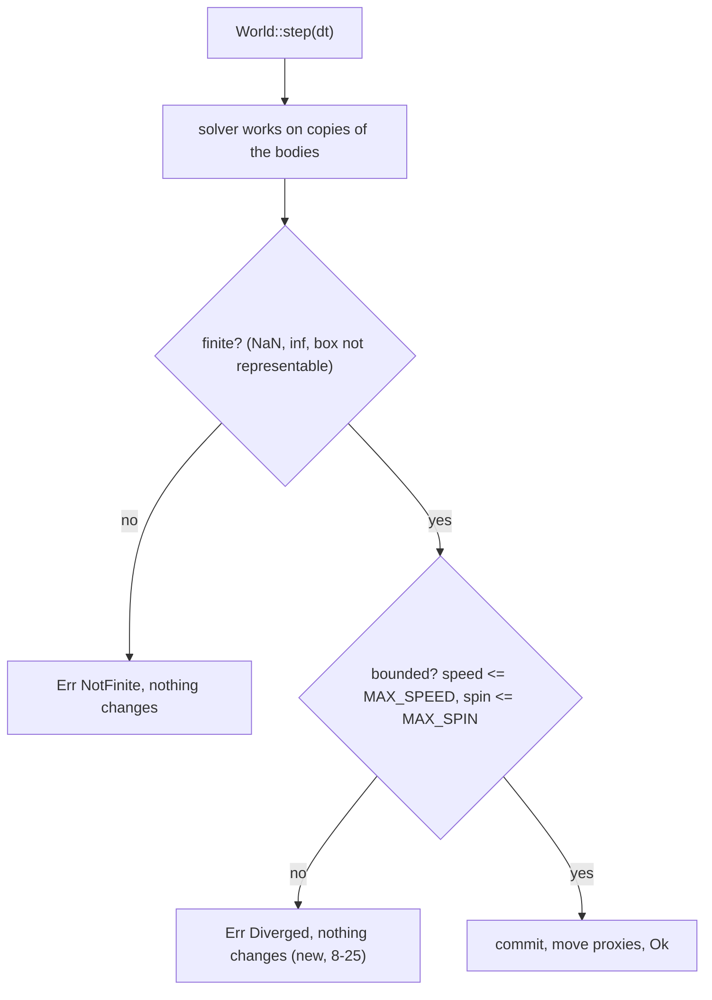

# Review 8-25: diverging joint scenes are refused

Task: 8-25. Class 2 (physics: a new value of the public error enum `PhysicsError`, two public constants, a new refusal in `World::step` of the shared core). Ordinary card into `develop`. Found in 8-7 (loop 3) and listed as F-JOINT in the phase 8 milestone review: a body tiny for its arm can diverge and `World::step` still returned `Ok`.

## What was wrong (measured, not assumed)

A scan of hinge scenes (a cube of 0.01 to 0.1 m on an arm of 3 to 20 m, started 1 to 3 rad round, with and without gravity, 600 steps) found many scenes in which a body ended with a speed of 1e11 to 1e18 m/s or one so large that its length overflows, with `step` returning `Ok` at every step. The old check looked only for NaN and infinity in the committed state, so a huge but finite state passed. The card's description ("can end finite and huge, and the step reports Ok") was right and, in the scan, not rare.

## Change

- `core/mod.rs`: `MAX_SPEED` and `MAX_SPIN`, both 1e5 (metres per second, radians per second).
- `core/error.rs`: `PhysicsError::Diverged` (the enum is `non_exhaustive`, so adding a value is not a breaking change), its message and its test case.
- `core/body.rs`: `motion_is_bounded` (squared speed against the squared bound; NaN and an overflow when squared are false).
- `core/world.rs`: after the finiteness check, `step` returns `Diverged` if any copy is not bounded; the committed state is untouched, as for `NotFinite`. The check is in the shared core, so the 2D world has it too.
- `d3/joint.rs` module doc and `phase8-3d-v0.md`: the known limit is restated.

## Decisions

1. **A bound on speed, not on position.** A diverging scene shows in speeds first; positions are already bounded by what the broadphase can hold (`NotFinite`).
2. **1e5 for both.** A bullet is about a thousand metres per second; nothing in the engine comes near the bound (all golden hashes and scenes are unchanged), while the diverging scenes pass it within a few dozen steps (the first test run: step 24 at 1.4e5). A tighter bound would be safer against divergence but risks refusing a legitimate fast scene; this one is a hypothesis in the sense of the gates and can be tightened by a later card with a measurement.
3. **A new error value, not `NotFinite`.** A caller can tell "the scene blew up" from "a number was not a number".
4. **Refuse, not repair.** The step returns the error and changes nothing; the same call gives the same error until the caller changes the scene. The caller decides (reset, destroy the bodies).

## Evidence

- Red first: `engine/physics/tests/d3_divergence.rs` with a local bound of 1e5 failed at "step 24 is Ok with speed 1.4e5" (the right reason). Green after the change (3 tests): three diverging scenes, with and without gravity, are all refused with `Diverged`, no step succeeds beyond the bounds and a refused step leaves `state_hash` as it was; a body thrown at 1000 m/s and spun at 500 rad/s still steps for a second; a body started beyond the bound is refused at the first step in 3D and in 2D with the world unchanged.
- Mutation (`cargo mutants -p physics --in-diff` over the changed source, tests `--lib` and `d3_divergence`): 12 mutants, 12 caught, none missed or timed out.
- Unit tests of `motion_is_bounded` at the exact limits, beyond them, negative, NaN and overflow.
- `cargo test -p physics` all green (432 unit tests and every integration binary, including the golden pins and the replay hashes); clippy `-D warnings` clean; fmt clean. Whole workspace (`cargo test --workspace --no-fail-fast`, Windows): every test binary ok; the only panic lines are those of `pool_abort_on_panic`, a test that panics on purpose.

## Not verified

- Linux and ARM64 not run here; the change is a comparison and an error value, and no golden hash moved on Windows.
- Only hinge scenes were scanned; ball and distance joints and contact-only blow-ups are covered by the same check in the core but were not scanned for divergence.
- A divergence that stays below 1e5 is still not seen (stated in the module doc and the wiki).
- A body created or set with a speed above the bound, or given a huge force, makes every later step fail until its velocity is set down or the body is destroyed (tested); the setters and `create_body` do not check the bound, and a refused step does not clear a force. Documented, not guarded: cards 8-36 and 8-37.

## R1 to R8

| phase | result |
|---|---|
| R1 self | the test needed scenes that diverge in both gravities; the first set did not |
| R2 automated | tests, clippy, fmt, workspace run |
| R3 independent | one read-only review: no blocker, no major; 3 minors and notes, fixed or carded |
| R4 QA | regression test red first, boundary unit tests, 2D and 3D, atomic refusal |
| R5 architecture | the check lives in the shared core, one place; physics stays free of ecs |
| R6 security | a refusal instead of an unbounded state; no new input path |
| R7 performance | one more squared-length comparison per body per step (cheap); not measured by a benchmark; the instruction-count gate runs on the release |
| R8 product fit | a caller can see a blown-up scene |

## Loops

| loop | finding | handling |
|---|---|---|
| 1 | minor: the ways out of a refusal were not documented or tested | named in the doc of `Diverged` and the wiki; a test sets the speed down and destroys the body |
| 1 | minor: `MAX_SPEED` and `MAX_SPIN` reachable only through `physics::core` | re-exported from `d2` and `d3`, the test imports them from `d3` |
| 1 | minor: "whole workspace: see below" pointed to nothing; R3 unfilled; loose bullet comparison | workspace result stated, R3 filled, wording sober |
| 1 | note: scenes tuned to diverge would turn the test red if the solver improves | comment says so |
| 1 | note: a huge force is a similar trap; setters and `create_body` accept speeds above the bound; contact-only blow-ups and divergence below the bound not scanned; no rotation bound measured | cards 8-36 and 8-37 |
| 1 | note: the loop-1 fixes were not seen by a second reviewer | stated |
