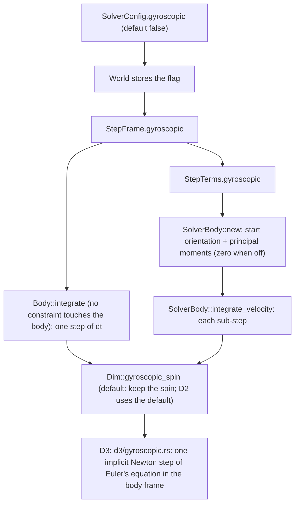

# Review 8-26: the gyroscopic term of 3D bodies (opt-in)

Task: 8-26 (found in 8-3, F-INERTIA of the phase 8 milestone review). Class 2 (physics, public config field, determinism). Ordinary card into `develop`. Owner go-ahead: "8-26"; owner decision: "Opt-in, off by default" (asked because the term changes every scene with a rotating non-sphere and so the stored golden hashes, which only a governance task may edit).

## What was done

| item | result |
|---|---|
| the term | `w' = w0 - J^-1 f` in the body frame, `f = h w0 x I w0`, `J = I + h (skew(w0) I - skew(I w0))`, solved by Cramer's rule; plain arithmetic only (no `sin`, `cos`, `sqrt`, no fused multiply-add); the moments are scaled by the largest one, so the step does not depend on the units |
| switch | `SolverConfig::gyroscopic`, `false` in `DEFAULT` and `STIFF_CONTACTS`; 2D ignores it (the `Dim` hook has a default that keeps the spin) |
| both paths | `Body::integrate` (a body nothing touches) and `SolverBody::integrate_velocity` (a body a contact or joint touches, each sub-step, orientation `turn * start`) |
| default unchanged | with the switch off the same operations run in the same order (the sum is only split into two statements); a full run of the physics tests with the cross-platform feature on passed before the last review fixes, golden hashes included |
| measured | box (0.5, 1, 0.25), spin (1, 4, 0.5), 240 Hz: momentum kept to 2.6 % over 2 s with the term (the angular velocity moves by 3.96 rad/s), turned away by 82 % without; a spin of 6 rad/s about the middle axis with 0.05 about the others flips at 1.46 s; the loss is first order, about 0.9 % of the momentum a second at 240 Hz, 0.2 % a second at 960 Hz, about 3 % a second at 60 Hz steps (free path) |

## Decisions

1. Opt-in and off by default (owner). Turning it on by default later moves every golden hash and many pins: a governance card.
2. Implicit single Newton step (as Bullet and Box2D v3), not the explicit one: the explicit step gains energy on a fast spin about the middle axis.
3. A hook with a default in `Dim`, so 2D, the spike tools and the test dimension in `generic_core.rs` need no change.
4. The card title says "full inertia tensor". Not done, on purpose: the three shapes and the hull are built on their principal axes, so the diagonal body-frame tensor is already the full tensor of those bodies. It becomes necessary only for a shape whose principal axes are not the local axes (a compound or an offset centre of mass). Card 8-72.

## Evidence

- Red: the field did not exist (compile error), then the two tests that need the term failed (momentum drift 7.8 % at the first probe, no flip) while the controls passed; the solver-path test failed (spin did not change: 0) until `SolverBody` got the term. The thin-body unit test is red against the old absolute guard at a step of 1e-5 s.
- By-hand mutations of the step (the sign of `step`, the factor of `f`, the sign of the `momentum x axis` term of the Jacobian) are all caught: the first two by unit and integration tests, the third by an integration test only (it is a second-order term).
- fmt, clippy `-D warnings` on `physics` (all targets), `cargo test -p physics --features cross-platform-determinism`, `cargo build --workspace` (see the PR for the gates).

## Not verified

- Mutation score of `gyroscopic.rs` (the memory limit of cards 8-34 and 8-70 still applies; only the three hand mutations above).
- Cost: `SolverBody` is 28 bytes larger and the default path runs one extra comparison per body per sub-step; no benchmark was run (the PR benchmark gate runs only on `main`).
- A touched body with a very fast spin at a large step; only the finite result is pinned.
- Conservation of energy: the scheme damps a little; not measured separately.
- Linux and ARM64 (the term uses no libm, and the golden file was not changed because the default is off); the term itself is not in the golden hashes.
- Mermaid read by the author, not rendered.

## R1 to R8

| phase | result |
|---|---|
| R1 self | first run: the probe showed 7.8 % drift over 10 s (first order); bounds were measured at 2 s and set with about 2 times margin; a first thin-body test used equal moments and so could not fail (fixed) |
| R2 automated | fmt, clippy, the physics tests |
| R3 independent | one read-only review: no blocker, one major, nine minor or nits; all handled (Loops) |
| R4 QA | analytic first-order check against Euler's equation, principal axes kept, equal moments kept, frame check, extreme step, bad moments; controls without the term |
| R5 architecture | one trait hook with a default; one new private module; public API gains one config field and one `StepFrame` field |
| R6 security | none (no input from outside; non-finite results fall back to the old spin) |
| R7 performance | not measured (see Not verified) |
| R8 product fit | the owner gets the physical tumble as an option and knows what turning it on by default costs |

## Loops

| loop | finding | handling |
|---|---|---|
| 1 | major: the singularity guard was absolute (`det <= EPSILON`) and skips the term for a long thin body | guard relative to the size of the columns; a thin-body unit test, red against the old guard at a step of 1e-5 s. At a step of 1/240 s the old guard was not reproducible (the `h` terms keep the determinant above it), so the reviewer's scenario holds only for very small steps |
| 1 | minor: a quaternion multiply per body per sub-step with the switch off | skipped when the moments are zero |
| 1 | minor: the per-pass copy of 312 bytes in the wiki is stale | the page says 56 bytes more and that the effect was not measured |
| 1 | minor: 960 Hz and 60 Hz figures looked extrapolated | they were measured; stated as measured, with 3 % (not 3.5 %) at 60 Hz |
| 1 | minor: "the 47 test binaries" | reworded to the existing tests and the full run with the feature on |
| 1 | minor: the comment pointed to a module doc without the figure | the figure is in the module doc |
| 1 | nit: the "never flips without it" half is a control by construction; the pinned box sphere might collide | commented in the test; `JointDesc::new` keeps connected bodies from colliding |
| 1 | nit: huge step | a unit test pins a finite result at a 10 s step |
| 1 | note: the loop-1 fixes were not seen by a second reviewer | stated |
