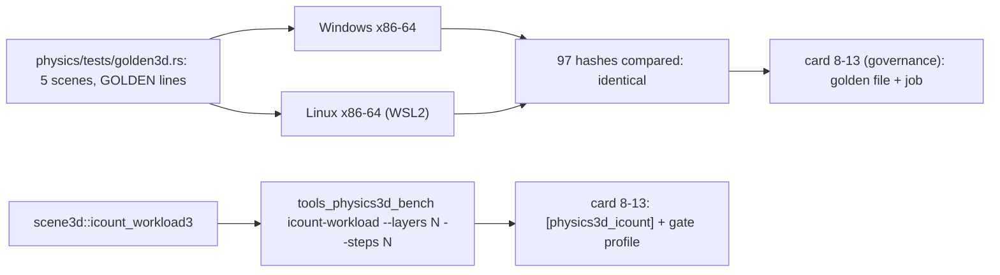

# Review 8-29: the 3D golden recorder and the 3D instruction-count workload

Task: 8-29. Class 2 (test code in `physics`, one new function in the dev tool `tools_physics_bench`, one new dev-tool crate `tools_physics3d_bench`; no engine code changed, no `unsafe`, no new third-party dependency, no port revision, no governance file, nothing in `gates/`). Ordinary card into `develop`. It is the code half of card 8-13: the owner declared 8-13 a governance task on 2026-11-19 and ordered the work as "code card first, then governance". 8-13 itself (the gate files, the CI jobs and the tool changes) is not part of this card.

## Decisions

1. **The recorder is a new test target `golden3d`**, not an extension of the 2D `determinism` target: the 2D golden file and its job stay as they are, so main is not touched by 3D lines before the 3D code reaches it. The lines have the 2D format (`GOLDEN|scene|`, `GOLDEN|hash|`, `GOLDEN|end|`), so the existing checker can read them.
2. **Five scenes of the `D=3` instance, stepped on the scalar serial reference**: pyramid (5 rows, two crates deep), sleeping tower (8 crates, sleeping on), heavy crate on light ones, mixed pile (32 bodies of four shapes including convex hulls, seeded tilt), joint chain (ball, hinge and distance joints). Checkpoint every 10 steps plus the first and the last step.
3. **A new crate instead of a new mode of the existing tool.** The gate calls `icount-workload` with flags fixed per tool; the 2D tool takes `--rows`. A new package means the base tree (main) has none, and the gate's existing rule for a tool only in HEAD ("no baseline, recorded only") applies, as for the audio and ECS tools; a new flag on the old binary would make the base measurement fail, which the gate reads as red. `tools_*` is layer 4 in `gates/architecture.toml`, so no gate file changes (arch-check: 40 crates, 0 violations).
4. The workload size is not chosen here; 8-13 chooses it on the hosted runner.

## Evidence

- Tests first: `tools_physics_bench/tests/icount3d.rs` (4) was red (did not compile) before `icount_workload3`; `tools_physics3d_bench/tests/cli.rs` (4) and `physics/tests/golden3d.rs` (5) were written before or with the code; the recorder tests are green on first run (the recorder is itself test code; its tests are about its lines, not about physics).
- `cargo test -p tools_physics_bench`, `cargo test -p tools_physics3d_bench`, `cargo test -p physics --test golden3d` (with the feature on and off), clippy `-D warnings` on the three crates with the feature on, `cargo fmt`: clean.
- **D2 on the 3D scenes (measured here, final code):** `GOLDEN` lines of `cargo test -p physics --features cross-platform-determinism --test golden3d -- print_the_golden_lines --nocapture` on Windows x86-64 and on Linux x86-64 (Ubuntu in WSL2, rustc 1.94.1): 107 lines each, 97 hash lines, **identical** apart from the platform header line. With the feature **off** the hashes were also identical across the two platforms and identical to the feature-on hashes on Windows (run before a change of the hull corner order; not repeated after it). So the recorder does not discriminate the feature on from off on these scenes.
- The workload `icount-workload --layers 10 --steps 20` printed `bodies=385 hash=0274e5debb3f7872` on Windows and on Linux (release builds).
- No `libm` call is reached from `physics/src/d3` or `physics/src/core` by the scan I ran (`sin cos tan atan acos exp ln powf cbrt hypot mul_add`); `Quat::from_axis_angle` and `slerp` go through `base::dmath`.

## For card 8-13 (governance; not done here)

- A golden file for the 3D scenes (a new file next to `physics-replay.toml`, the recorded lines of this card, taken on Windows and Linux), a job like `d2_determinism` that runs `cargo test -p physics --features cross-platform-determinism --test golden3d -- print_the_golden_lines --nocapture` and whose presence check says "not run" while `physics/tests/golden3d.rs` is absent (the 2D checker's `presence` knows only the crate); `golden_check.py` needs that extension.
- A `[physics3d_icount]` entry in `gates/benchmarks.toml` with `package = "tools_physics3d_bench"`, a new `Profile` in `tools/icount-gate` (flags `--layers`, `--steps`), a job `physics3d_icount` in `ci.yml` and the workload size chosen on the runner (the noise must stay within the 0.5% of the existing entries).
- Instruction counts were **not measured here**: `valgrind` is not installed in the WSL image and I did not install it.

## Not verified

- No instruction count (no valgrind here); the gate's noise rule is not checked for this workload.
- No hosted run; no ARM64; the Linux run is WSL2, not a hosted ubuntu runner.
- The feature-off equality was checked before the hull corner order of the recorder was changed; the final code was run with the feature on and off for the tests, and the cross-platform comparison was repeated only with the feature on.
- No mutation run: the changed code is test code, a dev-tool function and a dev-tool crate (layer 4, no gate).
- Mermaid read by the author, not rendered.

## R1 to R8

| phase | result |
|---|---|
| R1 self | clippy nesting (two items) and a by-value large type fixed; the hull corner order change re-recorded the mixed pile |
| R2 automated | tests, clippy, fmt, arch-check, local gates |
| R3 independent | one read-only review, no blocker or major; minors fixed, notes below |
| R4 QA | recorder lines twice, every scene moves, two platforms, a bad command line is refused |
| R5 architecture | new dev crate at layer 4, no new edge to the engine |
| R6 security | no `unsafe`, no dependency, no secrets |
| R7 performance | not applicable (a workload) |
| R8 product fit | the 3D claim of D2 gets its first cross-platform evidence |

## Loops

| loop | finding | handling |
|---|---|---|
| 1 | minor: a failing `from_axis_angle` in the recorder fell back silently to the identity | now an error (`NotFinite`) that fails the test |
| 1 | minor: `--steps` unbounded in the workload tool | bounded at 1,000,000 like the gate's workload keys; the tests were added with the bound, not run red first |
| 1 | minor: `--layers 0` untested | test added: no boxes, a hash |
| 1 | minor: recorder incompatible with `golden_check` presence and render (one file, 2D recorder path) | already listed under 8-13; the lines themselves parse |
| 1 | note: Linux figures and the workload hash were not re-run by the reviewer; stale sentence on feature-off equality | stated in Not verified |
| 1 | note: `du.exe.stackdump` untracked | not committed |
| 1 | note: the loop-1 fixes were not seen by a second reviewer | stated |
