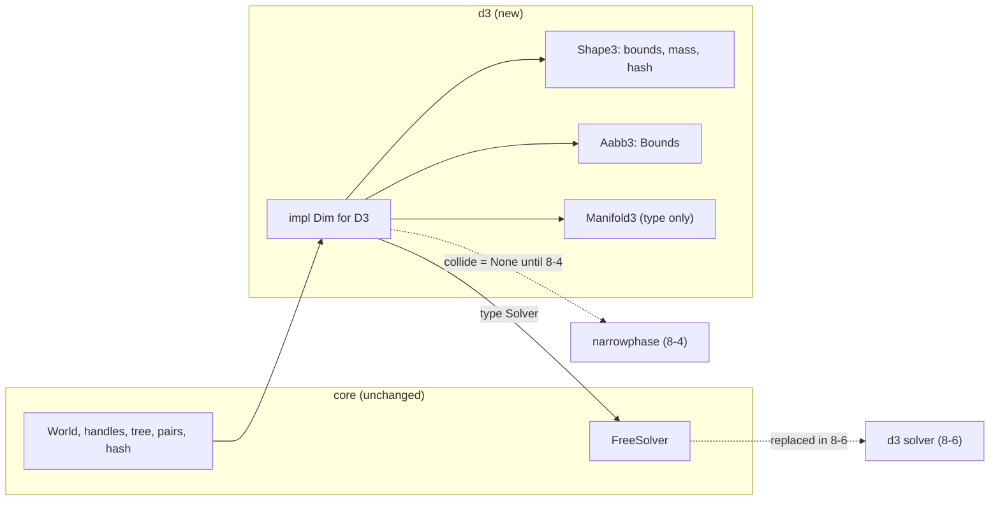

# Review 8-3: `physics::d3` bodies

Task: 8-3. Class 2 (new public API: `physics::d3`, no unsafe, no new dependency, no governance file). Ordinary card into `develop`. Loops: 1 fix loop (1 independent review). Open blocker/major: 0.

Delivers: the `D=3` instance of the generic physics core ([phase8-3d-v0](../wiki/architecture/phase8-3d-v0.md) section 3, ADR-0018): `D3` fills `Dim` with `Vec3`, `Quat`, a diagonal inverse inertia in the body frame, `Shape3` (sphere, box, capsule), `Aabb3`, `Manifold3`. Bodies integrate, spin, hash and enter the shared broadphase. README v1.64.

## Decisions

1. **Diagonal inverse inertia** (`InvInertia = Vec3`, principal moments in the body frame). Sphere, box and capsule are symmetric about their axes. The convex hull (8-5) has a general tensor: it then needs a principal-axes rotation or this type changes to a full matrix (a public API change). Recorded as an open point for 8-5.
2. **Capsule axis is the local Y axis**; `half_height` is half the cylinder part.
3. **`collide` returns `None` and the solver is `FreeSolver`** until 8-4 and 8-6. The `Dim` trait did not grow, as the spike (8-2) found.
4. **No gyroscopic term** (known limitation, stated in the module doc and the design note): a torque-free body keeps its angular velocity, which is not physical when the principal moments differ. Candidate for 8-6 or 8-12; not decided here.
5. **An orientation must be near unit length** (squared length within 1e-4 of one), checked where the core checks finiteness, so creation and every step refuse a zero or scaled quaternion with `NotFinite`. No new `Dim` method was needed.
6. `HashBits` and `Quantity` for `Quat` are implemented in `d3` (the traits are the physics crate's own).

## Evidence

- Tests written first (red: `physics::d3` did not exist, the test file did not compile). `engine/physics/tests/d3_bodies.rs`: 33 tests, plus 3 in `d3/manifold.rs`. `cargo test -p physics`: all pass.
- `cargo clippy -p physics --all-targets -- -D warnings`: clean (the physics crate bans `expect`, `sin`, `cos`; the tests use `dmath` and let-else).
- Mutation (`cargo mutants -j1`, one file at a time, tests `d3_bodies` and `d3::manifold`), result after fixing the tests: `aabb.rs` 16 caught, 1 unviable; `shape.rs` 177 caught, 8 unviable in the full run, whose 4 missed were fixed in the tests and then 138 caught, 4 unviable in a rerun filtered to `is_valid`, `mass_and_moments_per_density` and `mass_properties`; `mod.rs` 32 caught, 7 unviable (the orientation check was added afterwards: 6 caught in a filtered run); `manifold.rs` 3 caught. No mutant is missed. The three-part history is stated because the full `shape.rs` run was not repeated after the test fixes; the survivors had all been in the filtered functions. Output `target/mut-8-3-*` (not committed).
- Local gates (`python tools/local-gates/local_gates.py --base origin/develop`): exit 0 (the four `FAIL` lines are the tools' own negative-case output). Wiki lint: 70 pages, 0 violations. Output `target/local-gates-8-3.txt` (not committed).

## Not verified

No Linux or ARM64 run; no D2 cross-platform golden hash for `D3` (card 8-13); no multi-thread run (no parallel solver yet); no branch coverage or new-line gate; no benchmark; the full `shape.rs` mutation run was not repeated in one piece (see Evidence). Mermaid read by the author, not rendered.

## R1 to R8

| phase | result |
|---|---|
| R1 self | read the module against the `d2` patterns; fixed test values equal to 1.0 that hid mutants |
| R2 automated | tests, clippy, mutation, local gates, wiki lint, diff hash |
| R3 independent | read-only reviewer: 0 blocker, 2 major, 8 minor, 3 nit; handled below |
| R4 QA | closed-form checks plus an independent numerical integration of the capsule; bounds against extreme points |
| R5 architecture | `core` unchanged, `Dim` unchanged; `d3` inside the `physics` crate as ADR-0018 says; arch-check 0 violations |
| R6 security | no `unsafe`, no new dependency, no secrets; every size is validated and refused as a value |
| R7 performance | not measured (no solver yet); no allocation in `d3` code; benchmarks are card 8-12 and 8-14 |
| R8 product fit | the owner reads decisions 1 and 4: the diagonal inertia and the missing gyroscopic term |

## Loops

| loop | finding | handling |
|---|---|---|
| 1 | major: no check that an orientation is a unit quaternion | `Quantity::is_finite` for `Quat` now also requires near-unit length; tests with boundaries; 6 mutants caught |
| 1 | major: the design note still said a full 3x3 inertia tensor | section 3 of the design note now says diagonal, with the 8-5 consequence and the missing gyroscopic term |
| 1 | minor: this file pointed to sections that did not exist | sections written |
| 1 | minor: "as in 2D" for the missing gyroscopic term | reworded as a known limitation |
| 1 | minor: "exact in the limit"; `Error` alias; stale crate doc; capsule test copied the formulas | reworded; alias removed (`PhysicsError` as in `d2`); crate doc updated; numerical integration test added |
| 1 | minor: the `unwrap_or` fallback in `advance_rotation` is internal | kept, the test pins the fallback; accepted |
| 1 | nit: wording of symmetry; contract of manifold fields not yet produced | reworded; marked "from card 8-4" |
