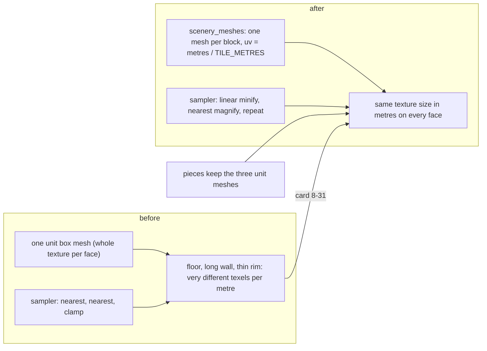

# Review 8-31: the texture of the 3D sandbox scenery

Task: 8-31. Class 2 (render sample: mesh data and texture sampling of a lit scene; no port, no shader, no `unsafe`). Ordinary card into `develop`. Found by the owner's look at the OpenGL window in card 8-27: the checker texture on the near walls and the floor broke into coarse stripes.

## Suspected causes (read in the code; the picture was not seen)

1. `Sandbox::populate` drew the floor and the four walls with the one unit box (`BOX`) scaled by the block's half extents. A unit box has the texture 0..1 on every face, so a face of 24 by 4 metres and a rim of 1 by 4 metres each show the whole texture: the sampling rate in texels per metre differs by a factor of about 24 between them, and a far or grazing face aliases.
2. The sampler was nearest for minifying and magnifying and clamped: no averaging when a face is far. With a texture of one mip level a linear filter only blends neighbouring texels, so changing it is a small help; the real cure is mip levels (card 8-35).

## Change

- `engine/app_sandbox3d/src/mesh.rs`: `TILE_METRES` (12 m), `SCENERY_FIRST` (3), `scenery_meshes()` (one unit box per block of `scenery()`, with uv scaled so one uv unit is `TILE_METRES` of the scaled face on every face, whatever its size).
- `renderer.rs`: the meshes are a `Vec` (the three unit meshes, then the scenery); the sampler is linear for minifying, nearest for magnifying, repeat.
- `sandbox.rs`: the block with index `i` is drawn with mesh `SCENERY_FIRST + i`.
- Tests (`mesh/tests.rs`): the scenery has one unit-box mesh per block after the three unit meshes; on every triangle of every scenery mesh one uv unit is `TILE_METRES` metres along both texture directions and the directions are square; the unit box stretches the texture by more than a factor of ten on a 1 by 3 by 24 metre wall (the old behaviour, so the cause is stated by a test).
- `tests/glue/session.rs`: the three golden fingerprints of the command stream changed. The test says to look at the picture before updating the numbers; a dump of frame 1 on `develop` and on this branch (the same session, seed 24) has 46 lines each and differs only in `bind_uniforms`, `bind_index_buffer` and `bind_vertex_buffer` lines (buffer handle numbers), no pass, pipeline, texture, sampler or draw command differs. The numbers are updated for that reason, with a comment saying so.
- Wiki: `phase8-3d-v0.md` (the bullet "Built in card 8-31"), `wiki/README.md` v1.82. The UML view of this documentation change is the diagram above.

## Evidence

- Red: the three new tests did not compile before the change (`scenery_meshes`, `SCENERY_FIRST`, `TILE_METRES` missing). The third test describes the old behaviour and passes at once by design (characterisation). The tile test could not be red for another reason than the missing function; it was not run against a half-implemented body.
- Green: `cargo test -p app_sandbox3d` (unit 54, binary 4, glue 31, golden 1, lit image 2: all ok on Windows), clippy with `-D warnings` clean, fmt clean.
- The Null-device golden stream moved as described above; the image test on OpenGL (lit side, colours, depth order) still passes.

## Not verified

- **The picture was not looked at by anyone.** Whether the stripes are gone at the default camera on OpenGL and Vulkan is for the owner's eyes (`app_sandbox3d` and `app_sandbox3d --vulkan`). The causes were read in the code and the texture size in metres is tested, but the screen was not seen.
- **No mip levels (card 8-35).** The device port uploads mip level 0 only (`update_texture` writes level 0), so the texture has one level; a surface far away or at a grazing angle can still alias a little, the averaging being the linear filter of one level. Mips need a port change (card 8-35).
- `TILE_METRES = 12` is a chosen size (squares of 1.5 m, about the density the floor had, 13 m over eight texels), not measured. At the first choice of 4 m the review found that far faces would have carried about six times more squares per metre than before and could alias more; the size was raised for that reason.
- Linux and ARM64 not run (the change is data and a sampler description).

## R1 to R8

| phase | result |
|---|---|
| R1 self | the clippy nesting lint on the first test helper; reshaped |
| R2 automated | tests on Windows, clippy, fmt, local gates |
| R3 independent | one read-only review: no blocker, two majors (the first tile size could make far aliasing worse; claims of cause and cure overstated), six minors and notes |
| R4 QA | uv size tested in metres on all triangles of all blocks; old stretch pinned |
| R5 architecture | no port change; the scenery mesh is app data |
| R6 security | none |
| R7 performance | five more meshes uploaded once at start; draw count unchanged |
| R8 product fit | the owner's report of stripes; the look needs the owner |

## Loops

| loop | finding | handling |
|---|---|---|
| 1 | major: 4 m tiles raised the pattern density up to six times, linear over one mip level cannot average that | tile size 12 m (squares as dense as the old floor); stated in code, wiki and here |
| 1 | major: "causes found / cure made" overstated | reworded to suspected causes, effect unseen |
| 1 | minor: `scenery_meshes` returned `Option` though it cannot fail | returns `Vec`, dead error branch removed |
| 1 | minor: `SCENERY_FIRST` only compared with itself | the test compares it with the number of unit meshes |
| 1 | minor: pieces also get repeat and linear minification | stated: their uv stay in 0..1, magnification is still nearest, effect at their edges tiny |
| 1 | minor: golden evidence covers frame 1 only; no test ties block index to mesh index | stated; the tile test pairs block and mesh in order, the fingerprints cannot see uv |
| 1 | note: the loop-1 fixes were not seen by a second reviewer | stated |
