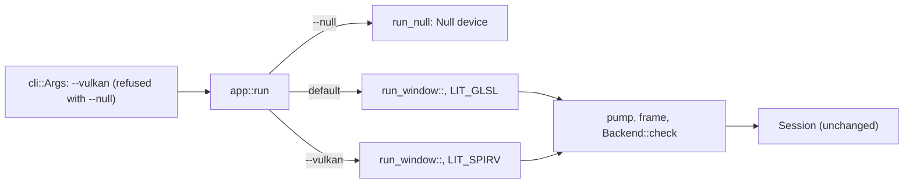

# Review 8-32: the Vulkan window loop of the 3D sandbox

Task: 8-32. Class 2 (a new mode of a layer 4 sample; `adapter_render_vk` moves from a dev-dependency to a dependency of the sample, a workspace crate, no third-party dependency; no port change, no `unsafe`, no governance file). Ordinary card into `develop`, ordered by the owner on 2026-11-19 after card 8-27 found that Vulkan ran only in the offscreen image test.

## What changed

- `cli.rs`: `Args.vulkan`, the flag `--vulkan`, the error `VulkanWithNull`, the usage line.
- `app.rs`: `run_window` and `draw_frame` are generic over `app_sprite_sample::backend::Backend`; the shader asset and the window title are chosen per API (`asset_for`); the per-frame error check is `Backend::check` (the GL error flag, or the Vulkan validation report), which replaces the GL-only call.
- `Cargo.toml`: `adapter_render_vk` is a dependency.
- Docs: `main.rs` header, `wiki/architecture/phase8-3d-v0.md` (bullet), `wiki/README.md` (v1.80).
- `Session`, `Renderer` and the physics are untouched.

## Tests (red first)

Red: the new unit tests did not compile (no `vulkan` field, no `VulkanWithNull`, no `asset_for`). Green after the change: flag parsing and default, the refusal in both argument orders, the usage line, the asset per API, the built program refusing `--vulkan --null`, and a window test (a Vulkan window draws 3 frames). Without a device it reports `not run` (exit code 3) unless `DUCK_REQUIRE_VK` or `DUCK_REQUIRE_GLFW` is set; any other exit code fails.

## Evidence

- `cargo test -p app_sandbox3d`: all suites pass (51 unit, 4 binary, 31 glue, 1 shader golden, 2 image).
- With `DUCK_REQUIRE_VK=1 DUCK_REQUIRE_GL=1` the 4 binary tests pass, so both window tests ran on real devices here (Windows, GLFW, an OpenGL 4.5 and a Vulkan 1.3 driver).
- `app_sandbox3d --vulkan --frames 200` (release) drew 200 frames, exit 0.
- `cargo fmt --check` and `cargo clippy -p app_sandbox3d --all-targets -D warnings` are clean.

## Not verified

- Whether the Khronos validation layer was active: the sample turns it on only when installed. The Vulkan SDK is installed on this machine (it ships the layer), so it very likely was, but the run does not print that, so "no validation errors" is stated as likely, not proven.
- No person has used the Vulkan window yet (keys, orbit, zoom, resize); only frames drawn.
- Window resize on Vulkan (swapchain recreation) is covered by the existing renderer code path, not by a test of this card.
- No Linux Vulkan window run, no hosted run.
- Mutation testing was not run: the changed code is layer 4, outside the mutation gate, and the new branches are covered by the tests above.
- Mermaid read by the author, not rendered.

## R1 to R8

| phase | result |
|---|---|
| R1 self | a test named for equal physics state compared nothing of the kind: renamed for what it checks |
| R2 automated | tests, fmt, clippy |
| R3 independent | one read-only review, no blocker or major; two minors fixed; notes in the loops table |
| R4 QA | flag combinations, both orders, asset per API, window tests on a real device |
| R5 architecture | layer 4 names two adapters (composition root rule); no port or lower layer touched |
| R6 security | no input beyond the existing flags; no `unsafe`; no secrets |
| R7 performance | the loop and the frame are unchanged |
| R8 product fit | closes the Vulkan part of card 8-27 |

## Loops

| loop | finding | handling |
|---|---|---|
| 1 | minor: the Vulkan window test was gated on the OpenGL switch | now `DUCK_REQUIRE_VK` or `DUCK_REQUIRE_GLFW`, header comment updated |
| 1 | minor: the both-windows test added nothing and hid a failed run as `not run` | removed (the two single-device tests already assert the frames) |
| 1 | note: a minimised Vulkan surface could count a frame as drawn that executed nothing | affects only the frame count; traced the resize and minimise path in `adapter_render_vk` (rebuild, retry once, `None` when minimised), not changed here |
| 1 | note: README header version line is old | existed before this card, not touched |
| 1 | note: the loop-1 fixes were not seen by a second reviewer | stated |
