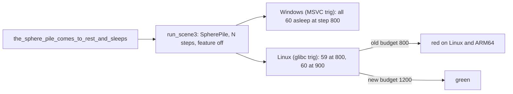

# Review 8-33: the sphere pile test on Linux and ARM64

Task: 8-33. Class 1 (one test file of a dev tool; no engine code, no gate, no threshold). Ordinary card into `develop`. It was the only failing test of the hand-dispatched `ci` run on `develop` for the release PR #92 (four jobs: Ubuntu build/test, headless-only, Ubuntu metrics, ARM64).

## Cause (measured)

The test asserts that all 60 spheres are asleep after 800 steps, with the cross-platform determinism feature off (the default build, which CI tests). With the feature off the platform's own trigonometric functions give the last digits of the rotations, so the pile does not move identically on Windows and Linux. A probe of the same scene at 600, 800, 900, 1000, 1200, 1600, 2400 and 4000 steps:

| steps | Windows asleep | Linux (WSL2 Ubuntu) asleep |
|---|---|---|
| 600 | 32 of 60 | 28 of 60 |
| 800 | 60 | **59** (final speed 0.012) |
| 900 and more | 60 | 60 |

The last sphere is asleep at step 800 on Windows and between 800 and 900 on Linux (the probe grid was coarse), so 800 had no margin. With the feature on the same test passes on Linux (checked); the ARM64 failure (59, the same figure) fits the same cause but was not run. The cause is therefore the platform's floating-point behaviour with the feature off: most likely the trigonometric library (glibc against the Microsoft one), possibly fused multiply-add inside glibc's own functions. The feature, which the control uses, changes both at once, so they are **not separated**; a discriminating test (the trig facade alone, or FMA off) was not made.

## Change

`engine/tools_physics_bench/tests/scenes3d.rs`: a constant `PILE_SLEEP_STEPS = 1200` used by `the_sphere_pile_comes_to_rest_and_sleeps` only (the other pile test keeps 800 and passes). The assertions are kept: every body asleep and the final speed under the rest speed, now by step 1200. **Added after the review:** at the old budget of 800 steps all bodies but one must already sleep (60 on Windows, 59 on Linux), so a pile that suddenly sleeps much later than before still fails. The budget is a looser bound by itself and the added assertion keeps the old tightness for the pile as a whole.

## Evidence

- Red: the test on Linux before the change, 59 against 60 (`scenes3d.rs:146`), the same figures as the CI run; also red on the hosted runs.
- Green after: Windows, the two pile tests; Linux (WSL2), all 13 tests of `scenes3d` with the default features.
- Feature on, Linux: the test passed already.
- The probe was a temporary test file, not committed.
- Full Linux workspace run (WSL2 Ubuntu, `cargo test --workspace --locked --no-fail-fast`, default features): no failed test. The only panic lines in the output are those of `pool_abort_on_panic`, a test that panics on purpose to prove the abort, and it passes. This answers the worry that a test binary stopping CI at the first failure hid others.

## Not verified

- No ARM64 and no hosted run of the new budget: the release PR's next `ci` run is the check. The ARM64 behaviour is inferred from its identical failure figure.
- 1200 is a margin chosen above the measured 900, not a computed bound; a different library version could move it. The determinism feature is the exact fix for cross-platform equality, and it is on in the golden jobs.
- ARM64 was not run locally.

## R1 to R8

| phase | result |
|---|---|
| R1 self | the probe, not a guess, chose the budget |
| R2 automated | tests on two platforms, fmt |
| R3 independent | one read-only review: no blocker; 2 majors (the cause claim overstated; a longer budget alone loses the not-later-than-before guard) and 4 minors, fixed |
| R4 QA | red on Linux first, green after; feature-on control |
| R5 architecture | test file only |
| R6 security | none |
| R7 performance | the test runs 1200 steps instead of 800 (a second or two) |
| R8 product fit | unblocks the phase 8 release |

## Loops

| loop | finding | handling |
|---|---|---|
| 1 | major: the evidence does not separate libm from fused multiply-add | the review and the code comment say so; no discriminating test made |
| 1 | major: raising the budget alone would let a pile that sleeps much later pass | added `asleep + 1 >= bodies` at 800 steps |
| 1 | minor: "about 900" was an upper bound of a coarse grid | "between 800 and 900" |
| 1 | minor: R3 and loops unfilled; a duplicated hosted-run line | filled and left (the line is the task text) |
| 1 | note: the fixes of loop 1 were not seen by a second reviewer | stated |
