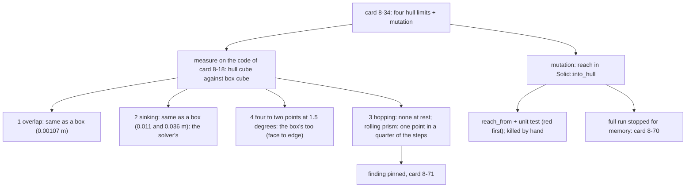

# Review 8-34: what is left of the hull limits of card 8-24

Task: 8-34 (found in 8-24, 8-5, 8-6, 8-18). Class 2 (physics). Ordinary card into `develop`. Owner go-ahead: "8-34". The card lists four open limits of the 3D hull and a mutation follow-up; it says "start with a failing test per item".

## What was found

| item | result |
|---|---|
| 1 hull contacts overlap more than box contacts | no longer: 0.00107 m for hull and box (a test pins both equal within 1e-4; hull and box go through different code, `face_clip` and `box_box`). The 13 to 16 mm of card 8-6 was reported with the one-point manifold; this card did not reproduce it, it infers that card 8-18 removed it |
| 2 a stacked hull sinks | no more than a box: 5 rows 0.0109 m, 10 rows 0.0355 m for both (equal within 1e-4). The sink that remains is the solver's (a column of boxes does the same) |
| 3 contact points hop on round hulls | at rest the points of prisms of 8, 12 and 16 sides do not move (below 0.1 mm over 100 steps, no change of count: both asserted). Rolling: one point in 52, 65 and 58 of 240 steps where an edge (two points) touches; never airborne; at most 5 mm sideways over the 240 steps; spin about the other axes at most 0.26 rad/s. Pinned as a finding on both sides; the cause was not looked into (card 8-71) |
| 4 hard switch from 4 to 2 points | at 1.5 degrees for the hull and the box alike (every half degree from 0 to 10 compared): four points up to 1 degree, two from 1.5; that is the change from face to edge contact, and an edge is two points. Not a defect of the hull; which rule of the narrowphase decides the tilt was not isolated (the face window of card 8-18 is in the path: raising `MIN_FACE_COSINE` breaks the parity test) |
| mutation follow-up | the survivor named in 8-24 (`-` to `+` in the reach of `Solid::into_hull`) is killed by hand: the reach is now `reach_from`, with a unit test written first (red: function missing); applying `-` to `+` by hand fails the test. Card 8-24 judged its other five survivors equivalent or boundary cases; they are not re-judged here. The full run (78 mutants on the functions changed by 8-24) was started and stopped by the system for low memory before one mutant finished: no score is reported (card 8-70) |
| the exact thin slab between 3e-5 and 5e-5 | an owner decision (a lower limit), not a card |

## Decisions

1. Nothing in the contact code changed: the limits the card lists are not hull defects on the present code, so the tests pin the measured state with the box as the control. A fix without a failing test would have been invented work.
2. One private helper `reach_from` in `hull.rs` (same value as before) so that the survivor can be tested at the smallest unit.
3. The rolling-prism numbers are chaotic (a probe with other sine values gave 27, 53, 67 one-point steps); the pin has a wide margin (10 to 120 of 240) and says so.

## Evidence

- Red: `reach_from` did not exist (compile error in the new unit test); then green. A by-hand mutation of the reach (`-` to `+`) fails the unit test.
- Mutation of the contact code: with `MIN_FACE_COSINE` raised from 0.9995 to 0.99999 three of the five new tests fail (tilt parity, rest stability, rolling); the file was restored from a copy.
- The new tests passed on their first run, which is the finding itself (the limits are fixed since card 8-18); the mutation above shows they can fail.
- fmt, clippy `-D warnings` on `physics`, `cargo test -p physics` (see the PR for the gates).

## Not verified

- The full mutation score of the hull build (card 8-70). The mutation figure of card 8-24 (47 of 53 viable) stays the last measured one.
- Hulls other than cubes and prisms of up to 16 sides (32 corners is the limit); a hull on a slope or under load; Linux and ARM64; coverage, benchmarks, Miri. Mermaid read by the author, not rendered.
- The tilt switch was measured about one axis (x) with a half millimetre gap and no gravity.

## R1 to R8

| phase | result |
|---|---|
| R1 self | the first rolling probe used `std` sine and gave other counts than the test's `dmath` sine (27 against 52 one-point steps): the pin got a wide margin; clippy nesting fixed by helpers |
| R2 automated | fmt, clippy, the physics tests |
| R3 independent | one read-only review: no blocker, three major, seven minors; all handled (Loops) |
| R4 QA | box as control for every hull number; both sides pinned; a mutation of the face window |
| R5 architecture | tests and one private helper; no API change |
| R6 security | none |
| R7 performance | none (a helper called once per hull build) |
| R8 product fit | the owner learns that three of four hull limits are gone or are not the hull's, and what is still open |

## Loops

| loop | finding | handling |
|---|---|---|
| 1 | major: the box control goes through another algorithm (`box_box`), so 'the box's too' is two code paths agreeing | worded so in the test header, the table and the wiki |
| 1 | major: 'the 1.8 degree window is not what decides it' was not measured, and the mutation of the window breaks the tilt test | sentence replaced: the rule that decides the tilt was not isolated |
| 1 | major: '5 mm over 3 m' and 'no change of count at rest' were not asserted | the count change at rest is asserted now; 'over 3 m' became 'over the 240 steps' |
| 1 | minor: `sink > 0` pinned a defect; `unwrap_or(IDENTITY)` hid a failed rotation; `physics_cos` wrappers; a wrong error for zero rows; the `Roll` doc | lower bound dropped (envelope 0.05 m), `turn` helper with an error, wrappers removed, `InvalidShape`, doc fixed |
| 1 | minor: the kill of the survivor was by hand, and the other 8-24 survivors were not named | said in the review, the wiki and the README |
| 1 | minor: the 13 to 16 mm cause is an inference | said so in the table |
| 1 | note: the loop-1 fixes were not seen by a second reviewer | stated |
