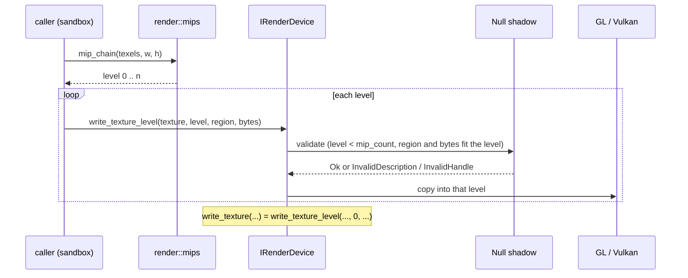

# Review 8-35: mip levels in the render port

Task: 8-35 (follow-up of 8-31). Class 2 (public change of the render port `IRenderDevice`). Ordinary card into `develop`. Owner go-ahead: "Yes" to the design below.

## Decisions

1. One new required trait method, `write_texture_level`; `write_texture` becomes a provided method for level 0, so no caller changed.
2. The device does not make levels. The caller sends each one; `render::mips` (`level_count`, `level_size`, `downsample` as a 2 by 2 box average, `mip_chain`) computes them. A generate-mips command was not chosen: it would need a new command in the stream and per-API code, and the caller already has the pixels.
3. `read_back` still reads level 0 only; the Null device keeps level 0 only (the other levels are validated and dropped).
4. The sandbox builds the full chain for its checker texture (`create_mipmapped_texture`); the sprite sample's `create_texture` is unchanged.

## Evidence

- Red first: the contract check `mip_level_contract` and a new broken-device flaw (`WritesEveryLevelIntoLevelZero`, expected panic "a write to level 1 or 2 must not touch level 0"). The first version of the contract check overwrote level 0 before reading it back and the flaw test failed to panic; the order was fixed so the flaw is caught.
- OpenGL real-device test `a_minified_texture_samples_the_mip_level_that_was_written`: a texture of 64, 128 and 256 texels over a surface of 64 shows the colour written to level 0, 1 and 2. Red when the adapter was made to ignore the level (1024 pixels of a colour that was not drawn), green restored.
- Vulkan: tests against the fake driver (a write to level 1 and 2 leaves level 0 as read back; level, region and byte count checked against the level's size). The first run failed because the fake copied every level's texels into level 0; the fake now keeps level 0 only.
- `cargo fmt --all -- --check`, `cargo clippy --workspace --all-targets -D warnings`, `cargo test --workspace` all exit 0.
- Real window (OpenGL, Windows): a screenshot of `app_sandbox3d` after the change shows the floor, walls and pieces textured, no black or grey surfaces.

## Not verified

- Whether the stripes of card 8-31 are gone: a still picture cannot show shimmer, and the owner has not seen it moving.
- The Vulkan path was not run on a real device for this card beyond the existing device tests; the new level write is covered by the fake driver only.
- The box average works on 8-bit values and is not gamma-aware (a mean of sRGB values is a little too dark); fine for a checker, not a general rule.
- Linux and ARM64 runs of the final code, mutation score, Miri, coverage and benchmarks (they run in the release PR's CI).

## R1 to R8

| phase | result |
|---|---|
| R1 self | the contract check hid its own flaw by rewriting level 0 first (fixed); the fake driver wrote every level into level 0 (fixed); clippy nesting and length limits met by helpers |
| R2 automated | workspace fmt, clippy, tests |
| R3 independent | one read-only review: no blocker, one major, five minors; all handled (Loops) |
| R4 QA | red first for the contract, GL and Vulkan; odd and non-square sizes in the `mips` tests |
| R5 architecture | port change is additive; adapters only |
| R6 security | level and region are validated before any copy, in the shadow device and again in the Vulkan layer |
| R7 performance | no hot path touched; upload happens at load |
| R8 product fit | the real cure for the aliasing found in 8-31 |

## Loops

| loop | finding | handling |
|---|---|---|
| 1 | major: `mip_chain` of a 1x1 image with a wrong byte count returned `Some` (the guard skipped 1x1) | explicit size and length check at the top; tests for 1x1, zero size and a correct 1x1 added (written together with the fix, so no separate red run for this one) |
| 1 | minor: `downsample` doc said odd edges use the texels that exist; the code drops the last row or column of an odd side above one | doc corrected |
| 1 | minor: the contract did not test a texture with one level or the largest level number | `single_level_refusals` added to the contract (passes on the Null device; GL and Vulkan reach the same validation through the shadow) |
| 1 | minor: the GL test's unwritten-level part only checks that no green appears | accepted; the written-level part is the proof (red when the level was ignored). Card for a stricter check |
| 1 | minor: the level-size rule is written in several places (`mips`, Vulkan `level_extent`, the fake driver) | accepted; the fake stays an independent oracle. Card to let the Vulkan adapter call `render::mips` |
| 1 | minor: a blank line in the wiki list; "red when the adapter ignored the level" had no evidence in the review file | blank line removed; the evidence is in the Evidence section |
| 1 | note: the loop-1 fixes were not seen by a second reviewer | stated |
