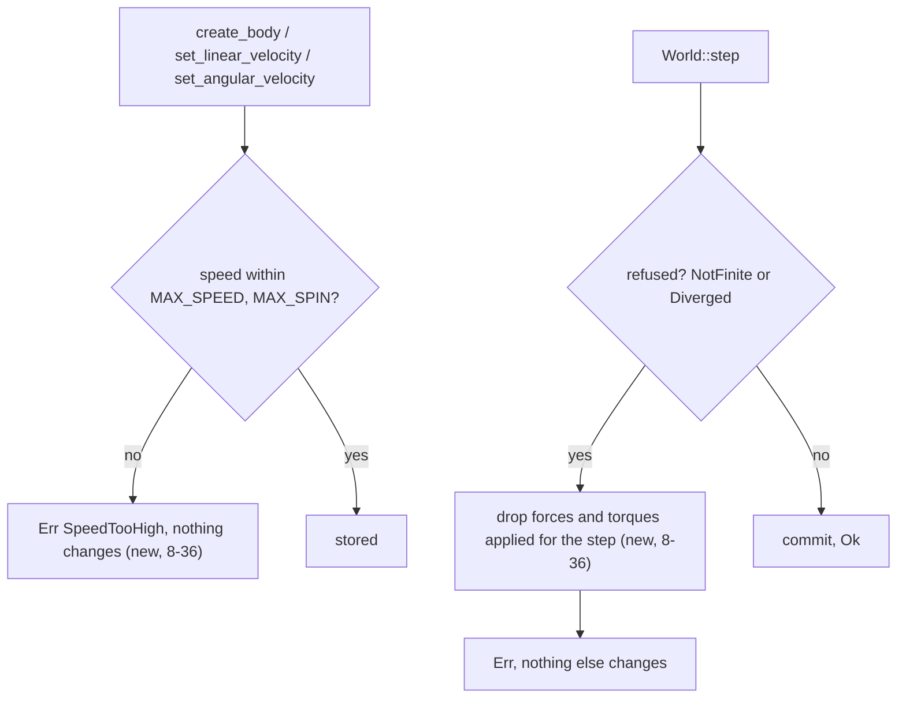

# Review 8-36: speeds checked where they are given, a refused step drops its forces

Task: 8-36. Class 2 (physics: a new value of the public error enum, a new check in `create_body` and the velocity setters, a change to what a refused `World::step` does with forces; shared core, 2D and 3D). Ordinary card into `develop`. Follow-up of 8-25, found in its review (loop 1).

## Decisions

1. **Keep refusing (owner, after the comparison below).** A speed beyond the bound is an error value at the call, and a diverging step is an error value, not a clamp.
2. **Validate at the call with its own error `SpeedTooHigh`,** not `Diverged` (that one is about a step) and not `NotFinite`.
3. **A refused step drops the forces and torques applied for it.** A force acts in the next step only; kept, a huge one made every later step fail. The other way out was a bound on the force, which would depend on the mass and the step length. Cost: a refused step is no longer exactly "nothing changes"; the forces are spent. Easy to reverse.

## Compared with the established engines (asked by the owner after the first design; searched, not remembered, unless said)

- Jolt: a per-body maximum linear and angular velocity, "used to prevent the system from exploding"; its velocity setters clamp. (Default values were not in the results; about 500 m/s and about 47 rad/s are from memory, unconfirmed.)
- PhysX: `setMaxLinearVelocity` (default effectively unlimited) and `setMaxAngularVelocity` (default 100 rad/s), clamped before the solver, softly.
- Box2D and Unity 2D: a per-step translation limit "to prevent numerical problems"; Unity names it `maxTranslationSpeed`.
- Rapier: checks for non-finite numbers at the start and end of a step and quarantines the body; its forces persist until cleared by hand.
- Common practice is therefore **clamping**, and none refuses the step. Ours differs on purpose (errors are values; the blow-up is shown, not hidden), and the owner confirmed it. What we take from them: their bounds are far lower than 1e5, so card 8-37 starts from tens or hundreds per second.
- Sources: the Jolt motion properties documentation, the PhysX 5.4 `PxRigidBody` documentation, the `@box2d/core` constants, the Unity `Physics2D.maxTranslationSpeed` page and the Rapier user guide.

## Change

- `core/error.rs`: `PhysicsError::SpeedTooHigh` with message and test case.
- `core/body.rs`: `speeds_are_bounded` (one function for the check of a step, a creation and a setter), used by `from_desc`, `set_linear_velocity`, `set_angular_velocity` and `motion_is_bounded`; `clear_forces`.
- `core/world.rs`: `refuse` (drops the forces and torques of all bodies, returns the error) used by both refusals of `step`; docs.
- Tests: `engine/physics/tests/d3_divergence.rs` (create and set in 3D and in 2D, exactly the bound allowed, a refused call changes nothing, the forces and torques of a refused step are dropped and a later force still works, a diverging scene steps again after the body is destroyed).
- **Existing tests changed because their setup is now refused** (what they check is unchanged): eight tests and one helper built a body with a speed of 3e38 (or the largest float) to make a step overflow: `core::world` two unit tests, `generic_core` one, `islands` one, `joints/determinism` two, `solver/robustness` one, `stability/properties` one, and the `ball_moving` helper of the `body` unit tests (which now sets the fields directly). They reach the same overflow with a force (the refused step spends it, so they assert the hash equals the one taken before the force, which is stronger than before) or with a very long finite step at a speed within the bound. No assertion was removed or loosened and no threshold changed (`MIN_REFUSALS` is the same: the first force-based version of the stability test refused only 18 of 25 seeds, so it uses a speed at the bound and a step of 1e34 s instead, which every awake dynamic body refuses). In `solver` a zero force is applied first, because applying a force wakes a sleeping body.

## Evidence

- Red first: the force test failed at "the force was spent on the refused step" (`Err(Diverged)` again); the validation tests did not compile before `SpeedTooHigh` existed.
- Green: `cargo test --workspace` (237 test groups ok, exit 0), `cargo clippy -p physics --all-targets -- -D warnings`, `cargo fmt`, `cargo doc -D warnings` for the physics crate.
- Mutation (`cargo mutants -p physics --in-diff`, library tests plus `d3_divergence` and `generic_core`): 23 mutants, 21 caught, 2 unviable, 0 missed, 0 timeouts.
- The golden hashes did not move (the physics golden and replay tests are part of the suite).

## Not verified

- Linux and ARM64 not run.
- The bound is still the chosen 1e5 for both (card 8-37).
- A force is not bounded: a huge one is refused by the step, not at `apply_force`.
- The first design (before the comparison) was made without looking at the other engines; the comparison confirmed the difference rather than changing the code.

## R1 to R8

| phase | result |
|---|---|
| R1 self | eight existing tests and one helper had to change for the new rule; each checked one by one that it still tests the same thing |
| R2 automated | workspace tests, clippy, fmt, rustdoc, mutation 21 caught / 0 missed (numbers in Evidence) |
| R3 independent | one read-only review: no blocker, two major, five minor, all fixed (loops) |
| R4 QA | red first; boundary at exactly the bound; 2D and 3D; refused call changes nothing |
| R5 architecture | one check function in the shared core; no port change |
| R6 security | rejects absurd input at the call |
| R7 performance | one more squared-length comparison per create or set; none in the step beyond 8-25 |
| R8 product fit | the cause is reported where it is made |

## Loops

| loop | finding | handling |
|---|---|---|
| 1 | major: `# Errors` of `create_body` and both setters did not list `SpeedTooHigh` | listed, with the bound |
| 1 | major: the `Diverged` doc still offered a huge opposite force as a way out and the `step` doc contradicted itself ("three cases") | both rewritten |
| 1 | minor: the whole-world hash check of `a_step_that_would_overflow...` had been replaced by field checks | hash check back (taken before the torque), plus the leftover line removed |
| 1 | minor: `MAX_SPEED`, `MAX_SPIN` and the joint page did not mention the new refusal | mentioned |
| 1 | minor: counts of changed tests were inconsistent, a table was referred to that does not exist, `ball_moving` was called a unit test | corrected above |
| 1 | note: dropping all forces on a refusal hides which force was the culprit | accepted and stated; not a new cause for a card |
| 1 | note: the loop-1 fixes were not seen by a second reviewer | stated |
