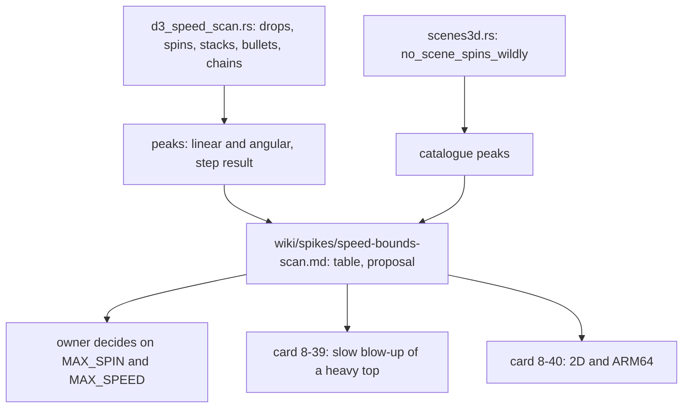

# Review 8-37: scan of absurd states below the speed bounds, and a measured proposal

Task: 8-37. Class 1 (new tests, a new wiki page; no constant, no engine source changed). Ordinary card into `develop`. Follow-up of 8-25 (the bounds were chosen, not measured).

## Decisions

1. **Measure, do not change.** The card says changing the constants is a separate decision; the page proposes `MAX_SPIN` 2000 rad/s and `MAX_SPEED` 1e4 m/s with the data, the owner decides.
2. **Characterization tests with wide margins.** The chaotic scenes (chains with a heavy end) differ in detail between machines, so tests assert "below half the proposed bound" for healthy scenes and "above the proposed spin" for absurd ones, never an exact number. They passed on Windows and on Ubuntu (WSL), each with the cross-platform feature on and off.
3. **No test of the proposal is added to the engine's own scenes except spin:** `no_scene_spins_wildly` (limit 100 rad/s, measured 42) because the catalogue had no angular check.

## Evidence

- Measurements in the page (section 2), taken once with a scratch version of the scan; the committed tests reproduce them with margins.
- `cargo test -p physics --test d3_speed_scan` (3 tests, 3 s), `cargo test -p tools_physics_bench --test scenes3d no_scene_spins_wildly`; Linux: the first command with the feature on and off, 3 passed each.
- Clippy `-D warnings`, fmt, wiki lint (73 pages, 0 violations).
- TDD exception, stated: these are measurement and characterization tests; they pass from the start by design, they were not written red first. Their usefulness is that they go red when a bound or the solver changes.

## Not verified

- 2D, ARM64 (card 8-40); the workspace with the proposed constants (the first step of the adopting card); a game scale above 2000 rad/s.
- The Jolt default values are from memory (see review 8-36).
- Most rows of the table of the page come from a scratch scan and are not pinned by a committed test (the page says which are); the catalogue test runs 400 steps, the scratch 600.
- The mutation score does not apply (no changed source).

## R1 to R8

| phase | result |
|---|---|
| R1 self | the first test spun a body on two axes, which exceeded the bound at creation (8-36 refuses it): fixed to one axis; a claim that the workspace was green with the proposed numbers was removed (not run) |
| R2 automated | tests, clippy, fmt, wiki lint |
| R3 independent | one read-only review: no blocker, two major, five minor, three notes; all fixed or stated (loops) |
| R4 QA | wide margins; both feature settings; two systems |
| R5 architecture | no code in the engine |
| R6 security | none |
| R7 performance | tests take 3 s and a few more seconds in the bench |
| R8 product fit | the owner gets a proposal with data and two open findings as cards |

## Loops

| loop | finding | handling |
|---|---|---|
| 1 | major: a test comment said 'ten times a drop from 1000 m' (it is about a hundred) | corrected, number made 10 400 everywhere |
| 1 | major: 'healthy' was an unstated choice (spin 1000 and bullets of 3000 m/s were excluded) | defined in the page, the factor of two for a spin of 1000 stated |
| 1 | minor: thin margin in the spin-at-the-bound test | threshold is half the proposed bound, revisit note added |
| 1 | minor: 'hundreds of turns' (tens), Jolt 'quarter turn' (an eighth), source framing, density-10 claim without data | corrected |
| 1 | minor: table rows not pinned by tests, step counts differ | the page says which rows are pinned, scratch steps stated |
| 1 | minor: a NaN speed was invisible to the peak | counts as infinite in both trackers |
| 1 | note: the doc of MAX_SPEED said a diverging joint scene passes it | doc corrected (hinge scene; chains with an absurd ratio stay below) |
| 1 | note: the loop-1 fixes were not seen by a second reviewer | stated |
