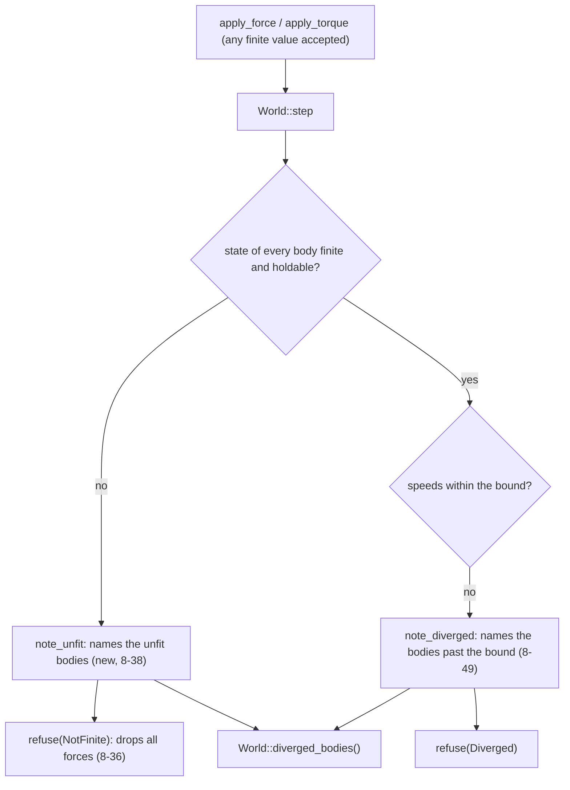

# Review 8-38: a refused step names its culprit

Task: 8-38 (found in 8-36). Class 2 (public query of the shared physics core, 2D and 3D). Ordinary card into `develop`. Owner go-ahead: "8-38"; owner choice among three options: "Name bodies for NotFinite too".

## What was done

| item | result |
|---|---|
| the question | the card asked which of three ways finds the culprit of a huge force: a bound at `apply_force`, an error that names the body, or keeping the culprit's forces. The owner chose to name the bodies |
| change | a step refused as `NotFinite` fills `World::diverged_bodies()` with the bodies whose new state is not finite or cannot be held by the broadphase (the exact complement of the check that refuses the step), in slot order; `note_diverged` and `note_unfit` share the helper `name_bodies` |
| not changed | `apply_force` and `apply_torque` accept any finite value (a bound needs the step length, which the call does not know); the refused step still drops the forces of all bodies (a kept huge force fails every later step, card 8-36); the error enum is unchanged |
| pin changed | `a_value_that_overflows_names_no_body_…` pinned "an overflow names no body"; it is now `…_names_its_body_…` on the owner's decision, not to get green |

## Decisions

1. Reuse the existing list rather than add an accessor: a body that overflows has diverged. The doc line "empty after `NotFinite`" is the only meaning that changed.
2. A body that overflows only through a contact with the culprit is named too; the tests use bodies far apart, so the doc says "names the body" for the isolated case and states the contact case.
3. The `can_hold` clause is kept because `note_unfit` must be the exact complement of `stays_finite`; no test reaches it on its own (a position plus a half extent rounds to a finite number), which is said below.

## Evidence

- Red: with `note_unfit` missing the three new naming tests failed on the list (the step itself returned `NotFinite` as asserted), the first run of the file showed 10 passed and 3 failed.
- Green: `diverged_bodies` (13 tests: huge force and torque on a light middle ball, 2D and 3D; the world steps again once it is destroyed; a good step after the refusal names nobody) and `no_allocation` (a `NotFinite` refusal and its names allocate nothing).
- By hand: dropping the finite check from `note_unfit` fails one test.
- fmt, clippy `-D warnings` on `physics` (all targets), `cargo test -p physics --features cross-platform-determinism` (47 targets pass), see the PR for the gates.

## Not verified

- The `can_hold` clause alone and the case of a solver that overflows while every body stays finite (no test reaches either).
- A body that overflows through a contact: described, not tested.
- Mutation score (not run: memory, cards 8-34 and 8-70), Miri, coverage, benchmarks. Mermaid read by the author, not rendered.

## R1 to R8

| phase | result |
|---|---|
| R1 self | the borrow checker refused a method that took `&mut self` inside a closure over `self.broadphase`; the helper became a free function |
| R2 automated | fmt, clippy, the physics tests |
| R3 independent | one read-only review: no blocker, five minor, two nits; all handled (Loops) |
| R4 QA | both dimensions, force and torque, recovery by destroying the named body, a good step afterwards, no allocation |
| R5 architecture | no new public name; one private helper |
| R6 security | none |
| R7 performance | the new work runs only on a refused step |
| R8 product fit | the owner learns that a huge force now names its body |

## Loops

| loop | finding | handling |
|---|---|---|
| 1 | minor: `name_bodies` sat between a doc comment and `live_slot_mut` | moved; the doc is back on `live_slot_mut` |
| 1 | minor: no allocation test of the `NotFinite` path | `a_not_finite_step_and_the_names_it_leaves_allocate_nothing` |
| 1 | minor: nothing pins the `can_hold` clause | stated under Not verified; kept for exactness with `stays_finite` |
| 1 | minor: the wiki said 2D where the recovery tests were 3D only | both tests now cover 2D and 3D |
| 1 | minor: the review file was missing | this file |
| 1 | nit: the mass in the test comment (3e-8) | 3e-7 kg in 2D, 4e-9 kg in 3D |
| 1 | nit: a long doc line | rewrapped |
| 1 | note: the contact case | stated in the doc and the wiki |
| 1 | note: the loop-1 fixes were not seen by a second reviewer | stated |
