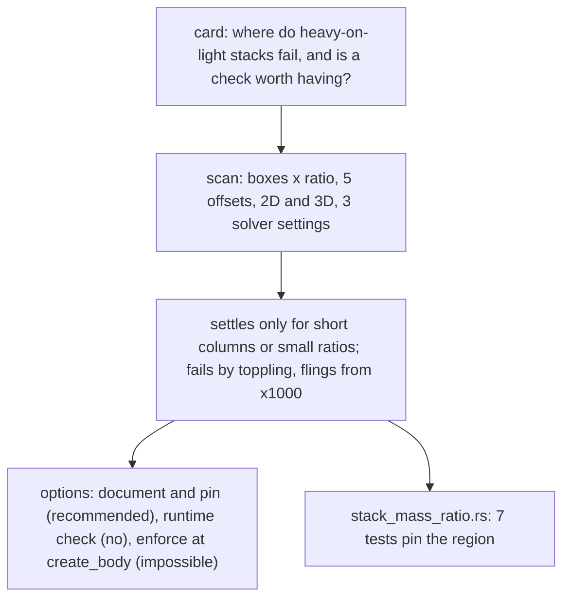

# Review 8-39: how tall a stack can be under a heavy top

Task: 8-39 (found in 8-37, widened by 8-40). Class 1 (tests and a report; no engine code changed). Ordinary card into `develop`. Owner, 2026-11-20: "8-49 keep it documented. 8-39". The owner's promise about mass ratios was not given in so many words; the card is done as a measurement with one recommended option, and the choice stays open (see the PR).

## Decisions

1. No engine change. The region is documented and pinned, so a solver change that shrinks it is seen.
2. The owner's decision on the spin room of 8-49 ("keep it documented") is recorded in section 10 of the scan page, in this PR.
3. Earlier wording corrected: 8-37 and 8-40 read stacks up to x100 as healthy by speed and by a reach under 30 m; a stack that has fallen over meets both. Sections 5 and 6 now say so.

## Evidence

- A scratch scan (removed) over 12 ratios, four heights, five offsets, two dimensions and three solver settings; the first pass used a 2 m drift limit and called every toppled stack a failure, so I split the outcomes into settled, toppled and flung before pinning anything.
- `stack_mass_ratio.rs`: 7 tests pass on Windows and on Ubuntu x86-64 (WSL); clippy `-D warnings` clean.
- The "flung" test asks for at least one of five (3D x1000 had three of five), so a different machine's chaos does not turn it red.
- Documentation search: the pages of Box2D, Jolt and PhysX that were readable give no ratio; Bullet's could not be read. Reported as not confirmed.

## Not verified

- The table is from Windows; the tests also pass on Ubuntu x86-64 (WSL); ARM64 and the hosted runs come with the release PR.
- Columns with the heavy box in the middle or bottom, stacks above eight, other shapes, sleeping on.
- Mutation score, Miri; Mermaid read by the author, not rendered.

## Loops

| loop | finding | handling |
|---|---|---|
| 1 | major: four pinned "settles" cells (x50 on three, x20 on four and five, x10 on six) settle in only 32 to 41 of 41 finer offsets, so a machine with other float behaviour could turn the test red | the pinned cells moved one ratio down (all 41 of 41 in both dimensions); the page says which cells hold at every offset and which at most offsets |
| 1 | major: "more sub-steps do not cure it" was tried on eight boxes only, with two settings | the largest setting added to the test; the claim says: not for tall stacks, and it helps five boxes (4 of 5 against 1 of 5 in 2D) |
| 1 | minor: flinging claims (from "4 or more boxes at x1000", "only from x1000") did not match the scan | reworded: some runs at x100 on eight boxes in 3D, x1000 from five boxes in 2D and four in 3D, not monotone |
| 1 | minor: fast bodies are not the flung ones (98 m/s with one of five flung, 93 m/s with none) | said on the page |
| 1 | minor: toppling reach "to the height" | 5 to 7 m for an 8 m column, page and test header |
| 1 | minor: the flinging test bounded speed by a tenth of the bound, the page says under 100 m/s | the test uses 100 m/s |
| 1 | minor: stale comment in the 2D scan test | cross-reference added |
| 1 | minor: section 10 decision wording went beyond the owner's words | now quotes "keep it documented" and says the other options are not taken |
| 1 | minor: a penetration report and a density band were not named | both named with reasons; the penetration report is the one check left worth a card |
| 1 | note: the loop-1 fixes were not seen by a second reviewer; mutation not run; the test file takes about 27 s in the dev profile | stated |
