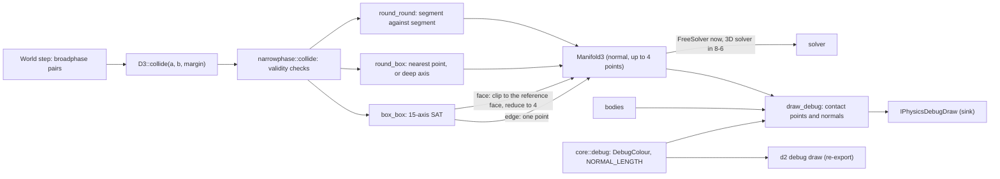

# Review 8-4: `physics::d3` shapes and narrowphase, part 1

Task: 8-4. Class 2 (public API of `physics::d3`: `IPhysicsDebugDraw`, `draw_debug`, `Manifold3` changes; no `unsafe`, no new dependency, no governance file). Ordinary card into `develop`. Loops: 1 fix loop (1 independent review). Open blocker/major: 0.

Delivers: contacts between every pair of sphere, capsule and box in 3D, and a 3D debug draw ([phase8-3d-v0](../wiki/architecture/phase8-3d-v0.md) section 3 and "Debug draw"). `D3::collide` now returns a `Manifold3` (normal from the first shape to the second, up to four points, `separation` negative while overlapping) instead of `None`. The 3D solver is still `FreeSolver` (card 8-6). README v1.65.

## Decisions

1. **A sphere is a capsule with a zero-length segment.** Sphere-sphere, sphere-capsule and capsule-capsule are one routine on two segments (closest points, a normal across the two axes when they meet, two points for capsules side by side). Fewer code paths, and one set of tests.
2. **Round against box: one normal, from the nearest point.** The distance from the segment to the box is convex along it, so a 40-step ternary search finds the nearest point. A segment that goes through the box has no useful nearest point, so the way out is the largest gap over six axes (three box faces, three across the segment and a box edge). A numerical check found the plain version 3 cm wrong for a capsule through a box; this was a real bug and is fixed with a test.
3. **Box against box: fifteen-axis separating axis test.** A face axis gives a face contact (incident face clipped to the reference face, cut to four points: deepest, farthest from it, widest on each side). An edge axis gives one point where the two edges are nearest. The first box's face is preferred, and faces over edges, unless another axis is better by 5e-4 m, so the choice does not flicker.
4. **No feature id on contact points.** The warm start of card 8-6 will match by position. Recorded so 8-6 does not assume ids.
5. **`ContactPoint3.depth` became `separation`** (negative while overlapping), the 2D convention, so speculative contacts work the same way. The type had no producer before this card.
6. **Debug draw has its own `IPhysicsDebugDraw` over `Vec3`.** `DebugColour` and `NORMAL_LENGTH` moved to `physics::core::debug` and `d2` re-exports them, so the two sinks share the palette and nothing in 2D changed for callers.
7. **No heap allocation anywhere in narrowphase or draw**: fixed arrays (capacity 8 for a clipped polygon).

Known limits (also in the design note, section 3): a speculative contact between apart boxes can read up to about 4 mm above the true gap; diagonally apart boxes get a speculative contact early (up to about 1.7 times too small a gap at a corner); the axis bias is absolute, so boxes under about 1 cm lose accuracy; a capsule through a box much deeper than the box is wide has its points at its ends, far from the box (normal and depth are right). The last three were found in the independent review and are documented, not fixed.

## Evidence

- Tests written first (red: the first run did not compile because `ContactPoint3.separation` did not exist, then the pairs returned `None`). `engine/physics/tests/d3_narrowphase.rs`: 30 tests (analytic cases per pair, both argument orders, refusal of invalid input, contact point positions, an independent oracle over six shape pairs and 150 scenes each, a world step). `d3_debug_draw.rs`: 10 tests. `d3_no_allocation.rs`: 3 tests (counting allocator, per-thread). Unit tests in `d3/manifold.rs` and `d3/box_box.rs`. `cargo test -p physics`: all pass.
- The oracle is independent of the code under test: the signed separation is the largest gap over 20,000 sampled directions plus a local refinement, computed in `f64` from the support functions of the shapes. The oracle found two real bugs (deep capsule through a box, normal taken from an end) before they were fixed.
- `cargo clippy -p physics --all-targets -- -D warnings`: clean (the physics crate bans `expect`, `unwrap`, `sin`, `cos`, `mul_add`, nesting over 3).
- Mutation (`cargo mutants -p physics -j1`, files in small batches because one large run was stopped by low memory; tests `d3_narrowphase`, `d3_debug_draw` and the unit tests). Rounds: first round `manifold.rs` 11 (5 missed), `box_box.rs` 197 (44 missed), `narrowphase.rs` 144, `debug_draw.rs` 70; after new tests `manifold.rs` 0 missed; `box_box.rs` 21 missed in the second round, then the edge, reduction and point-position tests were added and a rerun left 5 in the functions rerun (`extreme_point` was then killed by a different-size test, checked by applying the four mutants by hand); `debug_draw.rs` 3 missed in the rerun; `narrowphase.rs` 15 missed (second round, not rerun). Roughly 30 survivors of about 310 viable mutants, a score near 90% (gate: 80%). The `closest_parameters`/`probe`/`inside` survivors were not rerun after the last test additions. Output in `target/mut-8-4*` (not committed).
- Survivors judged equivalent: `* sign` against `/ sign` where the sign is plus or minus one (`axis_along`, `clip_to_sides`, `draw_capsule`); `>` against `>=` on exact float ties (`prefer`, `incident_face`, `face_contact`, `closest_parameters`); `<` against `<=` on exact thresholds (`edge_axis`); `|` against `^` on a bit known to be zero; the capacity guard in `Polygon::push` (never reached, a polygon has at most eight corners); `+` against `-` in `reduced` (a constant offset does not change the largest); `Frame::world` and `corner` mirrored (the drawn shapes are centrally symmetric). The `probe`/`inside`/`deep_axis` survivors are accepted as not killed: they affect the closest point or normal of a probe whose result is only read for its sign or for a point later replaced, but this was reasoned, not proven.
- Local gates (`python tools/local-gates/local_gates.py --base origin/develop`): exit 0 (the four `FAIL` lines are the tools' own negative-case output). Wiki lint: 70 pages, 0 violations. Output `target/local-gates-8-4.txt` (not committed).

## Not verified

No Linux or ARM64 run; no D2 cross-platform golden hash for the 3D narrowphase (card 8-13); no multi-thread run; no branch-coverage or new-line gate run; no benchmark (cards 8-12 and 8-14); the mutation survivors listed above were not all rerun after the last test additions; the Mermaid view was read by the author, not rendered; the independent reviewer ran the suite and clippy and probed with a throwaway program, but did not rerun mutation.

## R1 to R8

| phase | result |
|---|---|
| R1 self | read the code against the `d2` patterns; found test values that hid mutants (identical cubes, half size one) |
| R2 automated | tests, clippy, mutation, local gates, wiki lint, diff hash |
| R3 independent | read-only reviewer: 0 blocker, 0 major, 3 minor, 5 nit; handled below |
| R4 QA | analytic cases, independent numerical oracle, a dense numerical check that exposed the capsule-through-box bug |
| R5 architecture | `core` gained only `debug.rs`; `Dim` unchanged; `d3` stays inside the physics crate (ADR-0018) |
| R6 security | no `unsafe`, no new dependency, no secrets; non-finite or invalid input returns no contact |
| R7 performance | no allocation (counting-allocator tests); speed not measured (cards 8-12 and 8-14) |
| R8 product fit | the owner reads the known limits above and decision 4 (no feature ids) |

## Loops

| loop | finding | handling |
|---|---|---|
| 1 | minor: diagonally apart boxes get a speculative contact early, points outside the footprint | documented in the design note and above; a fix needs a true distance for boxes; left for 8-6 if the solver needs it |
| 1 | minor: absolute axis bias hurts boxes under 1 cm | documented; scaling the bias is a change to be decided with the solver |
| 1 | minor: deep capsule contact points far from the box | documented; normal and depth are right |
| 1 | nit: oracle comment said "exact" | reworded to the real slack |
| 1 | nit: redundant branch in `contact_parameters` | replaced by `count.max(1)` |
| 1 | nit: stale doc comment on `BoxFrame::inside` | rewritten |
| 1 | nit: shift and mask without parentheses in `debug_draw` | parentheses added |
| 1 | nit: box reach computed in three places, two `basis` helpers | accepted, small and local; a shared helper is a refactor for a later card |
| 1 | nit: crate description still says "the 2D instance" | pre-existing, not in this diff, left alone |
