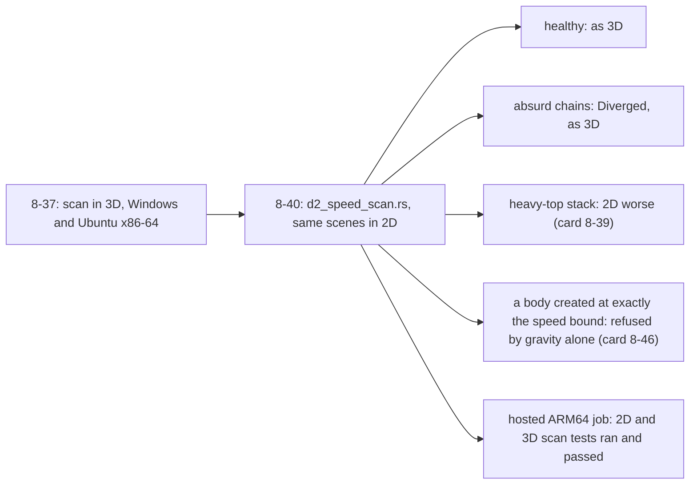

# Review 8-40: the speed scan in 2D and on ARM64

Task: 8-40. Class 1 (tests and a report; no engine code changes). Ordinary card into `develop`. Follow-up of card 8-37 (`wiki/spikes/speed-bounds-scan.md`, section 5).

## What was done

`engine/physics/tests/d2_speed_scan.rs`: the scenes of `d3_speed_scan.rs` in the 2D instance (drops with spin, a stack of eight squares with a heavy top, a bullet, hinge and rod chains with a heavy end), three tests: healthy scenes stay below half of each bound and are not refused (stacks of up to a hundred times also stay within 30 m); chains with a heavy end of 10 000 or a million times are refused as `Diverged`; a body spun at the bound ends below half the speed bound. The measurements (section 6 of the scan page) came from a temporary printing test that was removed.

## Evidence

- Peaks and reach measured on Windows x86-64 (numbers in the page). The 3D reach of the stack and the bullet was measured with a temporary copy of the 3D scan for a like-for-like comparison, then deleted.
- The new tests pass on Windows, on Ubuntu under WSL, and on the hosted `ubuntu-24.04-arm` job of a hand-started `ci` run of the branch (the job succeeded and its log shows `d2_speed_scan` and `d3_speed_scan` running).
- Sanity of the tests: with the absurd ratios replaced by healthy ones the absurd-chain test fails ("chain rod=false links=3 x1: None").
- clippy `-D warnings` and fmt on the physics crate; local gates, see the PR.

## Findings (not fixed here; engine code is unchanged)

1. A 2D stack with a heavy top of 200 times or more flies apart (reach 29 to 233 m for an 8 m stack) with every step `Ok`; in 3D it stays together up to 5000 times. Added to card 8-39.
2. A body created at exactly the speed bound is refused after 24 steps, in 2D and 3D, with no contact: gravity pushes the squared speed one float step over the squared bound. Card 8-46. (My first reading, "at its first contact", was wrong; the reviewer showed the bullet tunnels past the stack.)

## Not verified

- The ARM64 numbers: the tests assert margins and do not print values, so ARM64 shows the scenes stay inside the margins, not what they reach. The peaks in the page are from Windows.
- The 2D scenes are the 3D ones carried over, not drawn from a game; the 2D heavy-top threshold is between 100 and 200 from a handful of single runs of a chaotic scene.
- The rest of the hand-started `ci` run (other jobs) was not read for this card; only the ARM64 job was.
- No mutation run: tests only.

## R1 to R8

| phase | result |
|---|---|
| R1 self | `-D warnings` clean; the printing test and the 3D temporary copy removed |
| R2 automated | clippy, fmt, local gates, the test files on three platforms |
| R3 independent | see Loops |
| R4 QA | the tests can fail (checked); margins stated |
| R5 architecture | tests only |
| R6 security | none |
| R7 performance | the three tests take under a second |
| R8 product fit | closes the gap that 8-37 named; produces two real findings |

## Loops

| loop | finding | handling |
|---|---|---|
| 1 | major: the page, the review and the diagram said the bullet at the bound is refused at its first contact; there is no contact, gravity alone does it | all three corrected; card 8-46 given the cause |
| 1 | minor: "200 times or more comes apart" read as a trend, but reach does not grow with the ratio | reworded to what was seen at each ratio |
| 1 | minor: the 2D file asserts the reach of healthy stacks, the 3D one does not | stated in the page |
| 1 | note: the numbers of section 6 were re-derived by the reviewer and match | stated |
| 1 | note: the loop-1 fixes were not seen by a second reviewer | stated |
