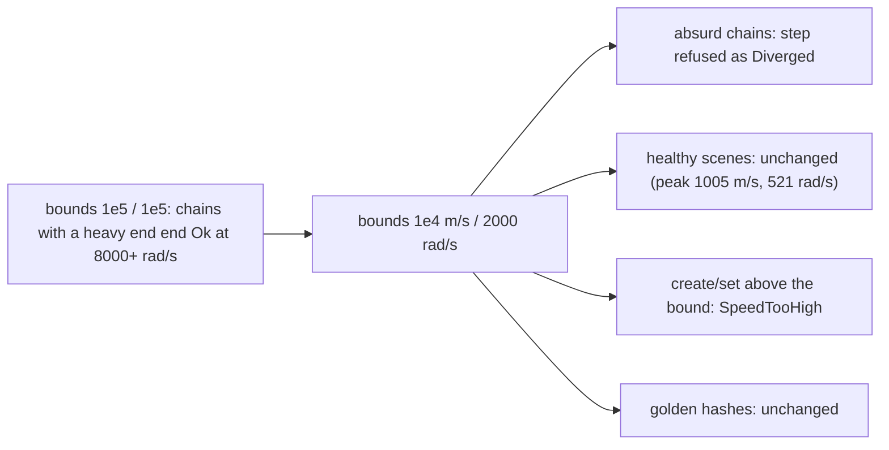

# Review 8-41: the speed bounds adopted (MAX_SPIN 2000 rad/s, MAX_SPEED 1e4 m/s)

Task: 8-41. Class 2 (public constants of the shared physics core, 2D and 3D). Ordinary card into `develop`. Owner decision of 2026-11-20: adopt the proposal of card 8-37.

## Decisions

1. Two constants change, nothing else in the engine; no new API.
2. Tests first: `d3_speed_scan.rs` now says the absurd chains are `Diverged` (red against the old bounds: "chain rod=false links=3 x10000: None"), the healthy scenes stay `Ok` below half of the bounds, a spin at the bound ends below half the speed bound.
3. Rewired tests from card 8-36 (very long steps at the old speed bound) were scaled so their comments' arithmetic is true again: steps of 3e34, 2e34 and 1e35 seconds instead of ten times less.

## Evidence

- Red then green as above (the first red: "chain rod=false links=3 x10000: None", the chain not refused with the old bound); `cargo test -p physics` (33 test groups ok, exit 0); `cargo test --workspace` (238 test groups ok, exit 0); clippy `-D warnings` and fmt on the physics crate; wiki lint (73 pages, 0 violations).
- Golden hashes and replay tests are in the physics suite and did not move.

## Not verified

- 2D scenes with the new bounds (card 8-40), ARM64, a Linux run of the final code.
- "Golden hashes did not move" rests on the golden and replay tests of `cargo test -p physics` (3D golden, determinism golden, replay), run with the cross-platform feature off; the D2 golden checker with the feature on (`gates/golden`) was not run locally, it runs in the release PR's CI.
- No sample or tool was found that sets a speed above the new bounds (the workspace suite is the evidence); an external game with a faster body would get `SpeedTooHigh`.

## R1 to R8

| phase | result |
|---|---|
| R1 self | three rewired tests no longer matched their comments with the new bound: steps scaled |
| R2 automated | workspace tests, clippy, fmt, wiki lint (numbers in Evidence); no mutation run: two constants changed, no function |
| R3 independent | one read-only review: no blocker, one major (a comment), four minors; all fixed |
| R4 QA | red first; healthy and absurd scenes both ways |
| R5 architecture | constants only |
| R6 security | rejects absurd input earlier |
| R7 performance | none |
| R8 product fit | the owner's decision, measured |

## Loops

| loop | finding | handling |
|---|---|---|
| 1 | major: a test comment said a hundredth (it is a fiftieth) | corrected |
| 1 | minor: the review file listed results it did not give | listed |
| 1 | minor: D2 golden with the feature on not run locally | stated in Not verified |
| 1 | minor: the spikes page contradicted the tests in two lines and said the workspace was not run | corrected, history flagged |
| 1 | minor: the 8-25 bullet gave the old bounds without saying so | now says then and since 8-41 |
| 1 | note: the loop-1 fixes were not seen by a second reviewer | stated |
