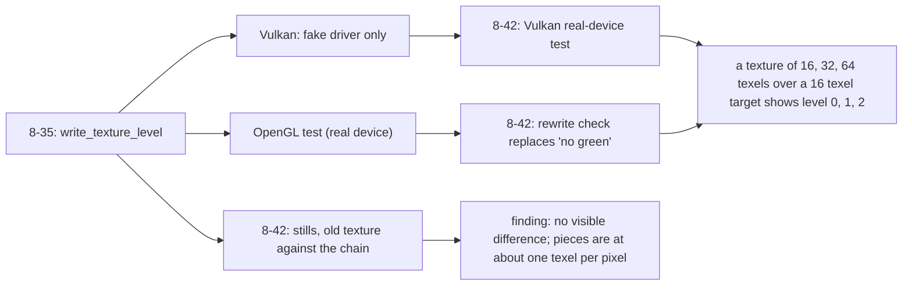

# Review 8-42: checks of the mip level writes

Task: 8-42. Class 1 (tests and a documented finding; no engine code changes). Ordinary card into `develop`. Follow-up of card 8-35 (`reviews/8-35.md`, Not verified and loop 1).

## What was done

1. **Vulkan real-device test** `a_minified_texture_samples_the_mip_level_that_was_written_on_the_vulkan_device` (`engine/adapter_render_vk/tests/device.rs`): a quad over the whole 16 by 16 target with texture coordinates 0 to 1; a texture of 16, 32 and 64 texels, each level a different colour, must show the colour of level 0, 1 and 2 on every pixel; then the 32 texel texture is drawn (green), its level 1 is rewritten with a colour no level has (magenta) and the picture must be that colour, which also takes an already sampled image back to the transfer layout; the validation report must have no errors or warnings (the layer was active in the runs; without it the test only prints a note). The sampler of this test is nearest, so a level is picked and not blended; the sandbox's linear mipmapped sampler is not exercised on a real Vulkan device.
2. **OpenGL test** (`engine/adapter_render_gl/tests/device.rs`): the part that only checked "no green" for an unwritten level is replaced by the same rewrite check (every pixel is the new colour).
3. **Moving picture:** screenshots of `app_sandbox3d` (OpenGL, Windows) after ten camera steps of two pixels, built with the old single-level checker texture and with the chain, compared by eye at twice the size and by the mean change of the static wall regions between frames.

## Evidence

- Vulkan: run with `DUCK_REQUIRE_VK=1` (a missing device would fail, not skip), 8 tests ok. **Red** when `at_level` was made to ignore the level: "a 16 texel texture shows [0, 0, 255, 255] first, expected [255, 0, 0, 255]"; green after restoring.
- OpenGL (rewrite check now draws before and after, with magenta): red when the adapter was made to write level 0 whatever the level, green after restoring; 12 tests ok.
- Clippy `-D warnings` and fmt on both crates.

## Finding (the moving picture)

- In the crops I saw no difference between the old and the new build. The lod was not measured and the pictures are not kept in the repository; my reading that the zig-zag on the small pieces is the 8 texel checker at about one texel per pixel is a guess. The mean change between frames was about the same for both (the geometry moving dominates it), so that number does not tell them apart, and it is not offered as evidence.
- So the card's third point is **not closed**: no still shows the old stripes, and nobody has watched the sandbox move. The owner can run `cargo run -p app_sandbox3d` and orbit with the right mouse button.

## Not verified

- Shimmer in motion (above). The pieces' texture is small (8 texels); if it looks wrong when moving, a larger texture or a coarser pattern is the lever, not more mip levels.
- Linux and ARM64 runs, a real Vulkan device other than this machine's.
- An accident worth stating: while restoring a temporary experiment I ran `git checkout -- .` and discarded my own uncommitted test edits; they were rewritten from the same text and re-run (red and green again), nothing of anyone else's was touched.

## R1 to R8

| phase | result |
|---|---|
| R1 self | clippy `manual_midpoint` fixed; the discarded edits rewritten |
| R2 automated | fmt, clippy, both device test files with a device required |
| R3 independent | see Loops |
| R4 QA | red first for both adapters |
| R5 architecture | tests only |
| R6 security | none |
| R7 performance | one more real-device test, about a second |
| R8 product fit | closes the Vulkan gap of 8-35; the shimmer question stays open and is stated |

## Loops

| loop | finding | handling |
|---|---|---|
| 1 | major: the wiki and review explained the screenshot result as fact (never aliased, no mip level can help) with no measurement | reworded to what was seen and what is a guess |
| 1 | minor: the rewrite check took no picture before, and its colour equalled level 2's | picture before; magenta; the sampled image is rewritten after use |
| 1 | minor: the Vulkan test's sampler is nearest, so the sandbox's linear mipmapped one is not run on a real device | stated here; card 8-44 |
| 1 | minor: the GL test compares colours exactly under linear mipmapping, which a driver with a coarse lod could blur by one step | passed here; card 8-44 |
| 1 | minor: the validation assertion only counts errors and warnings, and passes without the layer | stated |
| 1 | minor: `full_quad` duplicates `quad`; sizes are literals | accepted, tests only |
| 1 | note: the loop-1 fixes were not seen by a second reviewer | stated |
