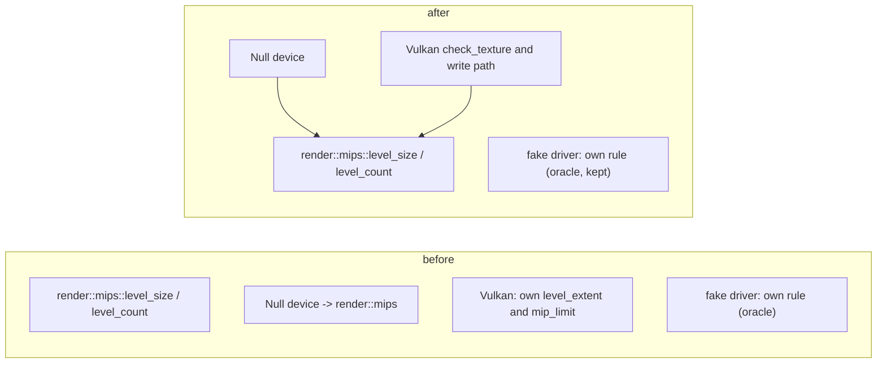

# Review 8-43: one level-size rule (part 1)

Task: 8-43 part 1 (follow-up of 8-35). Class 1 (refactor, no behaviour change). Ordinary card into `develop`. Owner, 2026-11-20: "let's tackle all class 1 tasks". Part 2 (a gamma-aware filter) is an owner choice and is not done.

## What was done

- `render/src/null.rs`: its own `max_mips` (the same rule as `mip_limit`) removed; the Null device uses `level_count` (a zero side is refused by `size_ok` before the count is read).
- `adapter_render_vk/src/resources.rs`: `level_extent` and `mip_limit` removed; `check_texture` uses `render::mips::level_count`, the write path `render::mips::level_size`.
- `resources/tests.rs`: the `mip_limit` test became a test that the adapter accepts the chain length of `render::mips::level_count` and refuses one more, for five sizes (including non-square).
- `render/src/mips.rs`: the header says the box filter is not gamma-aware (a doc comment only). Wiki bullet and changelog.

## Evidence

- Behaviour is the same: `level_count` differs from the removed `mip_limit` only for a zero side (`mip_limit(0,0)` was 0, `level_count` is 1), and `check_texture` refuses a zero width or height before the limit is read.
- Red checks (each restored): the write path asked for level 0 only, and the chain limit made one longer: `cargo test -p adapter_render_vk --lib` fails in both.
- Test run with `DUCK_REQUIRE_VK=1` for the device tests.
- `cargo test -p adapter_render_vk` (291 unit tests, device tests incl. the Vulkan level tests on this machine's device), clippy `-D warnings`, fmt.

## Not verified

- Part 2: no gamma-aware filter; the example numbers (127 against about 188) are arithmetic, not measured on a device. Owner decision.
- Copies left on purpose: the fake Vulkan driver (`fake/resource.rs`, an oracle) and the `.dtex` format owner `assets` (`dtex.rs` `mip_dimensions`, `max_mip_count`), which should not depend on `render`; if the owner wants one rule there too, it needs its own card.
- The OpenGL adapter has no copy of the rule (the driver sizes levels); the fake Vulkan driver's own rule was left as an oracle on purpose.
- Linux, ARM64. Mermaid read by the author, not rendered.

## Loops

| loop | finding | handling |
|---|---|---|
| 1 | major: the Null device still had `max_mips`, the same rule | replaced by `level_count` |
| 1 | minor: copies in `assets/dtex.rs` and the fake driver not mentioned | stated under Not verified |
| 1 | minor: a long doc line, "a little too dark" understated, the limit mutation was not in the evidence, `DUCK_REQUIRE_VK` not named | fixed |
| 1 | note: the loop-1 fixes were not seen by a second reviewer | stated |
