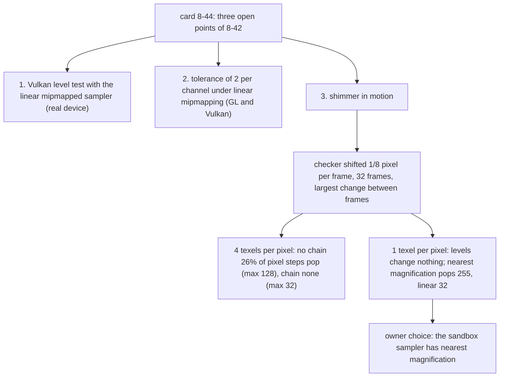

# Review 8-44: mip tests under the sandbox's sampler, a tolerance, and the shimmer measured

Task: 8-44 (follow-up of 8-42). Class 1 (tests and a measurement; no engine code changes). Ordinary card into `develop`. Owner, 2026-11-20: "let's tackle 8-44".

## What was done

1. **Vulkan:** the level checks are one function (`check_minified_levels`) run with the nearest sampler (exact colours, as before) and with the sandbox's sampler (`min_filter` linear, `mag_filter` nearest; the adapter then picks the linear mip mode), tolerance 2 per channel. Run on this machine's device with `DUCK_REQUIRE_VK=1`: 9 tests ok.
2. **OpenGL:** the minified-texture test compares within 2 per channel (`assert_only_within_the_mip_tolerance`). 
3. **Shimmer, measured:** two real-device OpenGL tests. A fragment shader shifts the lookup by `n/8` pixel (n from the vertex colour); 32 frames; the largest change of any pixel between two frames, and the number of changes above 64 of 255.

## Evidence

- **The tolerance is headroom, not a need here.** With tolerance 0 the Vulkan linear test and the OpenGL test also pass: both devices of this machine give exact level colours. The tolerance is for other drivers; it was not seen to be needed.
- **Red:** the Vulkan tests failed when an expected colour was changed (both, "a 32 texel texture shows [0, 255, 0, 255] first, expected [0, 0, 255, 255]"); the two shimmer tests failed when the chain was left out in the first and the linear sampler was made nearest in the second.
- **The numbers** (scratch scan, then pinned at two points; texture of 64, 128, 256 texels over 64 pixels, cells of 1, 2, 4, 8 texels): at one texel per pixel the chain and no chain give the same pictures (largest step 255, 13% of steps over 64 for cell 1). At two and four texels per pixel a cell of 1 or 2 texels averages to grey (no motion); cells of 4 and 8 texels show it: no chain, four to one: 26% and 13% of steps over 64, largest 128; with the chain none, largest 32. Linear magnification at one texel per pixel: largest 32 for every cell.
- fmt, clippy `-D warnings` on both adapters, `cargo test -p adapter_render_gl --test device` with `DUCK_REQUIRE_GL=1` (14 tests).

## Finding

- In a flat shifted checker the levels do their job where the surface is minified: the popping goes. What the card suspected may still be there is a crawl at about one texel per pixel; in the same flat test it does not depend on the levels, and linear magnification removes it, so the **nearest magnification** in the sandbox's sampler (`renderer.rs`, probably chosen to keep the checker crisp) is the likely reason. This is an interpretation of a flat picture, not something anybody has seen in the sandbox. With linear magnification the same movement changes a pixel by 32 at most. That is an owner choice (crisp or smooth), not a bug; not changed here.

## Not verified

- Fractional level of detail: the Vulkan linear test uses sizes that are exact powers of two over the target, so the linear mip mode has nothing to blend there and the tolerance is never exercised; the OpenGL test likewise.
- Nobody has watched the sandbox move: the measurement is of a flat picture shifted sideways, not of the perspective floor with a camera orbit, and not of the sandbox's own shaders. The owner can still run `cargo run -p app_sandbox3d` and orbit (right mouse button); what to look for is now stated above.
- The Vulkan adapter has no motion test (the same shader would need a SPIR-V version). Card 8-62.
- Linux, ARM64, devices other than this machine's, mutation, Miri. Mermaid read by the author, not rendered.

## Loops

| loop | finding | handling |
|---|---|---|
| 1 | minor: the `with` and `smooth` checks passed if nothing moved | assert that the largest step is above zero |
| 1 | minor: the linear Vulkan test never blends (whole levels of detail) | stated in the test and in Not verified |
| 1 | minor: the docs stated the crawl of the sandbox as a fact | worded as an interpretation of a flat picture |
| 1 | minor: an unnamed 10% threshold; `unwrap_or_default` on the mip chain; the 64 of the shader | named constant; a panic with a message; the comment says it is the surface width |
| 1 | note: the loop-1 fixes were not seen by a second reviewer | stated |
